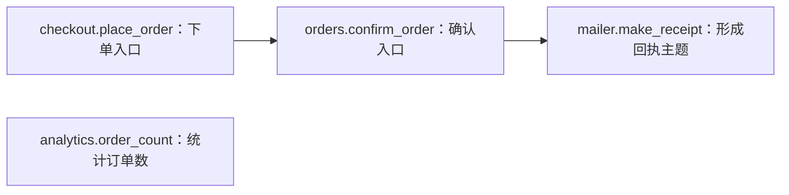
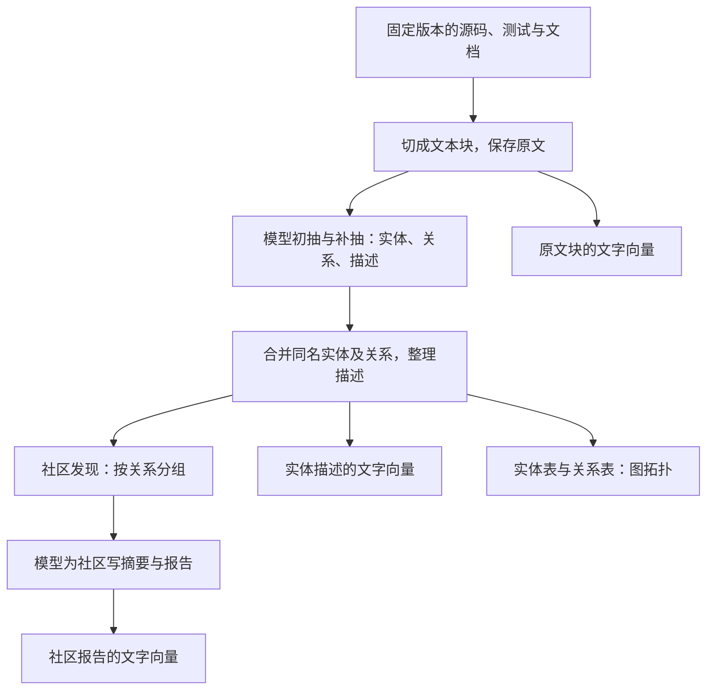
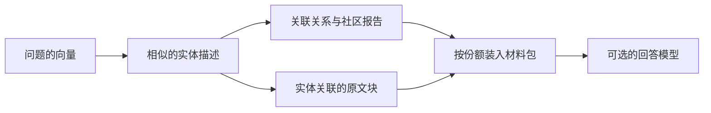
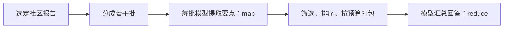

# 从查词到关系导读：代码检索的几种原理

这篇先解释方法怎样工作，再看[主报告中的真实效果与成本](report.md)。这里的 GraphRAG 特指 **Microsoft GraphRAG v3.3.0**；它让模型从文字中整理实体和关系，**不是编译器生成的精确调用图**。下面的小店、假想卡片和排名解释都是教学示意，没有拿示例调用模型，不能当成实验记录。

## 用同一道问题理解所有方法

想给小店加一个功能：“从下单入口传入自定义回执主题；不传时保持原样。”现有[原创代码](examples/shop/README.md)的链条是：

`make_receipt`现在返回一个包含`subject`的字典，并不真的发送邮件。要做好修改，需要末端实现、两层调用者、旧测试和项目约定。`order_count`虽然也谈订单，却不在这条调用链上。上图是**我们直接读示例代码画的调用图**，不是模型抽出的图。

设检索问题为：`Where is the receipt subject created, and which callers must pass a custom subject?`（回执主题在哪里形成，哪些调用者需要传递自定义主题？）检索器的工作是先给回答模型选材料；回答模型还要读、解释和验证。材料选对了，也可能读错；材料没选全，流畅的回答也补不出可靠依据。

## 先把书切成可携带的段落

多数方法不会每次都把全库交给模型，而是先切成“文本块”。太小容易丢上下文，太大容易把无关部分一并装入。token是模型计量文字的小片段，不等于字符、词或源码行。

**本次实测的共同底座：**Requests固定commit中的41个文件，按完整源码行预切为114块，每块最多1200个`o200k_base` token，相邻重叠最多100；不是AST语法分块。微软流程的第二次分块设为1200／0，已校验一对一、原文字节不变。最后组装材料时，路径和行号由共同映射补上；它们没有被额外塞入模型抽取正文。所有表头、描述、关系和原文都计入4000／8000／12000／16000的材料上限。[实际分块代码](../research/pilot/prepare.py)、[共同组装入口](../research/pilot/full_retrieve.py)

## BM25：查词，但比数出现次数更讲究

BM25像会判断“哪个词更有辨识度”的图书管理员：

- **词频：**一块里多次出现`receipt`，通常比只出现一次更相关，但重复十次不会简单获得十倍分数，收益逐渐变小。
- **稀有词权重：**几乎每个文件都有的`order`区分度低；只在少数地方出现的`make_receipt`可能更有用。
- **长度归一化：**长段落自然容易撞到更多词，需要适度校正，避免只因字多就排前。

在示例中，含`receipt`和`subject`的`mailer.py`容易成为线索。但如果问题只说“购买确认内容”，原文只叫`receipt`，纯关键词可能对不上。即便找到末端，它也不会凭BM25公式知道谁调用了它；调用者需要自身文字匹配、后续搜索或语言工具补充。

**本实验的具体实现：**按ASCII字母、数字、下划线提取词，统一小写，同时保留完整标识符和snake_case／camelCase词段。例如`make_receipt`保留整体并增加`make`、`receipt`；不是中文分词器，实测题目为英文。参数`k1=1.5`、`b=0.75`，查询词去重；全库按分数排列，同分按冻结输入顺序。没有另设top-10候选限制，而是按共同token上限依次装完整块，下一块放不下就停止。[可直接检查的BM25代码](../research/pilot/baselines.py)

## Dense向量与Microsoft Basic：按意思找近邻

Embedding（向量表示）把一段文字变成一串数字，让意思接近的文字在数值空间中倾向于靠近。“回执”与“购买确认”即使没用相同词，也可能成为近邻。Dense表示数字向量较稠密；它是真实模型编码，不能把词频矩阵换个名字就叫语义embedding。

建库时为源码块算向量；查询时也为问题算一个向量，再找近邻。示例中，它可能找到描述“生成订单确认内容”的段落；但“语义相关”仍不保证它是调用者、唯一实现，或某个分支下真正运行的函数。同名符号和精确拼写也可能需要关键词／符号查找兜底。

**Microsoft Basic是本次向量检索基线。** 它直接检索文本块向量，不经过实体或社区报告。实验用真实的OpenAI `text-embedding-3-large`、3072维，并固定`k=10`。官方实现选出近邻ID后，按已加载文本表的顺序取回这些块，再按预算截取；因此最终展示顺序不保证是相似度排序。Basic在16000预算已放下全部10块，之后只放宽预算不会带来第11块；这不是向量检索的普遍能力上限。[固定版Basic源码](https://github.com/microsoft/graphrag/blob/5faaaf4f5685fa2056fa8c3bf9342cb089f2942f/packages/graphrag/graphrag/query/structured_search/basic_search/basic_context.py#L63)

## Hybrid：让查词和按意思搜索各交一份名单

混合检索先独立得到两份排序，再融合。本实验使用 **RRF（倒数名次融合）**：某块在一份名单中越靠前，得到的名次分越多；同时出现在两份名单中的块得到两份分。它融合名次，不直接相加BM25分数与向量分数，因为两者的刻度不同。

具体为BM25前20名＋向量cosine（余弦相似度）前20名，等权相加`1 / (60 + 名次)`，名次从1开始；同分按冻结输入顺序。源码向量与Basic使用同一套实际持久化向量。合并后的候选最多40块，依次按共同token预算装入。这是RRF，不是另一个模型重排，也不是沿图走多跳。[本实验hybrid代码](../research/pilot/baselines.py)

在示例中，关键词名单可能擅长找到`subject`，语义名单可能补到“回执约定”；两份名单都没找到`place_order`时，融合也不能凭空补出它。更强的系统可以再接reranker（重排模型）或多轮工具搜索，但本轮微软对照没有运行它们。

## Microsoft GraphRAG怎样先制作卡片和导读

**实体**是一张“被谈到的事物”卡片；**关系**是两张卡片之间的文字联系。模型可能把示例整理成“回执”“确认订单”“主题”等卡片，再写“确认订单会生成回执”。默认提示词的类型却是组织、人物、地理、事件，不是函数、类和模块；它不保证抽出每个函数，也不保证名称完整或唯一。教学卡片只是解释形状，并非预测默认模型一定会这样输出。

同一事物可能在多个文本块出现，流程会合并名称、整理描述；名称处理和去重并不等同于语言工具的作用域解析。随后社区发现算法把关联紧密的节点分组；这里的图在聚类时作为无向关系处理，分出来的组不必与软件包或调用方向一致。模型再根据实体／关系描述给每组写导读；它不是逐行验证过的源代码事实。固定v3.3.0的标准路径先准备各层材料、再生成报告，不能把本轮写成“先写子报告，再逐层总结为父报告”。[抽取源码](https://github.com/microsoft/graphrag/blob/5faaaf4f5685fa2056fa8c3bf9342cb089f2942f/packages/graphrag/graphrag/index/operations/extract_graph/graph_extractor.py)、[机制核查](../research/implementation.md)

**文字向量与图拓扑是分开的。** 实体描述的向量帮助找“意思像哪张卡片”；关系表保存“哪些卡片相连”；来源ID帮助回到文本块。向量不是把整张图直接塞成一串数字，也不是通过编译获得调用证明。本次Standard还建立了原文和社区报告向量；并非每一种查询方式都会用到每一种向量。[固定版向量生成入口](https://github.com/microsoft/graphrag/blob/5faaaf4f5685fa2056fa8c3bf9342cb089f2942f/packages/graphrag/graphrag/index/workflows/generate_text_embeddings.py)

## Local：先找卡片，再拿关系与相关原文

在小店例子中，Local可能先定位“回执”卡片，再看到“确认订单”的联系。关键问题是：这张卡片是否真的连到了`make_receipt`的实现，以及另外两层调用者？图有线，不等于线表示真实调用；卡片说明写对了，也不等于原文被选进最后材料包。

本实验显式设置实体参数10、关系参数10，源码份额50%、社区报告15%、实体关系等35%，社区层级2，使用报告正文。**“实体参数10”不等于最后只有10个实体。** 固定版本先按两倍参数请求20个向量候选，过滤后没有再截回10；实体表还受token预算限制，例如Q01在16000档实际展示19个实体。关系参数10也不是最终全部关系总数的硬上限。[实体映射源码](https://github.com/microsoft/graphrag/blob/5faaaf4f5685fa2056fa8c3bf9342cb089f2942f/packages/graphrag/graphrag/query/context_builder/entity_extraction.py#L36)

原文候选从这些实体的来源ID收集，先按实体顺序、再按相关关系数排序；不是重新对全库源码做Basic搜索。各份额装不下下一整条记录就停，空位不会自动挪给源码。本轮Local只构建材料，**没有生成20题的回答**。[Local排序与预算源码](https://github.com/microsoft/graphrag/blob/5faaaf4f5685fa2056fa8c3bf9342cb089f2942f/packages/graphrag/graphrag/query/structured_search/local_search/mixed_context.py#L303)

## Global：让几位读者读导读，再汇总

Global适合提出“整个资料库有哪些主题或职责”这类问题。它把选定层级的社区报告分批，每批由模型列出与问题有关的要点及重要性分数，称为 **map**；再收集、排序并限长，把要点交给模型综合回答，称为 **reduce**。这些重要性分数是模型给的排序依据，不是经过校准的正确概率。

示例里，Global可能整理“下单、回执、统计”的职责概览，却未必给出传参要修改的三个函数位置。摘要如果漏掉条件或误写方法名，后续汇总可能沿用错误；最后的报告引用也要检查是否存在。它不是把全部源码一次交给长上下文模型。

**本次真实Global：**84份既有报告，每题7批map＋1次reduce；每题map报告材料（含表头、编号等表结构）合计78,250 token，最终reduce材料上限12000。没有新查询embedding，关闭动态社区选择，不允许通用知识补充。六题Global总计48次生成，另有6次BM25直接回答作对照。官方map／reduce提示词保留；适配器和JSON参数兼容处理详见[技术附录](../research/pilot/full-run.md)。这些总输入成本不能只用“最后窗口都是12000”抹平。[固定版Global源码](https://github.com/microsoft/graphrag/blob/5faaaf4f5685fa2056fa8c3bf9342cb089f2942f/packages/graphrag/graphrag/query/structured_search/global_search/search.py)

## 同一个问题，最终交给模型的东西有什么不同？

| 方法 | 怎样选材料 | 示例中可能帮到什么 | 仍需检查什么 |
| --- | --- | --- | --- |
| BM25 | 词匹配计分，按预算装原文 | `receipt`、`subject`和精确符号 | 同义词、没被问题点名的调用者 |
| Dense／Basic | 找原文向量近邻；本次Basic最多10块 | 用不同说法描述的回执行为 | 语义像是否真相关，候选与展示顺序 |
| Hybrid | 两份前20名单做RRF，再装原文 | 兼顾词和意思，补充不同线索 | 两路共同漏掉的证据仍会漏 |
| Local | 实体定位＋关系、报告、来源块 | 找与回执相关的概念和测试 | 实体是否连到实现，边是否为真实调用 |
| Global | 多批社区报告提要，再汇总 | 概览职责、主题与潜在检查项 | 细节压缩、错误传播、最终引用 |

这不是胜负表。AST（按语言语法生成的树）与符号／调用图可直接帮助找定义和调用表达式，但动态派发、运行时插件、跨项目依赖仍有边界。Agentic search是让模型多轮调用文本搜索、读文件、语言工具等；长上下文是一次装入更多文字。这些与检索材料的生成方式是不同维度，可以组合，不能仅凭名字相互替代。本轮微软对照没有对它们做新的效果实验。

## 为什么要分别算建库、查询和维护？

BM25需要整理词项；向量检索还要为文本算向量；Standard GraphRAG额外需要模型抽取、合并描述、写社区报告。本轮建图workflow累计71.28分钟，518次生成尝试＋46批embedding，另有停止等待；**不是图的数学分组本身花了71分钟**，社区检测阶段仅记录0.092秒。本轮Basic／Local只组装材料，若再生成回答需另计；Global的map／reduce已经包含回答生成。[真实阶段数据](report.md#建图的时间花在哪里)

日常改一行代码，直接搜索可读取当前文件；向量需要替换受影响块；语法／符号工具也需要更新依赖信息。文档实体图还可能使描述、关系、社区报告一起过期。固定v3.3.0的默认update按新标题追加，没有完成任意编辑／删除同步；不能因为命令叫update就认为换分支后全图正确。更适合先作为**低频、按commit隔离、允许延迟的理解快照**候选；是否值得部署仍看证据收益与成本。[开发变更场景与源码依据](report.md#日常开发一改代码哪些材料会过期)

本文实现描述核查于2026-10-13，均指向固定版本源码或本仓库实际脚本；不是对未来版本的承诺。继续阅读：[主报告](report.md) · [逐条失败链证据](../research/pilot/results/failure-analysis/README.md) · [研究首页](../README.md)。
