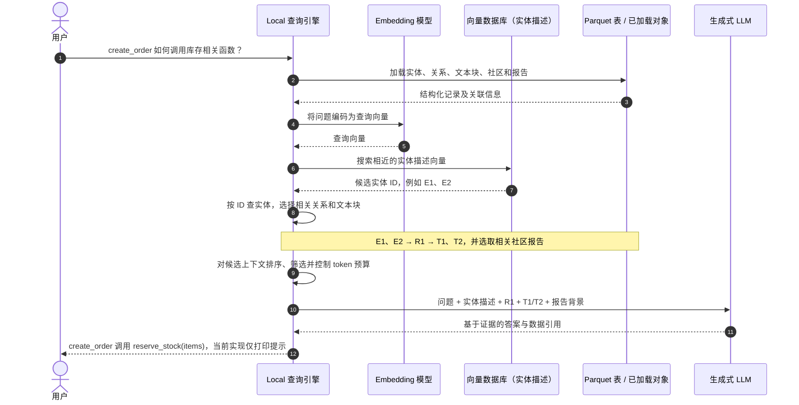
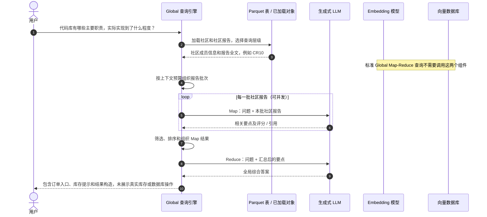
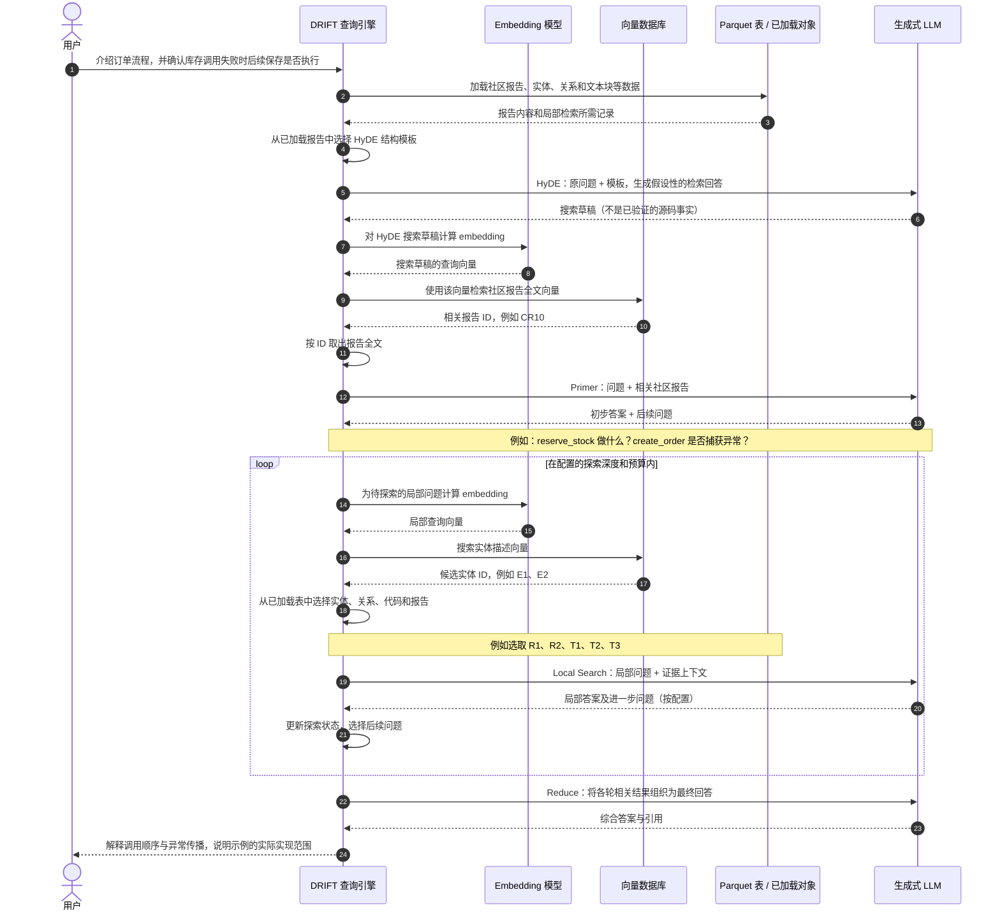
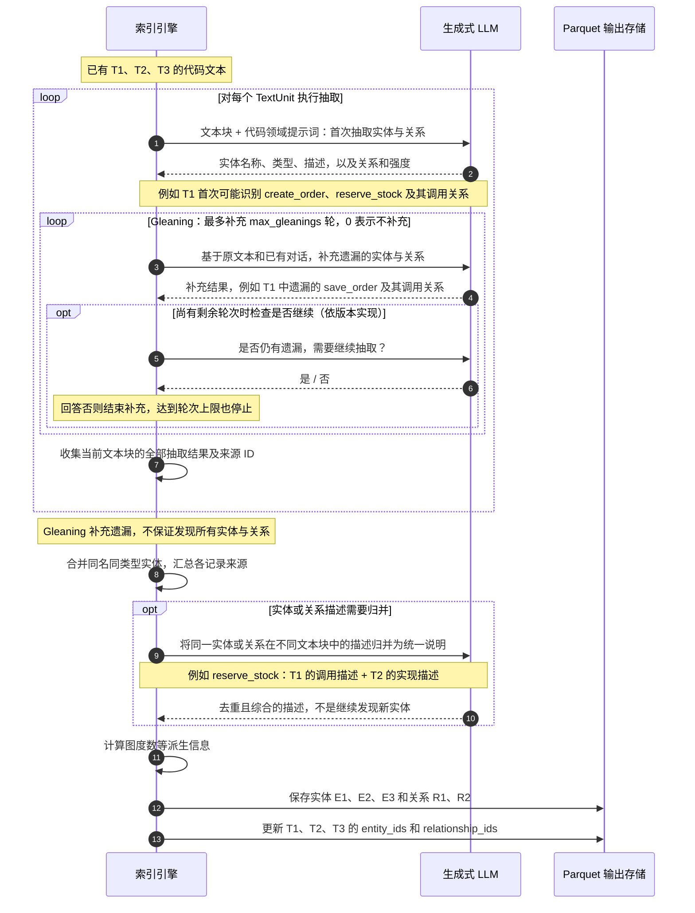

# 基于 Microsoft GraphRAG 的代码库索引与 Embedding 完整流程


> **代码库 → 输入文档 → TextUnits → 实体与关系 → 描述归并 → Leiden 社区发现 → 社区报告 → Embedding → 查询**

其中需要特别注意：**Microsoft GraphRAG 默认处理的是文本，不会自动执行 AST 分析、符号解析或精确调用链分析。** 因此，代码库需要做一些面向代码的预处理和提示词定制。

下面以一个 Python 电商代码库为例，说明整个过程。

---

## 一、整体架构

假设代码库为：

```text
shop/
├── api/orders.py
├── services/order_service.py
├── services/inventory_service.py
├── repositories/order_repository.py
└── tests/test_orders.py
```

使用 Microsoft GraphRAG 时，各类对象对应如下：

| GraphRAG 对象 | 在代码库中的含义 |
|---|---|
| Document | 文件或预处理后的函数级文档 |
| TextUnit | 参与抽取和检索的代码文本块 |
| Entity | 模块、类、函数、接口、业务概念等 |
| Relationship | 调用、导入、继承、读写等关系的描述 |
| Community | 图聚类得到的关联符号集合 |
| Community Report | 对关联代码集合生成的解释性报告 |
| Embedding | TextUnit、实体描述、社区报告的文本向量 |

例如：

```text
Entity:
shop.services.order_service.OrderService.create

Relationship:
OrderService.create 调用 InventoryService.reserve

Community:
订单创建相关符号集合

Community Report:
说明订单创建流程、库存预占与订单持久化之间的协作
```

**社区是图聚类结果，不一定与目录、模块或业务子系统一一对应。**

---

## 二、准备代码库输入

### 1. 过滤文件

保留：

```text
源代码
测试
README
设计文档
接口文档
必要的配置和数据库 schema
```

排除依赖目录、构建产物、缓存、二进制文件和大量自动生成代码。

同时固定代码版本，记录：

```text
repo_id
commit
path
symbol
start_line
end_line
content_hash
```

这些信息需要由你的预处理层维护，以便后续追溯代码。

### 2. 将代码转换为 GraphRAG 输入文档

最简单的方式是把源码包装成 `.txt` 文档放进 `input/`：

```text
Repository: shop
Commit: abc123
Path: services/order_service.py
Symbol: shop.services.order_service.OrderService.create
Lines: 20-35

Code:
def create(self, items):
    self.inventory.reserve(items)
    return self.repository.save(items)
```

对于实际项目，建议先使用 AST 按函数、方法、类切分，然后每个符号输出一个文档：

```text
code_index/
├── input/
│   ├── order_service_create.txt
│   ├── inventory_service_reserve.txt
│   ├── order_repository_save.txt
│   └── architecture.txt
└── ...
```

这样可以避免一个 TextUnit 混入多个无关函数。

不过，**函数级输入文档仍可能被 GraphRAG 再次切分**。需要根据模型 token 上限配置 chunking；超长函数应提前按语法块拆分，并在每块重复必要的符号定位信息。

---

## 三、初始化 Microsoft GraphRAG

安装和初始化：

```bash
python -m pip install graphrag

graphrag init --root ./code_index
```

初始化后，在 `.env` 中配置 API Key，在生成的配置文件中设置：

- 用于实体抽取、描述归并、社区报告和回答的生成模型。
- 用于向量化和查询的 embedding 模型。
- 输入、输出、缓存和向量存储路径。

**建议以安装版本生成的配置为基础修改。** Microsoft GraphRAG 的配置字段和 CLI 在不同版本之间有变化，不要直接混用旧教程里的配置。

默认向量存储通常是 **LanceDB**；图结构通常以 **Parquet 表**保存，因此基础使用不需要额外部署 Neo4j。

---

## 四、Document → TextUnit

GraphRAG 首先加载输入文档，然后按照 chunking 配置生成 TextUnits。

例如：

```text
Document:
order_service_create.txt

TextUnit:
包含符号名称、路径、代码位置以及 create 方法代码的文本块
```

这一阶段形成文档与文本块的关联：

```text
Document
   └── TextUnit
```

后面的实体和关系会通过 `text_unit_ids` 指回这些文本块。

针对代码库，重点是：

1. 保留完整函数或有意义的语法块。
2. 每块带上全限定符号名。
3. 每块能追溯文件和行号。
4. 控制重复上下文的大小。

GraphRAG 默认 chunking 是文本切分，**不会自动识别函数边界**；代码结构切分需要预处理或自定义流程完成。

---

## 五、抽取实体和关系

Microsoft GraphRAG 的标准流程会把 TextUnit 交给 LLM，抽取实体与实体之间的关系。

### 1. 修改实体类型

默认实体类型面向一般文本。代码场景可以配置为：

```yaml
extract_graph:
  entity_types:
    - MODULE
    - CLASS
    - FUNCTION
    - API_ENDPOINT
    - DATABASE_TABLE
    - BUSINESS_CONCEPT
```

这里是配置片段，应合并到当前版本生成的配置中。

### 2. 定制代码抽取提示词

在生成的抽取提示词模板中加入代码领域规则，并保留模板要求的输出格式和占位符。例如：

```text
实体名称使用完整限定名，区分大小写。
不同模块中的同名函数不得合并。

识别函数、类、模块、接口和数据库表。

关系描述明确注明 CALLS、IMPORTS、INHERITS、
READS、WRITES 等语义。

只能根据输入代码或已提供的静态分析事实建立关系。
无法确定动态调用目标时，描述不确定性，不补造目标。
```

假设输入为：

```python
def create(self, items):
    self.inventory.reserve(items)
    return self.repository.save(items)
```

期望抽取：

```text
实体：
shop.services.order_service.OrderService.create
shop.services.inventory_service.InventoryService.reserve
shop.repositories.order_repository.OrderRepository.save

关系：
OrderService.create → InventoryService.reserve
描述：CALLS；创建订单时调用库存服务预占库存。

OrderService.create → OrderRepository.save
描述：CALLS；库存预占后调用仓储保存订单。
```

但这个结果需要足够的类型、导入或依赖注入上下文才能可靠得到。仅凭上述函数体，LLM 无法确定 `self.inventory` 的真实类型。

**因此，精确关系最好由静态分析提供，LLM 负责解释语义。**

另外，GraphRAG 标准关系表主要保存：

```text
source
target
description
weight
text_unit_ids
```

它不是完整的、带强类型边和程序分析语义的调用图数据库。调用方向和关系类型应明确写进描述，并在需要时额外维护结构化关系。

---

## 六、归并实体和关系描述

同一个函数可能在多个文本块里出现：

```text
定义代码
调用方代码
测试代码
设计文档
```

标准流程会归并相同实体，并让 LLM 汇总描述。

例如：

```text
实体：
shop.services.order_service.OrderService.create

归并描述：
创建订单的服务方法。调用库存服务预占库存，
通过订单仓储保存订单，并在库存服务失败时传播异常。
```

这一阶段使实体拥有统一、适合检索的描述。

使用全限定名称非常重要，否则：

```text
OrderRepository.save
UserRepository.save
```

可能因为都被抽取为 `save` 而发生错误合并。

---

## 七、执行 Leiden 社区发现

GraphRAG 根据实体和关系构建图，再执行 **层次化 Leiden 社区发现**。

可能得到：

```text
社区 A：订单创建
    OrderService.create
    InventoryService.reserve
    OrderRepository.save

社区 B：用户认证
    AuthService.login
    TokenService.issue
    UserRepository.find
```

关系的 `weight` 会影响聚类结果。

需要关注：

- 通用工具函数是否连接过多模块。
- 无关实体是否造成噪声。
- 小型、断开的模块是否被保留。
- 聚类结果是否符合代码实际关联。

**这一步生成社区结构，并不进行 embedding。**

---

## 八、生成社区报告

GraphRAG 使用 LLM，根据社区内实体和关系生成报告。

例如：

```text
标题：订单创建与库存协作

摘要：
该社区实现订单创建流程，涉及库存预占与订单保存。

主要发现：
1. OrderService.create 是主要业务入口。
2. 库存服务负责预占库存。
3. 订单仓储负责持久化。
4. 库存服务异常可能阻止订单保存。
```

代码场景建议定制社区报告提示词，重点描述：

```text
模块职责
主要入口
关键协作关系
数据读写
异常行为
测试证据
尚不能确认的实现细节
```

报告中的事务、回滚、性能等结论必须有输入证据支持，不能仅凭函数名称推断。

---

## 九、真正执行 embedding

Microsoft GraphRAG 的文本向量化主要涉及三类内容：

| Embedding 名称 | 向量化内容 | 主要用途 |
|---|---|---|
| `text_unit_text` | 代码及上下文文本块 | Basic Search 等 |
| `entity_description` | 归并后的实体描述 | Local Search 的实体定位 |
| `community_full_content` | 社区报告全文 | DRIFT 等检索流程 |

概念上：

```python
text_unit_vector = embed(text_unit.text)
entity_vector = embed(entity.description)
community_vector = embed(report.full_content)
```

当前官方配置文档提供的配置方式为：

```yaml
embed_text:
  names:
    - text_unit_text
    - entity_description
    - community_full_content
```

模型和向量维度应与向量存储配置一致，查询时使用兼容的 embedding 模型。

这里生成的是**文本向量**，不是 Node2Vec、GNN 等算法生成的图结构向量。

---

## 十、索引最终产物

典型输出：

```text
output/
├── documents.parquet
├── text_units.parquet
├── entities.parquet
├── relationships.parquet
├── communities.parquet
├── community_reports.parquet
└── lancedb/
```

其中：

```text
Parquet 表：
保存代码文本、实体、关系、社区及来源关联。

LanceDB：
保存对应文本的向量。
```

执行标准索引：

```bash
graphrag index --root ./code_index
```

该命令会执行配置指定的索引流程。

---

## 十一、索引之后如何查询

### Local Search：具体函数或局部流程

例如：

```bash
graphrag query --root ./code_index --method local "创建订单时，库存不足如何处理？"
```

主要流程：

```text
问题 embedding
    ↓
搜索实体描述向量
    ↓
得到相关函数和类
    ↓
关联实体、关系、TextUnits 和社区报告
    ↓
排序并控制上下文长度
    ↓
LLM 回答
```

它并不是默认执行任意深度的精确调用图遍历。

### Global Search：整体架构

```bash
graphrag query --root ./code_index --method global "该代码库有哪些主要子系统，它们如何协作？"
```

主要针对社区报告进行 Map-Reduce 式汇总。**标准 Global Search 不要求先用问题向量搜索代码块。**

### DRIFT Search：从整体下钻到局部

```bash
graphrag query --root ./code_index --method drift "订单、库存和支付之间有哪些依赖？"
```

结合社区层面的信息和局部搜索，逐步探索问题。

上述命令使用当前官方 CLI 文档的参数形式；旧版本可能使用不同的 query 参数。

### 将引用映射回源码

GraphRAG 的默认引用通常是数据表记录 ID，未必直接显示为：

```text
services/order_service.py:20-35
```

要提供源码引用，需要在应用层维护并解析：

```text
回答引用
    → 实体 / 关系 / TextUnit 记录
    → 源文档
    → repo、commit、path、行号
```

---

## 十二、标准索引流程与核心表的生成顺序

使用 Microsoft GraphRAG 的标准索引流程时，你提供的是输入文本与配置，GraphRAG 负责生成数据表：

```text
代码库 → 包装成输入文本
   ↓ 加载文档
documents
   ↓ 按配置切分
text_units
   ↓ LLM 抽取、归并描述
entities + relationships
   ↓ Leiden 社区发现
communities
   ↓ LLM 生成报告
community_reports
   ↓ 对配置指定的文本字段执行 embedding
向量存储
```

保留初始化配置中的完整标准管线，配置模型、输入路径、代码实体类型及提示词后执行：

```bash
graphrag index --root ./code_index
```

完整标准索引有六张核心表：`documents`、`text_units`、`entities`、`relationships`、`communities`、`community_reports`。下一节重点展示后五张表，Documents 表作为输入来源一并说明。可选的 Claim 抽取还会产生 `covariates` 表，默认不启用。

实体和关系来自 LLM 对文本的理解，准确性取决于输入上下文和提示词；它们不等同于编译器生成的精确调用图。

---

## 十三、标准索引生成的五张核心表示例

以下五张表均由 Microsoft GraphRAG 的标准管线生成：

| 表 | 生成方式 | 保存什么 |
|---|---|---|
| `text_units` | GraphRAG 按配置切分输入文档，后续补充关联 | 原始代码文本块及其关联 |
| `entities` | GraphRAG 调用 LLM 抽取并归并描述 | 函数、类、模块等图节点 |
| `relationships` | GraphRAG 调用 LLM 抽取并归并关系 | 图节点之间的关系 |
| `communities` | GraphRAG 社区发现流程 | 节点分组与社区层级 |
| `community_reports` | GraphRAG 的 LLM 报告流程 | 对社区的文字解释 |

以下使用同一组代码贯穿五张表。表格和 JSON 是对可能输出的简化展示，实际文件为 Parquet；短 ID（如 E1、T1）代替实际唯一 ID。LLM 抽取结果、关系权重、社区分组及报告内容并不保证每次与示例完全一致，实际字段以安装版本为准。

### 1. 示例源码

`services/orders.py`：

```python
from services.inventory import reserve_stock
from repositories.orders import save_order

def create_order(items):
    reserve_stock(items)
    return save_order(items)
```

`services/inventory.py`：

```python
def reserve_stock(items):
    print("预占库存", items)
```

`repositories/orders.py`：

```python
def save_order(items):
    return {"items": items, "status": "created"}
```

这是用于解释数据关联的最小代码：`reserve_stock` 只打印提示，`save_order` 只返回字典，并没有真实库存变更或数据库写入。实体描述和报告也应忠实反映这一点。

### 2. text_units：代码证据表

先将上述三个源码文件分别包装为三个 `.txt` 输入文件，保留源码路径、版本、行号以及必要的模块上下文。GraphRAG 加载后生成三个 Document，再按 token 数等配置切分为 TextUnits。

本例每个文件都很短。假设配置的切分大小足以容纳单个完整输入文档，则每个 Document 生成一个 TextUnit：

| Document ID | 输入文件 | 内容 | 生成的 TextUnit |
|---|---|---|---|
| D1 | orders.txt | orders.py 的源码和定位信息 | T1 |
| D2 | inventory.txt | inventory.py 的源码和定位信息 | T2 |
| D3 | repository_orders.txt | repositories/orders.py 的源码和定位信息 | T3 |

**这里恰好每个文件只有一个函数，因此文本块看起来像函数级切分；默认切分仍依据文本/token，不是识别函数边界。** 文件变长时，一个 Document 可以生成多个 TextUnit，一个函数也可能被切开。

**这张表的一行就是一个文本块。最重要的 `text` 列存的是完整文本字符串，而不是文件名、函数名称或代码摘要。** 下表直接展示文本内容；为便于在 Markdown 表格中阅读，使用 `<br>` 展示字符串中的换行。

这是抽取结束并补充实体、关系关联后的 TextUnits 表。刚完成切分时，还没有这些抽取结果。这里只展示部分字段：

| id | text（实际文本，换行以分行展示） | document_id | entity_ids | relationship_ids |
|---|---|---|---|---|
| T1 | Repository: shop<br>Commit: abc123<br>Path: services/orders.py<br>Symbol: services.orders.create_order<br>Lines: 1-6<br><br>from services.inventory import reserve_stock<br>from repositories.orders import save_order<br><br>def create_order(items):<br>&nbsp;&nbsp;&nbsp;&nbsp;reserve_stock(items)<br>&nbsp;&nbsp;&nbsp;&nbsp;return save_order(items) | D1 | [E1, E2, E3] | [R1, R2] |
| T2 | Repository: shop<br>Commit: abc123<br>Path: services/inventory.py<br>Symbol: services.inventory.reserve_stock<br>Lines: 1-2<br><br>def reserve_stock(items):<br>&nbsp;&nbsp;&nbsp;&nbsp;print("预占库存", items) | D2 | [E2] | [] |
| T3 | Repository: shop<br>Commit: abc123<br>Path: repositories/orders.py<br>Symbol: repositories.orders.save_order<br>Lines: 1-2<br><br>def save_order(items):<br>&nbsp;&nbsp;&nbsp;&nbsp;return {"items": items, "status": "created"} | D3 | [E3] | [] |

例如，第一行 T1 的 `text` 单元格展开后就是以下完整字符串：

```text
Repository: shop
Commit: abc123
Path: services/orders.py
Symbol: services.orders.create_order
Lines: 1-6

from services.inventory import reserve_stock
from repositories.orders import save_order

def create_order(items):
    reserve_stock(items)
    return save_order(items)
```

第一行记录也可以用以下 JSON 展示。它不是单独的 JSON 文件，而是 Parquet 表中一行数据的可读表示；`\n` 表示字符串中的换行：

```json
{
  "id": "T1",
  "text": "Repository: shop\nCommit: abc123\nPath: services/orders.py\nSymbol: services.orders.create_order\nLines: 1-6\n\nfrom services.inventory import reserve_stock\nfrom repositories.orders import save_order\n\ndef create_order(items):\n    reserve_stock(items)\n    return save_order(items)",
  "document_id": "D1",
  "entity_ids": ["E1", "E2", "E3"],
  "relationship_ids": ["R1", "R2"]
}
```

读取这行数据时：

```text
id               → 这一块文本的编号是 T1
text             → 这一块具体写了什么：源码与定位上下文
document_id      → 它从哪个输入文档切出来：D1
entity_ids       → 从这块文本识别到了哪些实体：E1、E2、E3
relationship_ids → 从这块文本抽取到了哪些关系：R1、R2
```

- `text` 存实际输入文本；例子中的 Repository、Commit、Path、Symbol、Lines 是预先写入输入文件的内容，不是 GraphRAG 自动分析源码后添加的字段。
- 假设 LLM 从 T1 中识别了 E1、E2、E3，T1 就关联这三个实体。
- 假设 LLM 从 T1 中抽取了两个调用关系，T1 就关联 R1、R2。
- 实际记录还包括 `human_readable_id`、`n_tokens` 等字段；GraphRAG 在处理过程中生成编号并计算 token 数。
- D1、D2、D3 是 Documents 表中的源文档 ID，不是源码路径。源码定位信息应保留在输入内容、文档元数据或应用层映射中。

**Document 是完整输入记录，TextUnit 是从该记录切分得到的文本块。** 本例每个 Document 足够短，所以 Document 与 TextUnit 的文本可能相同，但二者的职责和记录 ID 不同。

### 3. entities：代码对象表

GraphRAG 将 TextUnits 交给 LLM，按配置的代码实体类型抽取函数等对象，再归并同名、同类型实体并总结描述。假设得到以下结果：

| id | title | type | description | text_unit_ids | frequency | degree |
|---|---|---|---|---|---|---|
| E1 | services.orders.create_order | FUNCTION | 接收 items，先调用 reserve_stock，再返回 save_order 的结果。 | [T1] | 1 | 2 |
| E2 | services.inventory.reserve_stock | FUNCTION | 接收 items 并打印库存预占提示；此示例没有实际修改库存。 | [T1, T2] | 2 | 1 |
| E3 | repositories.orders.save_order | FUNCTION | 返回包含 items 和 created 状态的字典；此示例没有数据库写入。 | [T1, T3] | 2 | 1 |

- `title` 使用全限定名，避免不同模块的同名函数被混淆。
- `text_unit_ids` 可以包含定义位置和引用位置的文本块。
- `frequency` 表示实体出现于多少个 TextUnit，不是运行时执行次数。
- `degree` 是图中的连接度；本例 E1 连接两个实体，E2、E3 各连接一个。
- `description` 是 LLM 从输入文本抽取并经描述归并得到的说明，用于实体语义检索。

### 4. relationships：关系证据表

LLM 根据导入语句、函数调用及模块上下文识别实体间关系。假设抽取出两条调用关系：

| id | source | target | description | weight | combined_degree | text_unit_ids |
|---|---|---|---|---|---|---|
| R1 | services.orders.create_order | services.inventory.reserve_stock | CALLS：create_order 调用 reserve_stock，并传入 items。 | 1.0 | 3 | [T1] |
| R2 | services.orders.create_order | repositories.orders.save_order | CALLS：create_order 调用 save_order，并返回其结果。 | 1.0 | 3 | [T1] |

- `source`、`target` 对应实体的 `title`，不是实体 ID E1、E2、E3。
- `text_unit_ids` 指向证明该关系的源码。本例两条调用都出现在 T1 中。
- `weight` 是边权，用于图处理和社区划分；标准流程会汇总 LLM 为各关系实例给出的强度。本例的 1.0 仅为演示值，不表示调用次数或置信度。
- `combined_degree` 是两端实体连接度之和，本例两条边都是 2 + 1 = 3。
- 标准关系表没有独立的 CALLS 类型列时，可把关系语义写进 `description`；精确程序分析所需的有向、带类型关系可另行维护。

### 5. communities：社区成员与层级表

假设 GraphRAG 将这三个实体聚成一个社区，编号为 10。该编号仅用于演示，实际编号和分组由算法生成。

```json
{
  "id": "C10",
  "human_readable_id": 10,
  "community": 10,
  "title": "Community 10",
  "level": 0,
  "parent": -1,
  "children": [],
  "entity_ids": ["E1", "E2", "E3"],
  "relationship_ids": ["R1", "R2"],
  "text_unit_ids": ["T1", "T2", "T3"],
  "size": 3,
  "period": "2026-10-14"
}
```

这条记录表达的是：

```text
Community 10
    ├── 成员实体：E1、E2、E3
    ├── 内部关系：R1、R2
    └── 相关代码：T1、T2、T3
```

- `level` 是社区层级深度，本例为顶层社区。
- `parent` 表示父社区；本例用 -1 表示无父社区，实际哨兵值以版本输出为准。
- `children` 为空表示此例没有子社区。
- `relationship_ids` 保存两端实体都在社区内的关系；跨社区关系仍保留在 Relationships 表中。
- `size` 是实体数量，不是 token 数或代码行数。
- `period` 是索引处理日期，用于更新合并，不是源代码 commit 日期。

**Community 保存分组和关联 ID，不复制完整源码，也不存放完整总结正文。**

### 6. 父社区和子社区是如何生成的？

**父社区和子社区由 Microsoft GraphRAG 使用层次化 Leiden 社区发现算法，根据实体之间的连接关系逐层划分出来，不是由 LLM 决定。**

可以理解为：先将整张图划分为若干社区，再对其中较大的社区尝试进一步划分，形成父子关系。

#### 第一步：构建实体关系图

假设代码抽取得到以下实体：

```text
订单相关函数：create_order、cancel_order、save_order
库存相关函数：reserve_stock、release_stock、check_stock
认证相关函数：login、find_user、issue_token
```

它们通过调用等关系连接：订单与库存函数之间联系较多，认证函数之间联系较多，而认证与订单、库存之间联系较少。

算法依据这些连接关系及边权进行分组，不是根据函数名称中的“订单”“库存”等词进行语义分类。

#### 第二步：生成顶层社区

假设算法首先得到：

```text
整张实体关系图
    ├── Community 0：订单与库存相关实体
    └── Community 1：认证相关实体
```

顶层社区通常记为 `level = 0`。**整张图不一定对应一个统一的根社区，可以有多个顶层社区。** 此处的业务名称仅用于解释，实际分组和编号由算法生成。

#### 第三步：继续划分较大的社区

GraphRAG 可以通过 `cluster_graph.max_cluster_size` 配置社区大小阈值。例如：

```yaml
cluster_graph:
  max_cluster_size: 10
```

字段名称以安装版本为准。这里的大小指实体数量，不是 token 数或代码行数。假设订单与库存社区超过阈值，算法会尝试在这个社区内部继续划分，可能得到：

```text
Community 0：订单与库存                  level 0
    ├── Community 2：订单               level 1
    │       ├── Community 4：订单创建     level 2
    │       └── Community 5：订单取消     level 2
    └── Community 3：库存               level 1

Community 1：认证                       level 0
```

这个层级图独立于前面三个函数的最小示例，用于说明较大代码图中的可能结构。Community 0 是 Community 2、3 的父社区，Community 2 又是 Community 4、5 的父社区。

**大小阈值影响是否继续细分，但不保证任意图都能拆成指定大小。** 是否能够继续划分，还取决于图的连接结构和算法结果。

#### 第四步：将父子关系写入 Communities 表

上述层级可表示为：

| community | level | parent | children | entity_ids（概述） |
|---|---|---|---|---|
| 0 | 0 | 无父社区 | [2, 3] | 订单与库存实体 |
| 1 | 0 | 无父社区 | [] | 认证实体 |
| 2 | 1 | 0 | [4, 5] | 订单实体 |
| 3 | 1 | 0 | [] | 库存实体 |
| 4 | 2 | 2 | [] | 订单创建相关实体 |
| 5 | 2 | 2 | [] | 订单取消相关实体 |

表格中的“无父社区”仅为文字说明，实际记录使用版本规定的哨兵值。`parent`、`children` 引用的是社区编号，而不是实体 ID 或报告 ID。

父社区覆盖较大的实体集合，子社区对应其中进一步划分出来的部分。同一个实体可以同时出现在所属的顶层社区、子社区和更细的子社区中：

```text
create_order 实体
    ├── 属于 Community 0：订单与库存
    ├── 属于 Community 2：订单
    └── 属于 Community 4：订单创建
```

这是同一个实体在不同粒度上的归属，不是重复创建了三个实体。同一层级上的分组与跨层级的父子包含关系要区分开。

#### 第五步：为各层级社区生成报告

**先由算法确定社区及其父子关系，再由 LLM 生成社区报告。**

```text
Entities + Relationships
    ↓ 层次化 Leiden 社区发现
Communities：成员、层级、父子关系
    ↓ LLM 总结
Community Reports：各层级的解释性报告
```

父社区报告可概述“订单与库存如何协作”，子社区报告可详细解释“订单创建流程”或“库存管理逻辑”。报告通过 `community` 编号关联对应社区，不负责决定社区成员或父子结构。

**总结：父社区是较粗粒度的分组，子社区是对其内部实体的进一步划分；分组结构来自图算法，文字解释来自 LLM。**

### 7. community_reports：社区解释报告表

GraphRAG 根据该社区的实体描述和关系生成报告，保存为独立记录：

```json
{
  "id": "CR10",
  "human_readable_id": 10,
  "community": 10,
  "level": 0,
  "parent": -1,
  "children": [],
  "title": "订单创建示例中的函数协作",
  "summary": "该社区包含订单入口、库存预占提示函数和订单结果构造函数。",
  "full_content": "# 订单创建示例中的函数协作\n\ncreate_order 接收 items，先调用 reserve_stock，再调用 save_order 并返回结果。\n\n## 当前实现范围\n\nreserve_stock 仅打印提示；save_order 返回字典。代码没有展示真实库存修改、数据库持久化或事务处理。",
  "findings": [
    {
      "summary": "create_order 是协作入口",
      "explanation": "该函数连接库存预占提示和订单结果构造两个步骤。"
    },
    {
      "summary": "示例没有真实持久化操作",
      "explanation": "save_order 直接返回字典，没有数据库调用。"
    }
  ],
  "rank": 5.0,
  "rating_explanation": "该社区展示一个局部订单流程；评分仅为示例。",
  "period": "2026-10-14",
  "size": 3
}
```

- `community = 10` 将报告关联到 Communities 表中的社区 10。
- `title`、`summary`、`full_content`、`findings` 是 LLM 生成的内容。
- `full_content` 是完整报告文本，通常包含格式化标题、正文和数据引用。
- 实际表还可保存 `full_content_json`，保留 LLM 返回的完整 JSON 内容；上例省略以避免重复展示。
- `rank` 是按报告提示词生成的评分，不是社区发现算法的边权，也不是某个用户问题的实时相关性分数。
- 示例 JSON 没有展示 GraphRAG 的数据引用格式；实际报告中的引用需通过对应记录进一步解析到源码。

### 8. 五张表怎样关联？

```text
community_reports：CR10
    │ community = 10
    ↓
communities：C10（community = 10）
    ├── entity_ids → entities：E1、E2、E3
    ├── relationship_ids → relationships：R1、R2
    └── text_unit_ids → text_units：T1、T2、T3

entities：E1
    └── text_unit_ids → T1

relationships：R1
    ├── source → 实体 title：services.orders.create_order
    ├── target → 实体 title：services.inventory.reserve_stock
    └── text_unit_ids → T1

text_units：T1
    ├── entity_ids → E1、E2、E3
    ├── relationship_ids → R1、R2
    └── document_id → D1 → 源码来源映射
```

这些表通过 ID 或实体名称关联，不是每一张都直接关联另外四张。尤其要区分社区编号 `10`、社区记录 ID `C10` 和报告记录 ID `CR10`。

### 9. 哪些内容生成 embedding？

| 表与字段 | 示例内容 | 向量化名称 |
|---|---|---|
| `text_units.text` | T1 的代码和定位上下文 | `text_unit_text` |
| `entities.description` | E1 的函数职责描述 | `entity_description` |
| `community_reports.full_content` | CR10 的完整报告正文 | `community_full_content` |

启用相应 embedding 后，向量通常写入 LanceDB 等配置的向量存储，并通过对应记录 ID 关联原表。

**五张表保存文本和图结构，向量库保存向量。标准配置不是为 Communities 表的成员 ID 列表直接生成图向量，也不是默认为每一条 Relationship 单独生成向量。**

---

## 十四、Local、Global、DRIFT 与模型、向量库和 Parquet 表的交互

### 1. 先区分四类组件

| 组件 | 职责 | 示例 |
|---|---|---|
| GraphRAG 查询引擎 | 调度检索、读取数据、组织上下文和调用模型 | Local / Global / DRIFT |
| Embedding 模型 | 将查询文本转成向量 | 配置的 embedding API |
| 向量数据库 | 根据查询向量搜索已有向量及其记录 ID | LanceDB |
| 生成式 LLM | 阅读上下文、生成答案或后续问题 | 配置的 completion 模型 |
| Parquet 数据表 | 持久化实体、关系、代码文本和社区报告 | output/*.parquet |

**向量数据库不是 Embedding 模型。** 模型负责计算向量，数据库负责保存和搜索向量。生成式 LLM 负责理解上下文与生成文本，也应与 Embedding 模型区分。

下图展示查询期间的逻辑数据流。实际实现通常先将所需 Parquet 表加载并转换为内存对象，再查询这些对象，并不是每一步都重新读取磁盘文件。数据库和数据表的调用由 GraphRAG 查询引擎完成，不是 LLM 自己直接访问文件或数据库。

### 2. 共用的订单示例

以下沿用第十三节的最小示例：

```text
实体 E1：services.orders.create_order
实体 E2：services.inventory.reserve_stock
实体 E3：repositories.orders.save_order

关系 R1：create_order 调用 reserve_stock
关系 R2：create_order 调用 save_order

文本 T1：create_order 的源码及导入信息
文本 T2：reserve_stock 的源码，只打印提示
文本 T3：save_order 的源码，只返回字典

社区 C10：包含 E1、E2、E3
报告 CR10：解释订单入口与另外两个函数如何协作
```

索引阶段已经保存了三类向量（前提是已启用相应 embedding）：

```text
实体描述向量     → 对应 entities 中的实体 ID
文本块向量       → 对应 text_units 中的文本块 ID
社区报告全文向量 → 对应 community_reports 中的报告 ID
```

三种查询模式在这些数据上选择不同入口。

### 3. Local：从实体向量进入，再读取代码证据

问题示例：**“create_order 如何调用库存相关函数？”**



关键交互：

1. **Embedding 模型**计算问题向量。
2. **向量库**寻找相关实体，充当进入图谱的入口。
3. **Parquet 表及其内存对象**提供实体的实际描述、调用关系和代码文本。
4. **LLM**根据组装好的证据生成答案。

Local 通常不需要再对 T1、T2 做一次文本向量搜索：可以通过实体与文本块的关联直接取出代码证据。候选关系、文本块和报告会经过排序、筛选，不保证所有相关记录都进入最终上下文。

### 4. Global：读取社区报告，再由 LLM 分批汇总

问题示例：**“这个代码库有哪些主要职责，实际实现到了什么程度？”**



关键交互：

1. **Parquet 社区报告表**提供已经生成的解释性报告。
2. **LLM 的 Map 调用**分别分析报告批次，并提取相关要点。
3. **LLM 的 Reduce 调用**将要点汇总成整体答案。
4. **标准 Global 查询不要求计算问题 embedding，也不要求访问向量库。**

本例只有一个社区报告，因此可能只有一批 Map 输入。较大的代码库会有多个社区报告，可能形成多个批次。启用动态社区选择时还可能增加用于判断报告相关性的 LLM 调用；上图展示的是标准 Map-Reduce 主流程。

Global 主要依赖报告内容，不会默认因为报告提到某个函数就进一步读取其源码。报告可能没有覆盖某个细节，不能把这种缺失当作源码中一定不存在该行为的证明。

### 5. DRIFT：先检索社区报告，再多轮局部探索

问题示例：**“介绍订单流程，并确认库存调用失败时后续保存是否执行。”**



该图显式展示本次固定 v3.3.0 路径中的 HyDE：先调用生成式 LLM 产生假设回答，再对这份草稿计算 embedding，用于检索相关社区报告。模板报告提供格式和结构参考，不等于已通过语义检索选出的证据。图抽象了主要阶段，具体调用次数取决于版本、fold、探索轮数及其他配置。

关键交互：

1. **LLM 的 HyDE 阶段**生成搜索草稿；它是检索辅助文本，不是源码证据。
2. **Embedding 模型将草稿向量化，向量库搜索社区报告**，提供整体背景和探索方向。
3. **LLM 的 Primer 阶段**阅读检索到的报告，生成初步回答和后续问题。
4. **多轮 Local Search**先对局部问题计算 embedding，再通过实体向量定位代码证据并生成局部回答。
5. **LLM 的 Reduce 阶段**综合相关中间结果，生成最终答案。Primer 和 Reduce 本身不要求额外计算 embedding。

对于本例，合理结论是：

```text
create_order 先调用 reserve_stock，再调用 save_order。
create_order 没有展示 try/except；如果 reserve_stock 抛出异常，
正常控制流将中断，后面的 save_order 不会执行。
但当前 reserve_stock 只有打印操作，示例没有显式的库存不足检查、
业务异常定义、库存修改或事务回滚实现。
```

这说明 DRIFT 的价值是继续调查证据，而不是自动补全代码中不存在的功能。

### 6. 三种模式的交互对比

| 交互项 | Local | Global（标准 Map-Reduce） | DRIFT |
|---|---|---|---|
| Embedding 模型 | 为实体检索查询计算向量 | 通常不调用 | 为社区检索及后续局部查询计算向量 |
| 向量数据库 | 主要搜索实体描述向量 | 通常不访问 | 搜索社区报告向量和实体描述向量 |
| Parquet 表 | 实体、关系、文本块、社区报告等 | 主要是社区和社区报告 | 社区报告及局部查询需要的各表 |
| 生成式 LLM | 根据局部上下文回答 | Map 分批分析 + Reduce 汇总 | HyDE 搜索草稿、Primer、局部回答与 Reduce 归并 |
| 入口 | 相关实体 | 选定层级的社区报告集合 | 相关社区报告，再深入实体 |

**三种模式都由查询引擎协调数据访问。Embedding 用于定位，Parquet 提供内容及关联，生成式 LLM 负责解释与生成。**

---

## 十五、实体关系抽取：LLM 从文本中提取图数据



---

## 十六、BM25：基于关键词的检索排序

**BM25 根据查询词在文档中的出现情况，计算文档与查询的相关性，用于关键词检索排序。** 它不需要生成式 LLM，也不需要 embedding，常见于 Elasticsearch、OpenSearch 等全文搜索系统。

在代码库检索中，可以把一个 TextUnit 作为一条检索文档。这里的“检索文档”是搜索系统中的记录，不一定对应 GraphRAG 的完整 Document。

### 1. 用代码搜索举例

假设搜索：

```text
reserve_stock 库存不足
```

为展示排序，另设以下三个候选文本块；其中库存检查是本节假设的实现，不是前面只打印提示的最小示例：

| 文本块 | 内容 |
|---|---|
| B1 | create_order 调用 reserve_stock |
| B2 | reserve_stock 检查库存，库存不足时抛出异常 |
| B3 | 用户登录与令牌生成 |

在分词合理的情况下，B2 同时匹配函数名和“库存不足”，通常比只匹配函数名的 B1 更靠前，B3 的关键词相关性较低。

**分词决定了哪些词能够匹配。** 中文如何切词，以及 `reserve_stock` 是否保留为完整标识符，都会影响结果。代码检索通常需要兼顾完整符号名和下划线、驼峰拆分后的词。

### 2. BM25 主要考虑三个因素

| 因素 | 含义 | 代码示例 |
|---|---|---|
| TF：词频 | 查询词在当前文档中出现多少次，增加的收益会逐渐饱和 | 多次出现 reserve_stock 会增加相关性，但不会无限线性加分 |
| IDF：逆文档频率 | 查询词在整个语料中是否少见，少见词通常更有区分度 | reserve_stock 通常比 return 更有区分度 |
| 文档长度归一化 | 按文档长度调整词频，避免长文本仅因更容易包含关键词而占优势 | 大文件不会只因很长就必然排在短函数之前 |

### 3. 与向量检索的区别

| 对比项 | BM25 | Embedding 向量检索 |
|---|---|---|
| 匹配依据 | 分词后的词项匹配 | 向量的语义相似度 |
| 是否需要计算向量 | 不需要 | 需要 |
| 擅长 | 函数名、错误码、配置项等精确词 | 自然语言描述、同义表达、语义相近内容 |
| 常见短板 | 查询和代码用词不一致时可能漏检 | 精确标识符匹配可能不稳定 |

例如，查询 `ERR_STOCK_004` 时，BM25 很适合定位包含此错误码的文本；查询“在哪里预占商品数量”时，向量检索可能更容易找到只有 `reserve_stock` 标识符的代码。

---

## 十七、Hybrid Search：融合关键词与语义检索

**Hybrid Search（混合检索）同时使用 BM25 等关键词检索和 embedding 向量检索，再合并候选结果。** 它兼顾精确标识符匹配和自然语言语义匹配。

### 1. 检索过程

问题示例：**“reserve_stock 如何处理库存不足？”**

1. **关键词检索**：BM25 匹配函数名和“库存不足”等词，返回文本块 ID、排名和分数。
2. **语义检索**：Embedding 模型将问题转成向量，向量库返回语义相关文本块的 ID、排名和相似度。
3. **融合结果**：按统一的文本块 ID 合并候选，用 RRF 等方法融合排名。
4. **获取证据**：读取候选文本块的实际代码和来源，可选用 Reranker 根据内容重新排序。
5. **生成答案**：按需扩展图关系、去重并控制上下文预算，将最终证据提供给 LLM。

BM25 索引需要另行建立：将 TextUnits 的文本和 ID 写入支持全文检索的系统。向量库保存同一批文本块的向量。两路检索可以并行，最终按相同的 `text_unit_id` 融合。

如果一路返回实体，另一路返回文本块，应先映射到相同粒度，才能合理合并。相邻重叠文本块可能有不同 ID，还可在上下文构建时进一步去重。

### 2. 为什么不能直接相加两种分数？

BM25 分数可能是 15.8，而向量相似度可能是 0.89。它们的含义和数值尺度不同，直接相加容易导致某一路主导结果。

可以使用归一化后的加权分数，也可以采用只依赖排名的 **RRF（Reciprocal Rank Fusion，倒数排名融合）**。

### 3. 用 RRF 融合结果

对于候选文档 d，RRF 分数为：

```text
RRF(d) = 对各检索列表求和：1 / (k + rank_i(d))
```

- `rank_i(d)`：文档在第 i 路结果中的排名，从 1 开始。
- `k`：平滑常数，常见取值为 60，不是返回结果数。
- 文档没有出现在某一路候选列表中，该路贡献为 0。

假设结果如下：

| 文本块 | BM25 排名 | 向量检索排名 | RRF 分数（k = 60） |
|---|---|---|---|
| B1 | 1 | 未出现 | 1/61 ≈ 0.01639 |
| B2 | 2 | 1 | 1/62 + 1/61 ≈ 0.03252 |
| B3 | 未出现 | 2 | 1/62 ≈ 0.01613 |

融合后排序为 B2、B1、B3。B2 同时得到两种检索的支持，所以在本例中排到最前面。

**RRF 只看排名，不重新阅读代码，也不会判断答案是否正确。** 即使候选都不相关，它仍会给出排序。Reranker 则通常读取查询与候选文本，对内容相关性重新评分；可在 RRF 之后使用。

### 4. 与 Microsoft GraphRAG 三种模式的关系

BM25 和 Hybrid Search 是检索策略，Local、Global、DRIFT 是组织检索与推理流程的查询模式，二者不在同一个层次。

**前面介绍的 Microsoft GraphRAG 标准 Local、Global、DRIFT 流程不以 BM25 为必经步骤。** 本节介绍的是应用层或自定义检索流程的扩展方案：

- 用 BM25 精确匹配函数名、错误码或配置项。
- 用向量检索补充语义相关代码。
- 融合后，通过实体和文本块关联扩展图上下文。
- 将证据提供给生成式 LLM。

这需要应用层的索引和查询实现，不能仅因为已经生成 GraphRAG 的 Parquet 表和向量，就认为自动具备混合检索。

**总结：BM25 擅长“找词”，embedding 擅长“找意思”，RRF 负责“融合排名”，图关系负责“补连接”，LLM 负责“解释证据”。**

---

## 十八、代码变化后如何更新索引：新增、修改、删除与改名示例

**代码更新不只是替换文本向量，还可能使实体描述、调用关系、社区和社区报告失效。** 能追加新材料，不等于能将整个索引同步成当前代码状态。

本节的更新行为依据 [完整实验报告](report.md)：针对 **Microsoft GraphRAG v3.3.0 所查默认更新路径**的源码核查，以及真实差分与文档拼接函数的四个无模型、无网络微测。微测没有执行完整模型更新流水线，也没有测试最终向量删除或查询效果；不能将这些行为推广到所有版本和自定义流程。

### 1. 更新判断中的 title 是什么？

`title` 是 Documents 表中的文档标题，不是函数名称，也不是正文的内容哈希。它由输入方式和配置决定。

以下假设将源码包装成输入记录，并明确使用完整源码路径作为 `title`：

```text
文档 D1
title: services/orders.py
text:
    def create_order(items):
        reserve_stock(items)

文档 D2
title: services/inventory.py
text:
    def reserve_stock(items):
        print("预占库存")
```

**这个标题映射是示例约定，不是 GraphRAG 自动保证的源码路径映射。** 默认文本 reader 的标题可能只有输入文件名；正文里的 `Path:` 也不自动等于 Documents 表的 `title`。

本次核查路径主要通过旧、新文档的标题集合差判断新增：

```text
新增标题 = 新标题集合中存在、旧标题集合中不存在的标题
删除标题 = 旧标题集合中存在、新标题集合中不存在的标题
```

正文改变但标题不变，不会仅凭这个标题集合比较被识别为新增。

### 2. 新增文件：新标题可以进入新增处理

在原代码库中增加文件，并生成新的输入记录：

```text
title: services/payment.py
text:
    def pay(order):
        ...
```

标题集合变化为：

```text
旧：services/orders.py、services/inventory.py
新：services/orders.py、services/inventory.py、services/payment.py

新增标题：services/payment.py
```

**结果：新标题被识别为新增，可以进入后续索引流程。** 是否成功生成实体、关系、报告和向量，还取决于后续执行结果。

### 3. 修改函数体：标题不变，正文变化不会因此进入新增集合

将订单函数的调用改掉：

```python
# 旧代码
def create_order(items):
    reserve_stock(items)
```

```python
# 新代码
def create_order(items):
    check_stock(items)
```

两次输入的标题仍然相同：

```text
旧 title：services/orders.py
新 title：services/orders.py
```

**结果：该记录不会仅因正文修改就进入新增集合。** 所查默认更新路径因此可能继续提供旧材料：

```text
当前代码：create_order 调用 check_stock
旧索引：  create_order 调用 reserve_stock
```

要真正同步这次修改，需要替换旧文本块，撤销旧调用证据，生成新关系，并更新受影响的描述、报告和向量，而不是只判断有没有新文件名。

### 4. 删除文件：识别删除不等于清除旧记录

删除 `services/inventory.py` 后，输入集合中不再包含对应文档：

```text
旧标题：services/orders.py、services/inventory.py
新标题：services/orders.py

删除标题：services/inventory.py
```

本次核查显示，差分能够识别删除，但所查默认后续合并路径没有消费删除集合来清除旧文档记录。

```text
当前代码库：没有 services/inventory.py
文档拼接结果：仍保留 services/inventory.py 的旧记录
```

**这里直接验证的是差分与文档拼接行为。** 完整系统中的旧文本块、实体来源、关系、报告和向量也需要失效处理，不能假定它们会自动清理；本轮微测没有逐一执行这些清理步骤。

### 5. 文件改名：可能追加新记录，同时保留旧记录

将文件改名，并同步改变输入文档标题：

```text
旧 title：services/orders.py
新 title：services/order_service.py
```

在标题差分中，这不是“修改同一文件”，而是：

```text
新增：services/order_service.py
删除：services/orders.py
```

如果新增记录被追加，而旧记录没有被清理，结果就可能是：

```text
当前代码库：
    services/order_service.py

索引文档记录：
    services/orders.py          ← 旧记录
    services/order_service.py   ← 新记录
```

首先受影响的是文档和来源记录。后续同名实体可能合并，不表示每个函数一定生成两条独立实体。

**文件改名是否改变 title，取决于标题规则。** 例如只移动目录，而输入标题仅使用文件名，title 可能不变；把 commit 写进标题可以让记录被视为新增，但若共用一个索引，也不会自动删除旧版本。

### 6. 四种变化的结果汇总

| 代码变化 | 标题差分看到什么 | 本次固定路径核查／微测结果 |
|---|---|---|
| 新增文件并产生新标题 | 新标题 | 能选入新增集合 |
| 同标题文件修改正文 | 标题集合不变 | 不会仅因正文变化选入新增集合 |
| 删除文件及对应输入记录 | 删除标题 | 删除被识别，但所查拼接路径保留旧记录 |
| 改名并改变标题 | 新增标题＋删除标题 | 可能追加新标题，同时保留旧标题记录 |

### 7. 实际使用时如何处理？

#### 方案一：按 commit 隔离，重新构建完整索引

对于小代码库或低频更新，先使用明确的版本快照：

```text
commit C1 → 索引 C1
commit C2 → 在独立存储中构建索引 C2
                ↓
           验证表、向量与来源一致
                ↓
           应用切换到索引 C2
```

每个快照隔离 Parquet 输出和向量存储，记录 commit 与文件哈希。新索引构建完成后再切换，避免读取新旧混合状态。重建有模型调用和时间成本，可按主分支合并、每日或发布触发，频率应根据实际需求决定。

#### 方案二：实现并验证增量维护

自定义更新流程需要处理：

1. 通过 Git diff 或内容哈希识别新增、修改、删除。
2. 替换失效文档和文本块，更新源码位置映射。
3. 重抽变化文本，撤销旧来源对实体和关系的贡献，再归并有效描述。
4. 检查社区变化，重写受影响的社区及父社区报告。
5. 删除失效向量，为变化后的文本计算新向量。
6. 验证一致性后发布新的索引版本。

同一个实体可能由多个文本块共同支持，删除其中一个来源不一定应删除整个实体。为了正确撤销旧事实，通常还需要保留文本块级的抽取结果，仅有最终归并描述未必足够。社区重分组也可能影响修改文件以外的报告。

这些是工程扩展要求，不是所查默认更新命令已经提供的完整保证。

#### 方案三：基础检索及时更新，GraphRAG 低频更新

对于开发助手，可让当前源码、BM25、文本向量和符号工具及时更新，GraphRAG 按 commit 或定期生成理解快照。旧报告提供背景时，应标明版本，涉及当前行为的判断回查最新源码。

**结合本次实验，建议先采用“基础检索及时更新＋GraphRAG 快照隔离重建”，验证收益后再投入复杂的图增量维护。**

复核材料：[固定版本更新源码核查与实验报告](report.md)、[微测代码](../research/pilot/probe_update_semantics.py)、[微测结果](../research/pilot/results/failure-analysis/update-semantics.json)。

---

## 总结

基于 Microsoft GraphRAG，完整流程是：

```text
① 固定代码版本、过滤文件
② 按代码结构生成输入文档
③ 生成 TextUnits
④ 使用 LLM 抽取代码实体和关系
⑤ 归并实体与关系描述
⑥ Leiden 层次社区发现
⑦ 生成代码社区报告
⑧ 对文本块、实体描述、社区报告进行 embedding
⑨ 保存 Parquet 图数据与向量索引
⑩ 使用 Local / Global / DRIFT 查询
⑪ 将回答引用映射回具体源码位置
```

**本文采用“代码文本输入 + 代码领域提示词 + Microsoft GraphRAG 标准索引管线”，由 GraphRAG 生成核心表、社区报告及配置指定的文本向量。**

## 参考资料

- [官方索引流程](https://microsoft.github.io/graphrag/index/default_dataflow/)
- [配置说明](https://microsoft.github.io/graphrag/config/yaml/)
- [输出 schema](https://microsoft.github.io/graphrag/index/outputs/)
