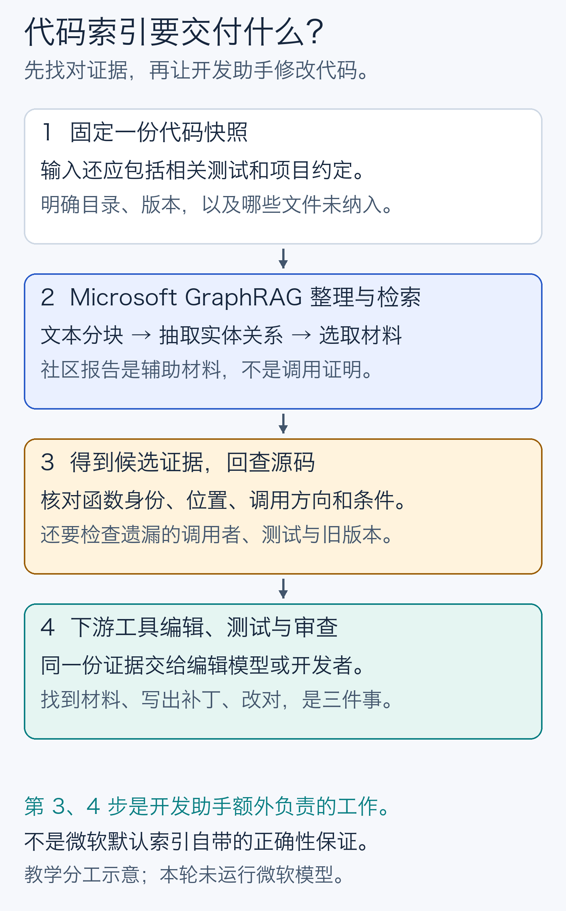
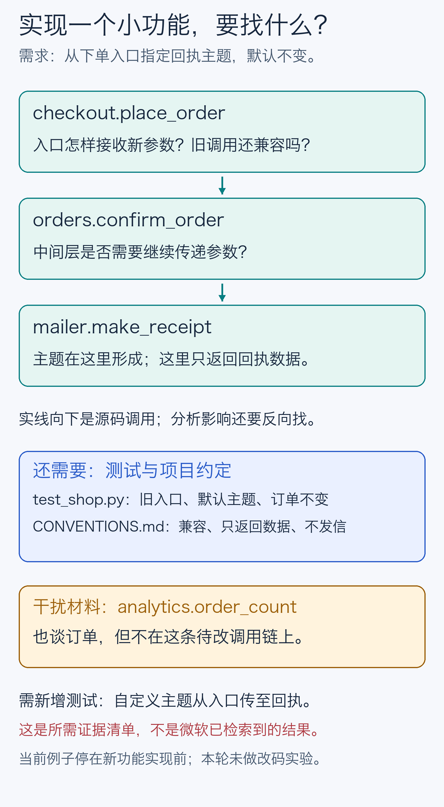
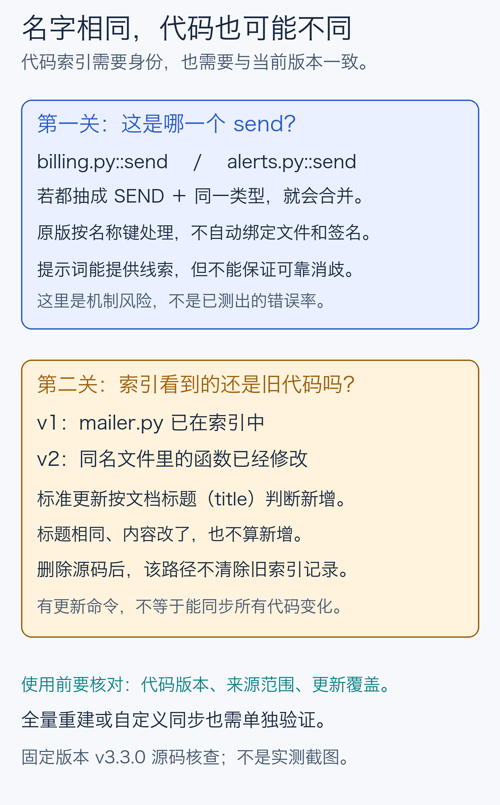
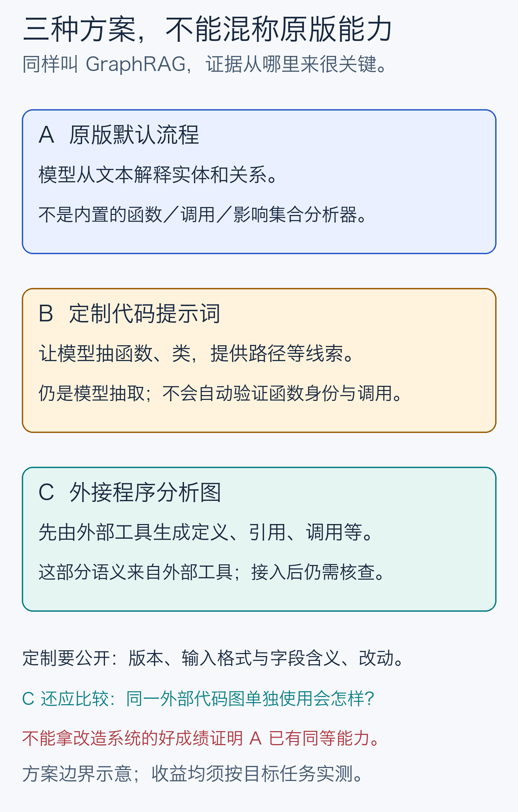

# Microsoft GraphRAG 适合做开发助手的代码索引吗？

给同事的一份 10–15 分钟图文说明。研究截止：**2026-10-12**；固定实现：[Microsoft GraphRAG v3.3.0](https://github.com/microsoft/graphrag/releases/tag/v3.3.0)。已完成文献与静态源码核查，正式微软索引已启动但在请求超时后中断；**检索评分与改码实验尚未完成**。中断不作为效果结论。图中例子均为人工教学示意。

## 先给判断：可以提供线索，核心开发价值尚未证实

我们关心的是：开发助手准备修改代码时，Microsoft GraphRAG 能否交给它**找得准、找得全、版本正确**的材料。解释得通顺、总结得全面，不足以证明这三件事已经做到。

**目前不应把原版默认流程当作可靠的符号、调用或影响分析索引的替代品。** 这是依据固定源码能力边界作出的工程判断，并非本轮测得它的错误率。自然语言需求与代码命名不一致、相关解释散在多个文件时，它可能补充语义线索；这种额外价值仍需与现有检索比较。

| 开发任务 | 原版可以尝试提供什么 | 当前判断 |
| --- | --- | --- |
| 精确找函数、类或其他符号 | 相关文本块、实体及其来源记录 | 未提供与语言解析绑定的符号身份及精确源码位置保证；精确定位收益未证实 |
| 追真实调用与依赖 | 模型解释的实体关联和相关文本 | 关联不能直接当成已验证的有向调用边或完整路径；调用追踪收益未证实 |
| 分析修改影响 | 围绕相关实体补充候选材料 | 没有完整影响集合保证；漏掉调用者、测试或读到旧版本都可能误导修改 |
| 辅助实现新增功能（feature） | 给下游工具提供跨文件上下文 | 候选用途合理，但索引找得好与最终改得对必须分开测；实现成功收益未证实 |

“未证实”指本轮公开证据仍不足，不是断言它毫无价值。本文严格讨论微软实现；代码中出现 graph，或论文引用微软，都不自动算它的成绩。

## 先弄清：它实际索引了什么

把项目想成一座图书馆。普通代码搜索像查书名和原文，语言工具还能指出“这个名字究竟指哪一个定义”。Microsoft GraphRAG 更像资料整理员：读文字，做事物卡片，说明卡片的联系，再把关系紧密的一组写成导读。**导读可以帮助找线索，但要修改某一页，仍需准确的页码、版本和依据。**

固定版本能把 `.py` 等代码配置成文本输入；默认文本读取器只匹配 `.txt`。标准流程按 token——模型计量文字的小片段——切分，默认每块 1200、重叠 100，不按函数边界切。随后模型抽实体和关系，算法分组，模型写社区报告。“社区”只是图中的分组，不是经过验证的软件模块。[输入与抽取源码核查](../research/implementation.md)

它保存原始文档、文本块、实体、关系、社区及报告等表。实体和关系可以关联到来源文本块，文本块再关联到文档，所以并非“完全没有出处”。但这些记录不是自动生成的函数定义／引用数据库，记录编号也不是源代码行号。[官方输出表](https://microsoft.github.io/graphrag/index/outputs/)

查询也有不同入口：Basic 按语义相似度找文本；Local 先找实体，再组织关系和相关原文；Global 用社区报告概括；DRIFT 结合报告继续局部追问。开发任务应检查**最后实际取回了哪些源码**，不能只因选了 Local 或多问几轮，就认定调用者已找全。本文把社区导读放在辅助位置，不用全局总结质量替代索引质量。

## 四项任务，逐一看它够不够用

### 1. 精确找函数：同名不等于同一个函数

假设两个文件都有 `send`，或者同一个类有不同参数的重载。开发助手需要的不只是“发送功能”，而是**当前版本中那个具体定义**，包括路径、位置、作用域和签名。

**源码事实：**默认实体类型是组织、人物、地理、事件；不是函数、类、模块。抽取后的实体名称和类型会转成大写，初步按名称与类型合并；关系端点也按名称处理。默认文本 reader 的标题只有文件名，没有目录；默认分块输出没有自动生成的源文件起止行号、字符偏移或 Git commit 身份。[身份与来源核查](../research/implementation.md)

最终实体表还会仅按名称去重，重新分配的实体 ID 也不是稳定的源码符号身份。默认给模型的 Sources 表主要是记录号和文本，不能把回答中的编号当成源文件行号；精确可点击引用需要额外映射与校验。

**对任务的含义：**若两个不同函数都被抽成同一个 `SEND` 和同一类型，可能被合并；若同一函数被叫成两个名字，也可能分散。大小写、同名、重载和跨目录文件不能仅凭这些键可靠区分。可以通过输入适配加入相对路径、commit 和位置映射，但这是额外工作，不能说默认版本已经具备。

合理的补充用途是：用户只记得“生成回执的地方”，它或许能找出候选原文。是否比关键词加语义检索找得更准、更全，**尚需直接评测**。最终选中哪一个符号，应回到指定版本的源码核对。

### 2. 追调用：一条关联，究竟证明了什么？

我们需要区分“两个功能有关”“A 调用 B”“B 调用 A”，还要知道调用条件和目标绑定。跨文件 `import`、接口实现、动态派发、插件选择，都可能改变答案。

**源码事实：**标准抽取让模型解释实体之间的关系，并不要求运行编译器或语言服务器来验证调用。关系表有 `source` 和 `target`，不能说它完全不存端点顺序；但字段名称本身不保证其语义就是调用方向。社区聚类还把关系规范成无向图，因此社区结构尤其不能当有向调用链。Fast 的共现边也不能充当调用证明。[关系与聚类核查](../research/implementation.md)

**对任务的含义：**Local 可以提供关系线索及相关原文，但并不是“穷举所有真实调用路径”的程序分析器。若运行时从插件表选择函数，应保留“候选／未知”而不是编出确定目标。读到了调用表达式，也要核对定义绑定、作用域和条件。

这里有限对照一下编辑器里的“跳转定义”“查调用者”：LSP 是编辑器与语言工具交流的协议，明确设计了符号位置、定义、进入和发出调用等接口。这说明为什么语言工具是相关基线，**不代表所有语言服务器都实现了它们，或能证明所有动态行为**。[官方 LSP 3.17 定义请求](https://raw.githubusercontent.com/microsoft/language-server-protocol/gh-pages/_specifications/lsp/3.17/language/definition.md)、[调用层级](https://raw.githubusercontent.com/microsoft/language-server-protocol/gh-pages/_specifications/lsp/3.17/language/callHierarchy.md)

### 3. 分析修改影响：漏一个调用者，比多找几段话更要紧

改一个函数，可能要检查上游调用者、接口和实现、配置、测试及项目约定。影响分析既要控制**漏报**——真正相关的没找到，也要控制**误报**——把仅仅词语相似的文件列为必须修改。

**源码事实：**微软默认维护的是抽取实体和关系，并非经过程序语义校验的接口／实现／调用／测试依赖集合。Local 的候选排序和上下文预算会筛选材料，不保证穷举所有上游。默认只有最大连通分量参与社区步骤，也不能推导所有文件都被社区报告覆盖；这不等于原始文本已从全部表中删除。[查询预算与覆盖核查](../research/implementation.md)

Local 的原文候选来自选中实体关联的文本块；某个函数若没被抽取或匹配到，这条分支不会自动通过全库文本向量搜索把它补回来。Basic 是另外一条查询路径，不能将两者混算成默认保障。

**对任务的含义：**把图中邻居当成完整影响集合，会把“抽取是否漏了”“检索是否裁掉了”“代码是否真的依赖”混在一起。图中没有边不能直接证明无影响，出现一条边也不能直接证明必须修改。配置和测试若未纳入输入，之后再好的图检索也无法把它们找回来。

它可能帮助补充难以用名字直接找到的说明或约定，但不能据此承诺影响分析更完整。所需证据应逐项回查；程序工具也不一定覆盖配置、运行时行为和业务约定，仍需组合使用。

### 4. 实现一个小功能：先看材料是否足够，再看补丁是否正确

以[原创小店](examples/shop/README.md)为例：**让调用者从下单入口指定回执主题，未指定时仍用“订单回执”。** 当前代码还没实现这个 feature；这里只列出开发助手应找到什么。

- `mailer.make_receipt`：主题目前在哪里形成？它只是返回数据，不能顺手扩写成发邮件。
- `orders.confirm_order`、`checkout.place_order`：谁调用谁，新参数怎样从入口传到末端？只改末端不等于入口已有新能力。
- `test_shop.py` 和 `CONVENTIONS.md`：旧入口、默认行为、不修改订单等约定如何保住？还要补什么验收测试？
- `analytics.order_count`：同样谈订单，却不在待改链路上；将它列为必改文件就是误报。

Microsoft GraphRAG 在这里能评估的是：是否把这些证据交给了下游。**生成／编辑补丁、执行测试和审查改动，是另一个系统的工作。** 同一个强模型可能用较差材料也猜对，或拿到好材料仍改错，因此不能只用最终“测试通过率”倒推索引质量；测试通过也不自动证明修改没有遗漏需求。

## 一个跨越四项任务的条件：索引必须跟得上代码

代码经常改名、改内容或删除。查到昨天的“正确函数”，也可能指导今天的错误修改。

**固定源码中有一个具体边界：**v3.3.0 的标准增量路径用文档 `title` 的集合差判断新增，后续处理消费新增文档。相同 title 的文件修改内容，不会因此进入新增集合；删除项虽然被算出，但该默认合并路径没有消费它们来清除旧记录。旧表与增量表主要做追加合并。[增量源码](https://github.com/microsoft/graphrag/blob/5faaaf4f5685fa2056fa8c3bf9342cb089f2942f/packages/graphrag/graphrag/index/update/incremental_index.py)、[完整更新核查](../research/implementation.md)

因此，**有 `update` 命令，不等于能同步代码修改和删除**。这是静态源码观察，未在本轮运行复现，不是对所有配置或未来版本的断言。输入标题若只有文件名，同名文件还会增加身份歧义。把 commit 塞进标题令文件“变新”，也不自动清除旧版本。

若实际接入开发助手，应固定并校验快照，或单独实现、验证修改／删除同步；全量重建也要保证输出和检索存储隔离到正确版本。不能仅靠模型缓存、文件日期或“上次索引成功”判断新鲜度。

## 定制之后会不会更合适？先分清三种方案

**原版默认流程**缺少本报告所查路径中的符号绑定、调用验证和完整影响分析保障。这里说的是已核查的默认数据结构与工作流，不是宣称整个项目绝不可能扩展。

**代码提示词定制**可以要求抽函数、类、路径和调用描述，改善模型看到的线索；但不会自动引入签名解析、作用域消歧、位置映射或更新同步。收益需按该配置单独评估。

**外接程序分析图**是可行的扩展方向，官方也提供导入自有实体、关系及文本块的说明。但程序语义来自外部分析器，适配时还得检查身份、方向、边类型和来源映射是否被后续流程保留。此时真正的问题是：在同一份外部代码图上，多加微软的抽象、检索或报告步骤，究竟增加了什么？不能把外部工具的功劳全部算给原版。[官方自有图接入说明](https://microsoft.github.io/graphrag/index/byog/)

## 直接证据能支持到哪一步

**在本轮公开检索范围内，未检索到足够可复核的直接微软评测，证明上述四类任务的特定收益。** 检索记录保留实现身份、版本、任务、指标和排除原因；未知项没有记成零分。[四类任务证据核查](../research/direct-evidence.md)、[检索记录](../research/search-log.md)

需要分清三个层次：官方论文和开放域评测证明的是它在相应文本任务上的结果；相近代码论文可能用作者自建图，不能给微软贴成绩；公开代码使用反馈、演示或尚未公开的研究，也不能替代有固定实现、题集和对照的评测。架构导读即使有帮助，仍不回答同名定位、调用方向、影响漏报或 feature 改动正确性。[官方原论文](https://arxiv.org/abs/2404.16130v2)

本次补检有一条重要发现：微软维护者在 code4llm 演示公开请求中，**确认存在代码相关 GraphRAG 研究**，并于 2025-11-18 表示当时无开源计划。不能说“微软没人研究过代码”；但该研究是否等同公开包、用了什么改动、四项任务表现如何，本轮都没有取得足够材料核实。迁移演示也不能自动算新增 feature 的受控评测。[官方 issue #1779](https://github.com/microsoft/graphrag/issues/1779)

## 本地实验怎样比较，当前完成到哪一步

本次在用户指定的Mac mini上执行：Apple M4、10核CPU、16 GiB内存、macOS26.4.1、Python3.12.10。固定公开Requests 2.32.3快照，41个源码、测试及文档／配置文件，总计114个完整行文本块。题目、必要证据及评分协议在运行模型前冻结；没有把验收测试、gold答案或未来补丁送进索引。[语料、版本与冻结证据](../research/pilot/README.md)

| 方法 | 用通俗的话解释 | 这次怎样保证可比较 |
| --- | --- | --- |
| BM25 | 根据词语是否出现、是否少见来找原文 | 保留完整代码名，同时拆开下划线及大小写词段 |
| hybrid | 把关键词结果与“意思相近”的结果合并 | 用真实3072维embedding，与Basic共享同一批源码向量 |
| Microsoft Basic | 微软实现的普通语义文本检索 | 使用固定官方上下文构建代码，保留实际输出顺序 |
| Microsoft Local | 先找实体，再找关系、导读和相关原文 | 使用官方Standard索引、默认实体类型和提示词，不改成代码专用图 |

四组分别回答：按词找是否够用、加上语义是否更好、微软普通向量检索表现如何，以及加入实体关系图后表现如何。

把最后交给模型的材料看成一个书包：每种方法的主比较都只能装4000 token，另做12000-token次比较。原文、图关系、社区报告、表头和来源标识都占空间。共同的路径／行号映射会计入预算，超额时统一删除末尾完整条目；同时保存微软原始上下文和最后实际交给下游的版本。[完整执行与复算方法](../research/pilot/full-run.md)

20个检索问题涵盖定位、调用链、有限影响检查、无实现和运行时未知。4题用于接口检查，16题为test；没有答案的Q19不进入召回分母，其余15个test题评分。主指标问的是：**解答这道题必须检查的原文，有多少真正装进书包？** 不是只找到文件名或生成一段听起来相关的描述。逐段至少取回80%的标注源码行才算命中，严格100%另列；同一段不能因重复取回而多算。[冻结题集及评分协议](../research/pilot/protocol.md)

另有两个原创小功能：给大小写无关字典增加合并运算；给Session增加可修改的默认超时，并区分“没传超时”和“明确传None”。每组只生成一次补丁，使用同一模型、提示词及4000-token初始材料；不给它追加搜索、验收答案或失败后修补机会。补丁先审查，再放到独立干净副本检查能否应用，分别跑新功能验收和59项旧回归，并人工核对需求。两题的测试结果只能作探索案例，不能算行业实现成功率。

**截至目前：**59项原版回归已通过；新功能前测如预期暴露缺失行为。官方114块一对一分块映射通过。索引随后在第159次模型请求超时停止，未形成可以评分的完整索引。[脱敏中断账本](../research/pilot/results/execution-interrupted.json)保留请求序号、状态、用量及时间；此前的小批接口探测见[单独记录](../research/pilot/probe-result.md)。所有已完成模型请求来自Mac mini命令行，没有使用本机或云浏览器运行实验。

生成模型由用户选定为one.fullstar.tech的 `gpt-5.6-luna`；向量使用官方OpenAI `text-embedding-3-large`。这是在Mac mini上编排、调用远端模型的实验，**不是本地权重推理实验**。服务身份、费用口径、输出限额与缓存恢复的技术边界见[执行附录](../research/pilot/full-run.md)。

### 成本与适用边界

关键词方案不需要模型抽取整个仓库；普通向量方案主要为源码块建立向量；本次Standard图方案还需逐块初抽与补抽、描述合并及社区报告生成，再为图产物建立向量。**索引建设、查询计算、模型最后读多少材料，是三笔不同的成本。** 当前正式索引未完成，不能填入完整耗时、体积或总费用。已有失败和诊断等待会保留并与算法运行时间分开。

代码变化后，向量和程序图都需要正确更新；默认文档图还增加了模型抽取、名字合并、报告再生成及来源核验的维护工作。上述固定版本的修改／删除边界意味着应按commit隔离快照，不能只检查“上次索引成功”。按用户要求没有资源采样，因此峰值内存未测；不能把停用采样后的0占位值当真实内存。

只有一个较小Python项目，问题由人工设计，公开源码可能被模型训练见过；结果即使完成，也不能推广为全行业结论。相同预算约束了“谁拿了更多上下文”，却没有单独隔离图的因果贡献。本轮不做代码提示词定制、外接AST图、reranker、agentic搜索或更新删除实验。未列入gold的材料是未判定，不会一概计作噪声；纯检索证据覆盖也不等于最终回答正确率。

## 对团队意味着什么

若今天要搭开发助手，优先确保代码快照、定义／引用、原文位置、测试和约定能够被可靠查到。Microsoft GraphRAG 可以作为**待验证的补充检索路线**，让它证明能补到基线漏掉的证据，同时不引入更多误报、陈旧材料和维护成本。

可以分三步落地；这是根据已知机制提出的工程建议，尚不是本实验验证出的收益：

| 阶段 | 先做好什么 | 升级依据 |
| --- | --- | --- |
| 1. 基础检索 | 固定commit、精确文本／符号位置、可追溯的原文和测试；建立关键词＋向量对照 | 在本团队真实问题上记录漏掉了哪些必要证据 |
| 2. 试验图检索 | 把Microsoft Local作为额外路线，用相同语料和上下文预算比较 | 它是否持续补到基线遗漏，而且没有明显增加无关材料与维护负担 |
| 3. 接入改码 | 将同等材料交给同一编辑模型，验证补丁、回归、需求和索引新鲜度 | 收益覆盖索引成本，并能追溯失败及版本变化 |

最必要的比较是两层：先只比索引交回的证据，再把各组证据交给**同一编辑模型、相同预算**，比较 feature 的测试与人工正确性。定位准确／召回、调用边和路径、影响遗漏／误报、更新新鲜度都分别记账；不能用一项总分掩盖失败。[精简验证计划](../research/pilot-decision.md)

**实验当前暂停，等待第159次请求的单次重试授权；没有自动重试，不能给出效果胜负。** Requests正式索引第159次生成请求在60秒超时处停止，前158条成功回复有完整缓存；第159条没有可恢复正文，远端状态和费用未知。完整索引、题集评分和feature补丁成绩均未取得。不得把一次服务超时当成检索差的证据，也不能将已有抽取输出当成完整实验。已冻结的方法与复算入口见[技术附录](../research/pilot/full-run.md)。

---

[研究导航与复核记录](../research/README.md) · [PNG／SVG 与生成源](figures/README.md) · [旧版实验与 Git 历史](../research/legacy.md)
