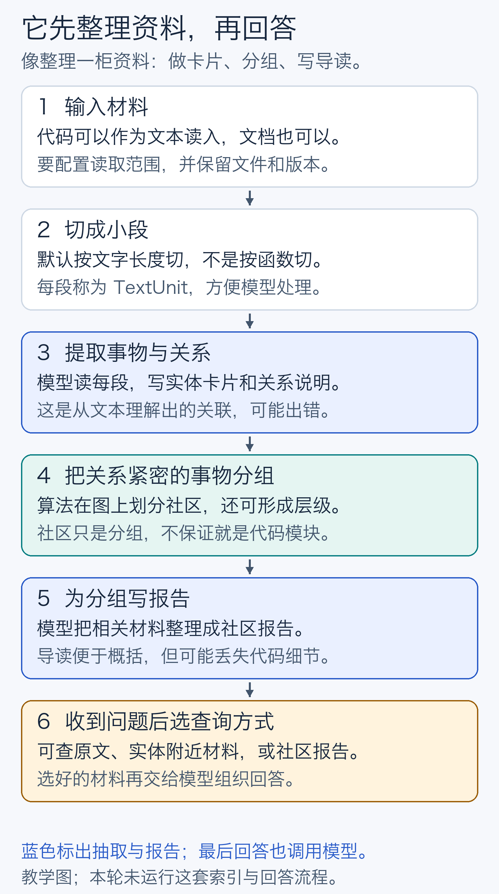
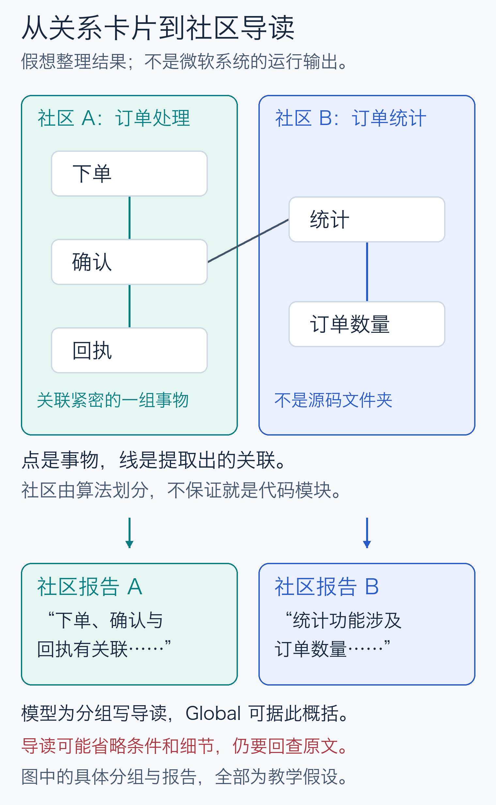
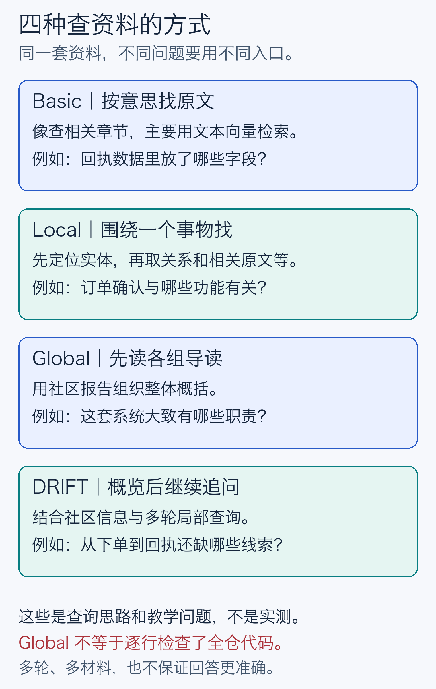
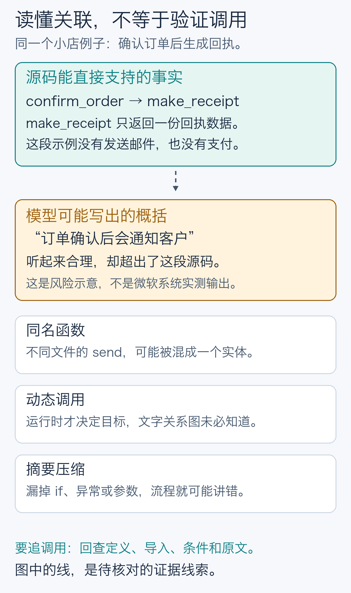

# Microsoft GraphRAG 能帮我们读代码吗？

给同事的一份 10–15 分钟交流材料。研究截止：**2026-10-12**；固定实现：[Microsoft GraphRAG v3.3.0](https://github.com/microsoft/graphrag/releases/tag/v3.3.0)。本轮做了文献检索和源码核查，**没有运行它的模型索引与问答实验**。图和小店例子都是教学示意。

## 先说我们能拿走什么

**值得考虑一个小试点，但目前还没有足够直接证据，支持把 Microsoft GraphRAG 当作读代码的默认方案。** 如果团队最想解决的是“新人怎样理解整个项目”，尤其代码旁边还有设计文档、说明和讨论记录，它有一条值得验证的思路。如果最想解决的是“这个调用到底跳到哪里”，仅凭它画出的关系还不够。

这里的“值得试”是工程判断，不是效果结论。三个问题应分开看：

| 团队的问题 | 这套方法可能提供什么 | 目前的判断 |
| --- | --- | --- |
| 一个函数、参数或异常是什么意思？ | 找到相关原文，围绕实体组织材料 | 先与搜索加原文阅读比较；没有证据表明建图总划算 |
| 下单之后经过哪些文件？ | 通过共同实体把分散的描述接起来 | 有探索价值，但不能把文本关联当成已验证的调用链 |
| 项目有哪些职责，模块如何协作？ | 用社区报告概括跨文档主题 | 最值得优先验证的方向；社区不保证等于真实架构模块 |

别被名字带偏：**本文只讨论 Microsoft 的实现。** 解析函数、导入和调用得到的代码结构图，是另一类技术。旧版仓库的自制代码图实验没有测试微软实现，已移出当前主文，仍可从[历史提交](../research/legacy.md)追溯。

## 它怎么工作

### 先找资料，再回答

把代码库想成一柜项目资料。普通 RAG 像同事先找几页相关材料，再据此作答。RAG 的中文是“检索增强生成”，不用记全称，记住**先找材料、后组织答案**就好。按词语找和按意思找，都是找资料的方法。

Microsoft GraphRAG 多做了一次整理：让模型读材料，做“事物卡片”，写出卡片之间的联系；把联系紧密的卡片分组，再给每组写一份导读。有人问整体问题时，不必只靠几段词语相近的原文，也能参考这些事先整理的导读。这是它的核心思路，不是“画了图，模型就自动懂程序”。[官方流程](https://microsoft.github.io/graphrag/index/default_dataflow/)



### 用一个小店贯穿来看

假设代码分在三个文件里：下单入口调用确认函数，确认函数调用回执函数。最末端只是返回数据，没有发送邮件。[完整原创教学代码](examples/shop/README.md)

```python
# checkout.py
from orders import confirm_order

def place_order(order):
    return confirm_order(order)

# orders.py
from mailer import make_receipt

def confirm_order(order):
    return make_receipt(order)

# mailer.py
def make_receipt(order):
    return {"to": order["email"], "subject": "订单回执"}
```

**第一步，读入并切分。** 在固定版本中，可以配置 `.py` 文件按文本读取，但默认文本读取器只匹配 `.txt`。读到文件也不等于解析了 Python：默认按 token，也就是模型计量文字的小片段，切成每段 1200、重叠 100 的文本。它不会自动保证一个函数、它的导入和调用都留在同一段里。[固定源码核查：输入与切分](../research/implementation.md)

**第二步，做卡片和连线。** “实体”就是被识别出来的事物，“关系”就是事物之间的联系。为了说明机制，假设模型提取出“下单”“确认”“回执”三个实体，并说明它们有关。注意，这是**假设**：默认实体类型其实是组织、人物、地理、事件，直接拿来读函数未必合适。要试代码场景，通常需要调整提示词和实体类型；调整后仍然是在让模型理解文本，不会自动变成程序分析。

**第三步，分组并写导读。** 算法把联系紧密的实体放进同一“社区”，这里的社区就是分组。再让模型写“社区报告”，说明这组材料主要在讲什么。它可以形成不同层级的分组，但一个组可能混合几个文件，一个文件也可能涉及几组，不能把社区直接叫成程序模块。

再加入一份订单数量统计材料，就可以示意另一组主题。小店代码中的统计函数，并没有被上面的调用链调用。



这些报告像导读，方便建立概览，也会压缩细节。原始代码仍可保存在文本记录里，**但不代表每次回答都会读到它**。当前默认社区步骤还只处理最大的一片相连子图，因此不能保证所有已读文件都被社区报告覆盖。这是源码能确认的边界，影响有多大还要实测。[社区与报告的核查](../research/implementation.md)

### 收到问题后，不只有一种查法



- **Basic，直接找原文。** 把问题和文字转换成可比较的数字表示，按意思相近程度找材料，然后回答。这是微软实现内的基础向量检索路线。
- **Local，围绕一个事物找。** 先找到相关实体，再组织关系、原文和社区材料。适合从一个具体概念往外探索，但并不是自动遍历完整调用链。
- **Global，读导读后概括。** 把社区报告分批交给模型，先得到部分回答，再合并成总回答。适合讨论全局主题；“全局”不表示逐行审过所有代码。
- **DRIFT，概览后继续追问。** 结合社区信息与进一步的局部查询。可以继续补线索，也会增加请求和成本；多走几步不保证更正确。

四者是查询方式。**Standard／Fast 是另一回事：它们决定怎样建索引。** 上面的流程图讲 Standard。Fast 主要用名词短语和同段共现建图，减少抽图阶段的模型使用，但社区报告等步骤仍需要模型；“一起出现”更不等于“互相调用”。[官方查询说明](https://microsoft.github.io/graphrag/query/overview/)、[索引方法](https://microsoft.github.io/graphrag/index/methods/)

## 代码交给它会怎样

### 有希望的地方：把散落的解释接起来

代码、README、设计说明往往用不同方式描述同一件事。比如一个文件叫 `make_receipt`，说明文档说“生成订单回执”，另一份文档讨论“订单通知”。如果实体识别、命名和关系抽取都合适，GraphRAG 可能把这些材料接起来，再给新人一份容易读的概览。

这是**待验证的收益假设**。它依赖输入质量、提示词、模型以及实体命名，不能只从“代码天然有关系”推出一定有效。单靠代码时，未写明的设计意图也不会因为建图就变成已知事实。

### 最关键的分界：关联不是调用证明

在小店例子里，我们能从[确认函数](examples/shop/orders.py#L7)和[回执函数](examples/shop/mailer.py#L5)核对：确认后生成的是一份数据。如果模型把它概括为“订单确认后会通知客户”，听起来很自然，却多说了源码没有做的事。



代码结构分析会尝试根据定义、导入、作用域和类型确定关系；Microsoft 的标准流程主要让模型从文本中解释关系。两者都可能不完整，但**关系的依据不同**。模型输出了一条“调用”描述，不代表已经验证目标函数、执行条件或运行时路径。

还有三类具体麻烦：

- **同名会混。** 两个文件都有 `send`，模型若给它们同一名字和类型，固定实现的合并规则可能把它们放到一起。源码还会把抽取名称转成大写，所以不能假设它保留了代码里的大小写区别。完整路径可以帮助模型，但不是自动消歧的保证。
- **动态调用看不全。** 如果实际调用变成“从插件表按名字选择函数”，只读文字未必知道运行时选中了谁。这里需要配置、运行证据或额外程序分析，不能用一条自然语言连线填补未知。
- **压缩会漏条件。** 一个 `if`、异常处理或参数值，可能决定程序到底做不做某件事。摘要写得顺，不代表这些关键细节还在。漏抽、误合并、分组筛选和上下文预算也可能使证据消失。

这些是由固定源码机制推导的风险，**不是本轮测出的错误率**。调整提示词、输入元数据或导入已有代码图，可能改善部分问题；但改动后的系统应单独记录和评估，不能把改善当成默认版本已经具备的效果。[逐项事实与推断](../research/implementation.md)

## 别人测过没有

**在本轮公开检索范围内，未检索到足够直接证据，证明 Microsoft GraphRAG 在代码库理解上稳定优于强检索方案。** 这句话不是“没有人研究”，更不是“它一定没用”。检索日期、关键词、候选及排除原因保留在[检索记录](../research/search-log.md)和[证据表](../research/direct-evidence.md)。

这里的“强检索方案”，指结合关键词和意思相近程度查找，并回读相关源码的方案。

我们先核实“测的是谁、测了什么”，再看成绩，得到三类材料：

| 材料 | 能告诉我们什么 | 为什么不能直接回答代码问题 |
| --- | --- | --- |
| Microsoft GraphRAG 原始论文 | 新闻与播客等文本上的全局归纳能力；作者报告回答全面性、多样性的收益 | 任务是概括文本集合，主要由模型评判，不是代码调用链或架构事实测试 |
| GraphRAG-Bench，以及官方另一组开放域评测 | 包含明确的 Microsoft GraphRAG 配置，对不同文本问题有比较 | 语料包括小说、医学、开放域问答、财报电话会与播客，不是代码库 |
| Reliable Graph-RAG for Codebases 等相近论文 | 确实讨论代码或架构理解，提出了有用的评估问题 | 核查的 LLM 图管线是作者自建实现；引用微软论文不等于运行微软软件 |

原始论文的首发日期是 2024-04-24，本轮采用 2025-02-19 的 v2；它的正面结果应留在原任务范围内。[原论文](https://arxiv.org/abs/2404.16130v2) GraphRAG-Bench 的本轮版本为 2026-02-22 的 v3；官方开放域评测论文为 2025-03-04 的 v1。[GraphRAG-Bench](https://arxiv.org/abs/2506.05690v3)、[开放域评测](https://arxiv.org/abs/2503.02922v1) 代码论文也要查实现身份，而不能只看标题里的 Graph-RAG。[代码研究候选](https://arxiv.org/abs/2601.08773)

也找到了明确自述试过微软方案的正反反馈：有人说它帮助理解遗留代码，也有人认为它较重、不易扩展且未充分利用代码结构，转向自建代码图。但这些反馈都缺少版本、题集、公平对照和可复核成绩，只能算线索。[正面自述](https://github.com/microsoft/graphrag/discussions/322)、[负面自述](https://www.reddit.com/r/LocalLLaMA/comments/1i62uwo/graphrag_but_for_code/) 还有一篇软件修复候选全文无法访问，保留为未核实，未用来支持或否定结论。

因此，新版不拼一个跨论文排行榜，也不用旧的自制代码图成绩证明微软方案好或不好。真正缺的是：**在固定的微软版本、公开代码语料、明确的问题和相同模型／预算下，它比现有方案多答对了什么，又多花了多少。**

## 我们能得出什么结论

### 可以做决定，但不要把假设说成收益

如果团队需要的是新人导览、跨文档概览、设计主题梳理，可以把它列为一个小试点候选。先确认概览里每个关键说法都有出处，再看是否真的减少理解时间。

如果团队当前主要痛点是精确找函数、追调用、分析修改影响，先把现有搜索、定义／引用工具和原文阅读做好。要引入 Microsoft GraphRAG，应让它在真实题目上证明额外价值。这里不是否定 Local 或 DRIFT，而是不把“能连概念”当成“能验证程序行为”。

还有维护取舍。截至固定版本，官方 README 已说明项目主要处于维护状态，不再推进新功能，并把代码定位为研究示范、非官方支持产品。仍有缺陷修复和依赖更新，不能解读为“已不能用”；但团队需要自己承担接入、提示词、更新和质量验证。[固定版本 README](https://github.com/microsoft/graphrag/blob/5faaaf4f5685fa2056fa8c3bf9342cb089f2942f/README.md)

### 若要试，先做一轮能停下来的小比较

建议先取一个许可证明确的公开小仓库，冻结代码版本和问题，再比较：现有强检索方案、微软 Basic、按题型预先选定的微软 Local／Global。三类问题分别看：局部事实是否正确，跨文件步骤是否缺漏，架构概括是否新增了源码不支持的说法。尽量让同事盲看答案和出处，别只给“读起来不错”打分。

除了答对多少，还应记录引用是否支持结论、每题花多久、索引与更新要多久、模型实际调用多少。即使“概览”变好，也未必值得把所有任务都切过去。对小到可以整仓读入的材料，长上下文阅读也是合理参照，需另外注明它用了多少材料。

**本轮停在文献与源码研究，不启动真实模型实验。** 两条后续路线——Mac mini 小型本地模型、微软默认模型对应的云端 API——以及会传输的数据、规划调用量和费用算例，均在[试点待决方案](../research/pilot-decision.md)。这些数字是预算假设，不是运行账单；需要另行决定后才开始，不能因为文档里写了方案就视为已授权调用。

如果只记三句话：它先把文本整理成关系和导读；导读有望帮人建立全局概览；代码里的精确事实仍要回到源码验证。目前证据支持理解它、设计小试点，还不支持宣称它已经证明更懂代码。

---

想核对细节，可从[研究材料导航](../research/README.md)进入：包含固定源码、直接证据与排除项、检索记录、实验决策和发布过程。四张图的 [PNG／SVG 与生成源](figures/README.md)均可查看与复用。
