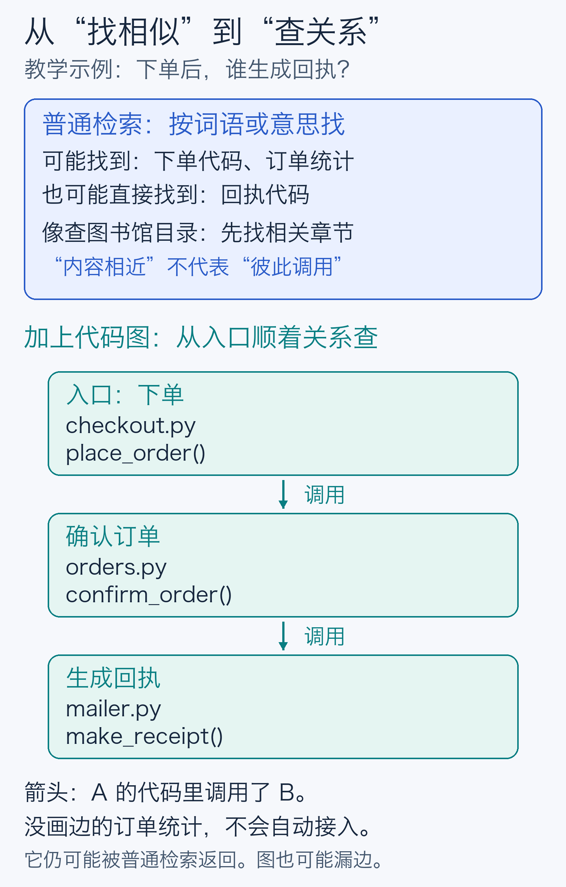
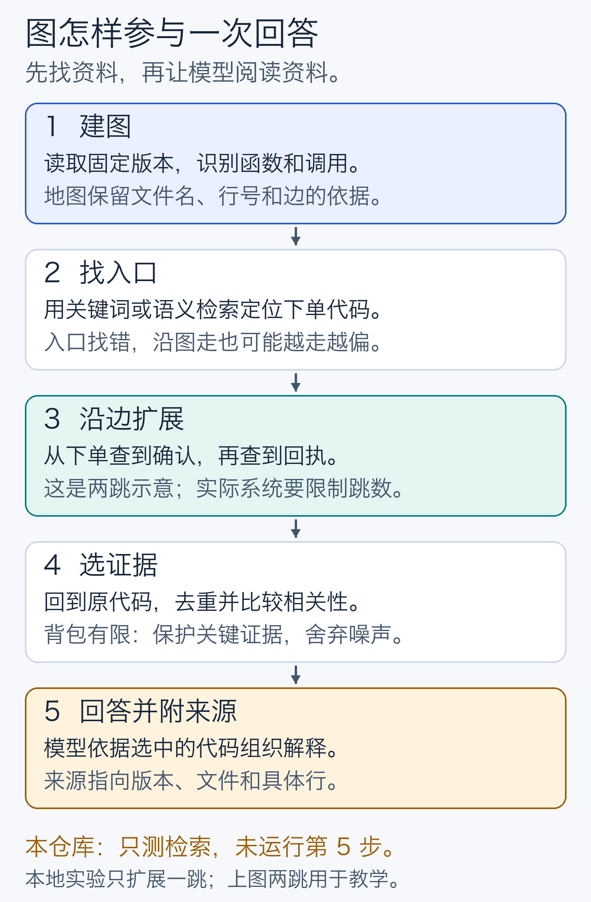
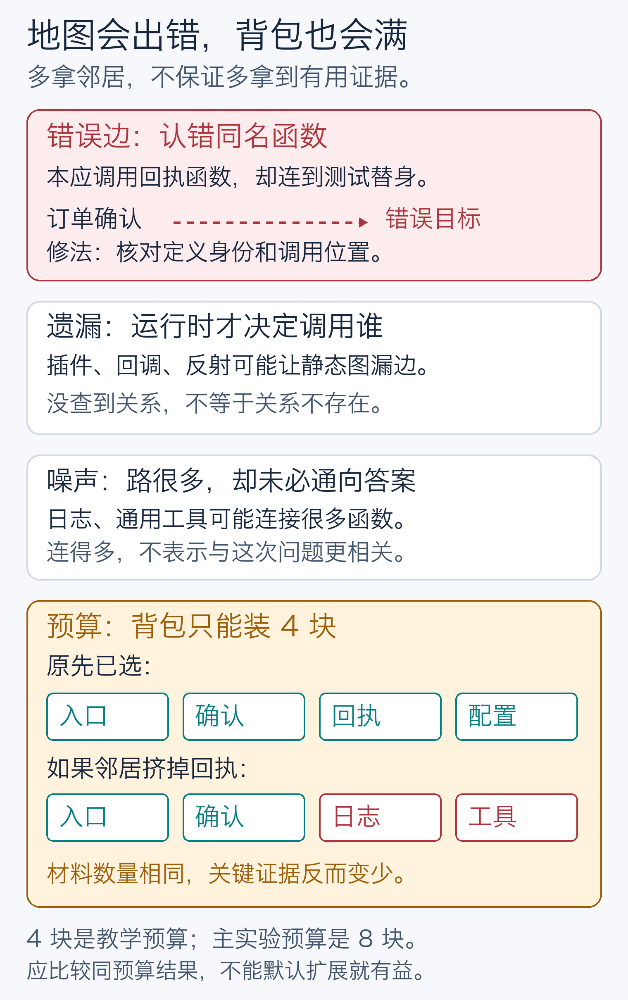
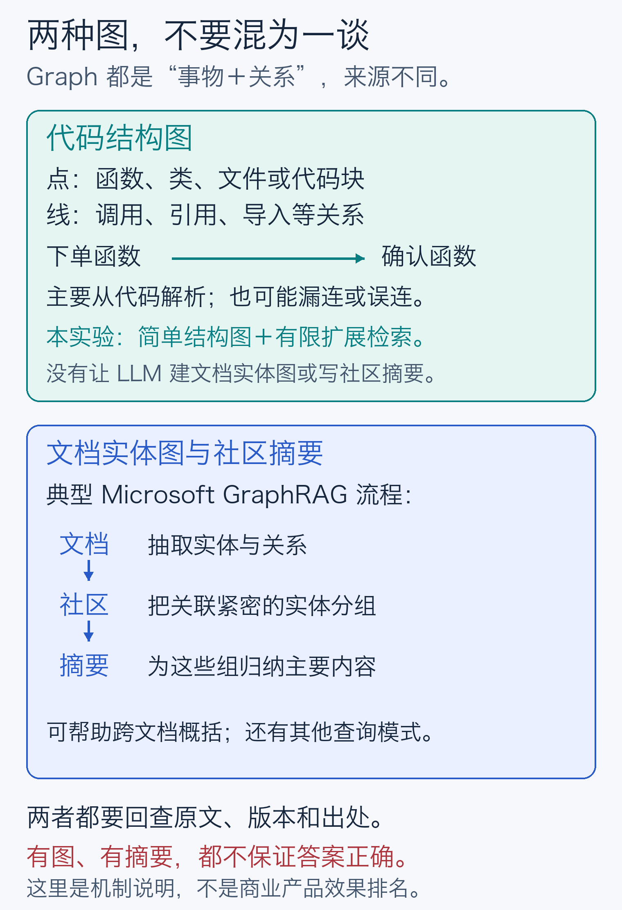
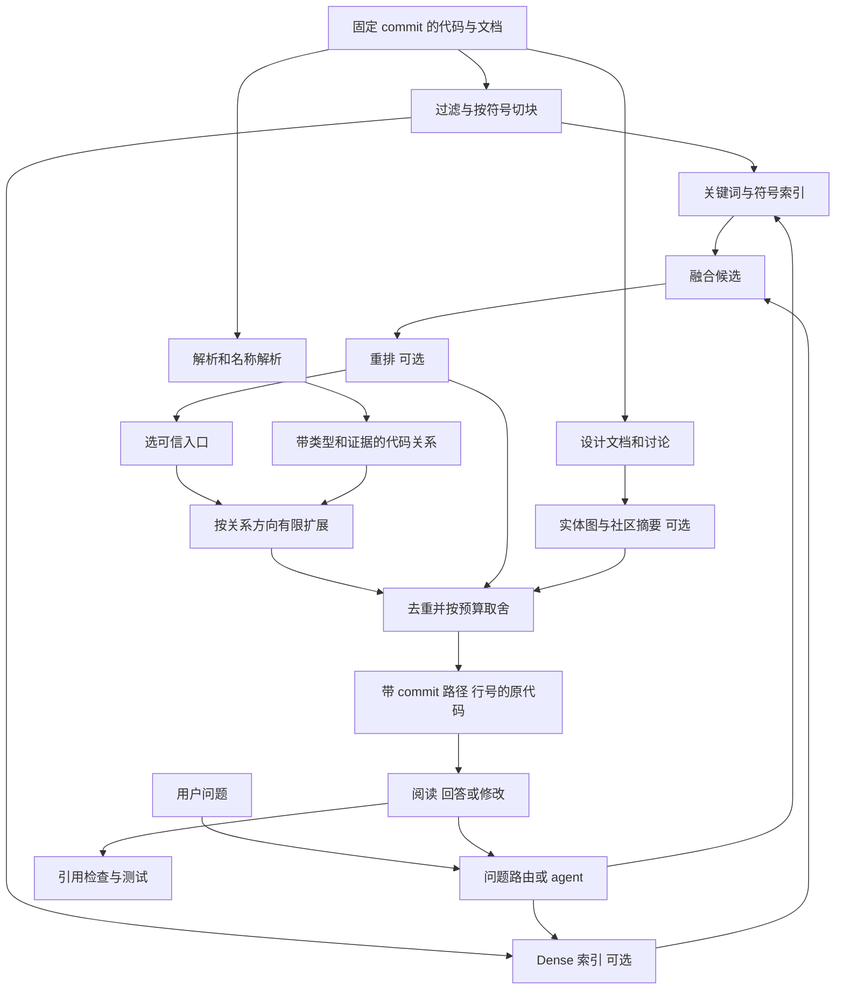

# Graph RAG 对代码有没有价值？

研究截止与访问日期：2026-10-12。面向希望理解技术取舍、又不想先学一套图数据库术语的读者。论文、官方文档及其适用范围见 [来源表](sources.md)；文中的“建议”是基于这些证据的工程判断。

## 先给结论

**有价值，最值得考虑的是把可靠的代码关系接到现有搜索后面。价值取决于问题是否需要跨文件追踪，以及新增上下文能否在相同预算内补到真正缺失的证据。** “代码天然有结构”不能直接推导成“所有代码问答都应该先建 GraphRAG”。

对新项目，建议从可追溯的关键词／符号搜索开始，加入经验证的语义检索与重排，再按失败案例补充调用、引用、导入关系。需要多轮调查时，让 agent 组合这些工具。文档多、需要概括全局主题时，再单独评估 Microsoft 式实体图与社区摘要。这是逐步验证投入的建议，并非行业市场份额结论。

三个判断要分开：

- **代码结构图有直接研究与实现。** RepoGraph、LocAgent 支持它在特定定位和修复流程中有增益；结果同时受模型、工具、任务和预算影响。[RepoGraph](https://arxiv.org/html/2410.14684v2)、[LocAgent](https://arxiv.org/html/2503.09089v2)
- **Microsoft GraphRAG 的原始胜场不能直接迁移到代码修复。** 其代表论文研究文本集合上的全局归纳问答，并非“改哪几个函数、测试能否通过”。[原论文](https://arxiv.org/abs/2404.16130v2)
- **没有一种检索方式通吃。** 代码 RAG 基准及 2026 年 GrepRAG 研究提醒我们保留强的非图基线；检索得分好也不等于生成代码正确。[CodeRAG-Bench](https://arxiv.org/html/2406.14497v2)、[Better Call Grep](https://arxiv.org/abs/2601.23254v3)

本项目的小型实测中，主预算 8 块时，图扩展证据覆盖率为 **62.5%**，低于 hybrid 的 **67.3%**；小型 dense 为 **74.0%**。4／12 块时图又高于 hybrid，说明结果依赖预算。本轮只有两份 Python 源码和 30 个作者构造的冻结查询，**不运行回答模型，不检验完整 Microsoft GraphRAG、真实 coding agent 或修复成功率**。[本地原始汇总](../results/summary.md)

## 一、先把它想成图书馆和地图

把代码仓库看成图书馆：文件是书，函数是章节，说明文档是导读。回答模型是读者；RAG 是先替读者找资料，再让它据此回答。

### 1.1 RAG 先找资料，Graph 把关系画成地图

想象有人问馆员：“这家店下单以后，谁负责生成回执？”馆员先找到相关章节，读者再用这些材料回答。这就是 **RAG（检索增强生成）**：先检索，再生成回答。它不会仅因“拿到了资料”就自动答对，找错材料、漏读条件或误解原文仍会出错。

**Graph 在这里不是统计图，而是“事物和关系”。** 点可以是一段代码，线可以表示“这段代码调用另一段代码”。像城市地图一样，地名告诉你在哪里，道路告诉你能怎样走。代码图提供路线，检索负责寻找出发点；实际系统不一定需要专门的图数据库。

下面贯穿使用一个**原创教学示例**，不是 Requests／Click 的实验题。小店只有三个动作：下单、确认、生成回执数据。为了让关系容易看清，省略真实业务中的支付、库存、异常处理；它也不会真的发送邮件。

```python
# checkout.py：下单入口
from orders import confirm_order
def place_order(order):
    return confirm_order(order)

# orders.py：确认后生成回执
from mailer import make_receipt
def confirm_order(order):
    return make_receipt(order)

# mailer.py：生成回执数据
def make_receipt(order):
    return {"to": order["email"], "subject": "订单回执"}

# analytics.py：另外一段订单统计代码
def order_count(orders):
    return len(orders)
```

普通检索会比较问题和代码的词语或意思：它可能先找到下单入口，也可能直接找到回执函数，还可能找到同样谈“订单”的统计代码。**“都在谈订单”不等于“互相调用”。** 图扩展则从已找到的入口出发，沿有依据的调用关系，跨过文件边界找到确认和回执函数。统计代码没有这条调用关系，不会仅因名字相似就成为调用邻居。



图 1：一份目录帮你找章节，一张地图帮你追关系。普通检索本来就可能找到答案；图的潜在价值是补齐它没找到的关联证据。[可编辑 SVG](figures/01-search-and-relations.svg)

### 1.2 从建图到回答，分成五步



图 2：建图通常提前做；收到问题后执行检索和证据选择，最后才轮到回答模型。[可编辑 SVG](figures/02-five-steps.svg)

1. **建图：先画地图。** 对一个固定代码版本，识别函数及调用位置，并保存文件、行号和关系依据。在教学例子里，从 `place_order` 指向 `confirm_order` 的箭头，来自前者代码中的调用。真实代码中的分支、同名符号和动态绑定会让这一步更难；代码更新后，地图也需要更新。
2. **找入口：先查目录。** 用名字、关键词或语义检索找到可能相关的代码。如果问题提到“下单”，入口可能是 `place_order`。入口错了，关系再丰富也可能越走越偏。
3. **沿边扩展：沿道路找相邻地点。** 读到下单调用确认，再读到确认调用回执，就能把三个文件串起来。走过一条边叫“一跳”。如果问“改回执会影响谁”，可以反向查调用者；但静态关系只提示需要检查的路径，不证明每次运行都经过它。
4. **选证据：决定背包里装哪些原文。** 扩展得到的是候选，还要回到原代码，去重、比较相关性并控制篇幅。图上相连的日志工具可能无关，不能自动挤掉已经找到的关键函数。实际系统可限制跳数、边类型、邻居数量和总字数／token。
5. **回答并附来源：让读者用材料作答。** 对这个例子，可回答：“`mailer.py` 中的 `make_receipt` 生成回执数据；下单入口通过 `confirm_order` 调用它。”依据应分别指向[生成位置](examples/shop/mailer.py#L5)、[中间调用](examples/shop/orders.py#L7)和[入口调用](examples/shop/checkout.py#L7)。这只证明示例中的调用与返回值，不能证明真实商店已经发信或支付成功。真实系统还应带上固定 commit，避免代码变了而来源没变。

这里展示两跳，是为了讲清三段代码如何协作。**本仓库的实验只从检索种子扩展一跳，并且没有运行第 5 步的回答模型。** 所以实验结果只说明证据找得怎样，不能换成“回答准确率”。四份[教学源码](examples/shop/README.md)与实验语料分开，不进入评测。

### 1.3 为什么有地图仍会找错



图 3：错误路线、漏画道路和拥挤的背包，都会影响找资料。[可编辑 SVG](figures/03-failures-and-budget.svg)

在小店例子里，若解析器把同名的测试替身认成真正的回执函数，就会连错边；若回执生成器要等运行时从插件中选择，静态分析可能漏掉边。因此，“图里没查到”不能当作“不存在”的证明。通用日志和工具函数还可能连到大量代码，跟着每条边走会淹没有用材料。

还有一个更隐蔽的问题：**回答模型能读的材料有限。** 假设背包只能装四块，原先已经有入口、确认、回执和配置；加入邻居后变成入口、确认、日志和工具，数量没变，回答所需的回执却丢了。这是教学反例，不是另一组实测数据。本地实验确实有图扩展挤掉证据的失败案例，详见后文 [R07 案例](#一个可检查的失败正确片段被邻居挤出)；不能把这个示意当作对 R07 内部路径的复现。

实用的检查方式是：先核对边的依据，再比较**相同预算下**是否补到了缺失证据。图有价值的条件是找对入口、关系可信、新证据相关，而且装得下；并不是画出更多点和线就更聪明。

### 1.4 再把这些办法放在一起看

| 方法 | 图书馆里的对应物 | 擅长什么 | 容易漏掉什么 |
| --- | --- | --- | --- |
| 关键词／BM25 | 查词语索引；稀有词更有辨识度 | 函数名、异常名、配置键、错误消息 | 问题与代码用词不同 |
| Dense 语义检索 | 把问题和章节变成数字向量，按相近程度找资料 | 用自然语言描述行为 | 意思表面相近但实际用途不同；精确名字可能被弱化 |
| Hybrid | 同时查字面索引和语义索引，再合并名单 | 兼顾名字与意思 | 两路都没找到的内容 |
| Reranker 重排 | 对候选章节逐一细读，重新排序 | 初筛找到但排得太后的材料 | 候选集合之外的材料 |
| 代码结构图 | 地图标明“谁调用谁”“谁继承谁” | 沿依赖补齐上下游证据 | 分析器漏掉或连错的关系 |
| Agentic search | 馆员边读边改搜索词、翻下一本书 | 一开始不明确、需要调查的问题 | 走错方向、重复搜索、花费失控 |
| 长上下文 | 能摊开更多书的大桌子 | 资料规模合适，需要综合阅读 | 大桌子本身不负责找书，也不保证每页都读对 |

这些比喻解释机制，不是准确率排行。例如“查谁调用 `send`”适合符号工具；“为何重定向后凭证消失”可能先靠检索找到入口，再沿调用与条件分支阅读。搜索确定起点，图提供路线，模型负责解释，三者可以一起工作。

## 二、GraphRAG 至少覆盖了三件不同的事

前面的地图属于**代码结构图**。另一个常见含义是 Microsoft GraphRAG 的**文档实体图**：从文章里识别人、项目、组织等事物及其关系，把联系紧密的实体分组，再为组里的内容写摘要。这里的“社区”是关联紧密的一组实体，不是聊天社区。



图 4：它们都用“点和关系”，但图的来源、关系含义及查询方式不同。图中所述为典型机制，具体能力以官方版本为准。[可编辑 SVG](figures/04-two-kinds-of-graph.svg)、[Microsoft GraphRAG 官方索引流程](https://microsoft.github.io/graphrag/index/default_dataflow/)

代码图更像“程序线路图”；文档实体图与摘要更像“人物关系图，加上各组事情的梗概”。后者可帮助概括跨文档主题，但摘要可能遗漏细节，抽取的关系也可能错误。**本实验不是完整 Microsoft GraphRAG 的实现或评测**，没有抽取文档实体、划分社区或生成社区摘要，也不能据此判断该系统的代码问答效果。两种图都应回查原始出处，图本身不保证回答正确。

### Microsoft 式：文档实体图与社区摘要

典型流程是文本切块 → LLM 抽取实体和关系 → 聚类形成社区 → 生成社区摘要 → 组织答案。原论文主要检验两个约百万 token 文本集合的全局概括，用 LLM 评价回答全面性与多样性，比较向量检索及无图的文本汇总等条件。它不是强 hybrid＋reranker 在代码任务上的对照，也不是对错误陈述率的完整验证。[GraphRAG 论文](https://arxiv.org/html/2404.16130v2)

当前官方项目还包括 local、global、DRIFT、basic search 及自定义图支持，不能把它说成“只有社区摘要”。不过，把代码导入后仍需证明实体、边和摘要保留了函数身份、版本及执行条件。[官方文档](https://microsoft.github.io/graphrag/)

对架构决策记录、设计文档、issue 与代码混合的知识库，这种方式可能有价值。对精确修改函数，过早用自然语言摘要替代原代码可能丢失参数、分支和异常路径；这是机制上的风险判断，不是本地实验结果。

### 代码结构图：从程序中提取关系

| 结构 | 通俗含义与检索用途 | 不能混淆的地方 |
| --- | --- | --- |
| AST／语法解析树 | 代码的语法组织；支持按函数、类、语句切块 | 识别调用表达式，不等于确定运行时调用目标 |
| 符号／引用图 | 名字指向哪个定义；支持找定义、找引用 | 同名文本未必是同一符号 |
| 调用图 | 哪个函数可能调用另一个；追上下游 | 静态“可能调用”不等于此次执行一定经过 |
| 导入／依赖图 | 哪个模块使用另一个模块或包 | 导入模块不等于使用其中每个函数 |
| 继承／实现图 | 类型继承、接口实现、覆盖关系 | 动态分派或注入可能不完整 |
| 数据流／控制流图 | 值从哪来、分支能走到哪 | 比文件依赖图更难构建和维护，常有语言限制 |

解析器、语言服务和编译器索引提供不同层次的事实。Tree-sitter 的官方定位是增量语法解析；SCIP 表达符号、定义、引用等导航信息。**只用 Tree-sitter 不会自动得到完整、精确的跨文件调用图**，还需名称解析、类型信息和语言特性处理。[Tree-sitter](https://tree-sitter.github.io/tree-sitter/)、[SCIP](https://github.com/scip-code/scip)

### 图进入训练：不等于在线图检索

GraphCodeBERT 把数据流用于预训练和注意力结构，在代码搜索等任务上评估表示学习。它说明结构可能改善表示；它没有证明“在任意仓库在线建图并遍历”优于 hybrid，也不是 Microsoft GraphRAG 的早期版本。[GraphCodeBERT](https://arxiv.org/abs/2009.08366v4)

## 三、实际产品能证明到哪一步

以下为访问日的公开说明，不是内部完整架构披露或独立准确率评测。

| 产品／项目 | 官方可确认的做法 | 证据边界 |
| --- | --- | --- |
| Sourcegraph／Cody | Context 文档并列 keyword search、Sourcegraph Search、Code Graph | 没公开各路权重或受控消融，不能推断图是主要增益来源。[S10](https://sourcegraph.com/docs/cody/core-concepts/context) |
| GitHub Copilot | 仓库语义索引服务于 Chat 与 cloud agent | 能确认语义检索仍受支持，不能推导所有客户端管线相同。[S12](https://docs.github.com/en/copilot/concepts/context/repository-indexing) |
| VS Code Copilot | semantic search、text／grep、file search、usages、read file；agent 可继续搜索 | 这是多工具迭代搜索实例；`usages` 导航不等于 Microsoft 式社区摘要。[S11](https://code.visualstudio.com/docs/agents/reference/workspace-context) |
| Continue | `@Codebase` 明确 deprecated；历史文档描述 embedding＋keyword 和可选重排；当前指南强调 agent 工具、rules、MCP、自建 code RAG | 旧 hybrid 实现不能写成当前全产品架构。[旧文档](https://docs.continue.dev/reference/deprecated-codebase)、[当前指南](https://docs.continue.dev/guides/codebase-documentation-awareness) |
| Aider repomap | 关键符号和签名构成紧凑地图，利用文件依赖图排序，按 token 预算选择内容 | 结构可用于上下文筛选，不需先让 LLM 抽取实体；地图仍不能替代完整代码。[S15](https://aider.chat/docs/repomap.html) |

这些实例支持组合方案值得评估，但样本既不完整也不随机。本文不依据 stars、宣传文章或少数产品文档宣称市场“主流”；厂商称“更准确”也只作为厂商陈述。

## 四、研究证据：有正例，也要有强基线

### 基础与直接代码研究

| 工作 | 检验的问题 | 可带走的启示 | 不可外推的结论 |
| --- | --- | --- | --- |
| Microsoft GraphRAG，2024／2025 v2 | 实体图＋社区摘要，面向文本全局问答 | 先确认有全局归纳需求 | 已验证代码定位／修复收益。[S1](https://arxiv.org/abs/2404.16130v2) |
| GraphCodeBERT，2020／2021 v4 | 数据流预训练，代码搜索等任务 | 结构可能改善表示 | 任意在线 repo 图扩展都更好。[S4](https://arxiv.org/abs/2009.08366v4) |
| RepoCoder，2023 v3 | 相似检索与生成交替，仓库级补全 | 跨文件检索和迭代本身有价值 | 它是图方法；补全成绩等于 issue 修复成绩。[S5](https://arxiv.org/abs/2303.12570v3) |
| RepoGraph，2024／2025 v2 | 定义／引用节点、包含／调用边，接到已有框架；测试 SWE-bench 和 CrossCodeEval | 图导航可作为插入已有流程的模块 | 整体提升全由某一边类型造成；所有语言都同样受益。[S6](https://arxiv.org/html/2410.14684v2) |
| LocAgent，2025 v2 | Python 目录／文件／类／函数图，包含／导入／调用／继承关系；agent 搜索和遍历 | 词法实体定位可与图遍历互补 | 摘要最高文件定位率就是 top-1 或修复率；微调和成本数字可照搬本地小模型。[S7](https://arxiv.org/html/2503.09089v2) |
| CodeRAG-Bench，2024／2025 v2 | 多类代码任务、多语料来源，sparse／dense／重排和不同生成器 | 收益依任务和生成器变化 | dense 总输给 BM25；检索得分高必然生成正确。[S8](https://arxiv.org/html/2406.14497v2) |
| Repoformer，2024 v2 | 训练模型判断何时需要检索 | 每次增加更多上下文不是合理目标 | 选择性检索的收益是图的收益。[S20](https://arxiv.org/abs/2403.10059v2) |

这些大多是作者自己的评测，本报告未独立复现完整系统。不同论文的模型、数据切分、上下文长度、重试次数与指标不同，不能拼成一个排行榜。

### 截至 2026 的补充核实

**LARGER（2026-05）** 将词法命中映射成图入口，在原有 agent 搜索中加入可信度过滤的局部邻居。MuLocBench 消融表的完整配置 Acc@5 为 55.7，去掉图扩展为 48.2，绝对差 7.5 个百分点。这支持该设置中图扩展有贡献，但不是本报告复测；其 Acc@5 要求全部目标文件进入前五，不能当作任一文件命中率。固定参数与调参成绩也须区分。[论文表 3](https://arxiv.org/html/2605.16352v1)

**Better Call Grep／GrepRAG（2026-07 v3）** 让 LLM 生成 ripgrep 搜索，结合标识符加权重排与结构去重，作者在补全任务上报告与复杂基线竞争的结果。这意味着较强词法 agent 是必要对照；它不是完全不使用结构，也不是单次 BM25。[论文](https://arxiv.org/abs/2601.23254v3)

**How Much Static Structure Do Code Agents Need?（2026-07 v2）** 研究轻量结构注释的粒度、方向与导航稳定性，局限部分明确限定 Python、单一 agent，并说明会漏动态特性。正文“仅评定位”与摘要／其他段落下游修复表述存在口径张力，本文不采用其修复成功率数字；保留的启示是结构密度和边方向需要消融。[论文第七节](https://arxiv.org/html/2606.26979v2)

**SWE-Explore（2026-06）** 评估固定行预算内返回的代码区域，覆盖 848 个 issue、203 个仓库、10 种语言。它提示应同时看覆盖、排序与上下文效率。相关区域由成功 agent 轨迹提取，是观察到的证据集合，不等于穷尽所有有效修复路径。[论文](https://arxiv.org/abs/2606.07297v1)

**Programming Knowledge Graphs（2026-01）** 把代码与文本组织成细粒度节点，结合剪枝和重排，主要评测 HumanEval／MBPP。它补充了外部编程知识检索证据，不能替代真实仓库跨文件定位评估。[论文](https://arxiv.org/abs/2601.20810v1)

版本还会改变名称：arXiv:2504.10046 的 v1 名为 CodeRAG，v2 已改名 **GraphCodeAgent**，组合需求图和代码结构语义图，评测 DevEval／CoderEval。本文按 v2 记录，也不把它与 CodeRAG-Bench 混淆。[v2 原文](https://arxiv.org/abs/2504.10046v2)

这是一组截至研究日核实的代表性材料，不是穷尽检索、元分析或“最新冠军”评选。新研究给出可测试假设，仍需在目标语言、仓库与预算上验证。

## 五、什么时候图值得用

| 问题 | 优先入口 | 图可补什么 | 先检查的失败条件 |
| --- | --- | --- | --- |
| “`HTTPAdapter.send` 在哪？” | 符号／精确词法 | 定义以外通常无需扩展 | 邻居挤掉精确答案 |
| “哪里合并环境代理配置？” | BM25＋dense，读候选 | 入口连接到辅助函数与配置来源 | 入口找错后，扩展把错放大 |
| “改接口要检查哪些调用者？” | 找引用／调用者 | 逆向引用、子类、测试 | 动态调用、注册表、字符串绑定缺边 |
| “为什么走到这个异常？” | 错误消息、栈、agent 调查 | 连接上下游和条件依赖 | 静态图不能确认实际分支，应看测试／trace |
| “解释模块如何协作” | repomap＋关键文件 | 模块依赖、有限多跳 | 工具函数连接过多，产生噪声 |
| “设计争论的主要主题？” | 文档检索、全局摘要 | 文档实体与社区归纳 | 单看代码结构不够 |
| 小项目、相关文件已知 | 直接读文件／长上下文 | 可能没有额外价值 | 建索引成本超过节省的阅读成本 |

这是路由建议。图扩展值得试的前提是：入口较可靠；缺失证据位于可提取关系上；预算容得下；任务确实需要这些证据。若主要问题是切块破坏函数、名字分词错误、候选排序差，先修这些环节更直接。

长上下文与检索也能组合：小仓库直接读，大仓库先选文件再提供完整内容。Lost in the Middle 在 2023 年当时模型的文档问答与键值任务中发现位置敏感，适合提醒我们测上下文使用效果；**不能据此断言 2026 年所有长上下文代码模型必然失败**。[原论文](https://arxiv.org/abs/2307.03172v3)

## 六、建议架构：先找到，再有选择地走关系

下图是可演进的建议架构，不是声称本项目已实现全部模块。



融合是合并候选；重排才是对“问题＋候选”再判断相关性。交叉编码器逐对打分，适合先筛选再使用，不能挽救没进候选集的代码。[Sentence Transformers](https://sbert.net/examples/sentence_transformer/applications/retrieve_rerank/README.html)

图不强制要求图数据库。小型静态索引用邻接表或 SQLite 足以验证；复杂跨库查询和并发服务再评估图数据库。RepoGraph 公开实现输出 NetworkX 图文件，说明“用图”和“部署图数据库”是独立选择。[实现说明](https://github.com/ozyyshr/RepoGraph)

## 七、成本不只有一次建图

| 方案 | 主要离线成本 | 主要在线成本 | 持续维护 |
| --- | --- | --- | --- |
| BM25／符号索引 | 分词、切块、倒排表 | 查询打分，通常无需模型推理 | 增量更新、符号身份、忽略规则 |
| Dense／hybrid | 模型下载、逐块编码、向量存储 | 查询编码、查找、融合 | 变化重编码；模型升级可能重建 |
| Reranker | 下载／配置评分模型 | 随候选数增长的推理 | 长代码截断、候选预算 |
| 静态代码图 | 解析、名称解析、边生成 | 有限遍历、取原代码 | 多语言、跨文件失效、边的精度／覆盖 |
| 实体图＋社区摘要 | 抽取、聚类、摘要生成 | 子图／摘要检索及生成 | 实体合并、社区和摘要更新 |
| Agentic search | 可利用以上索引，也可不预建 | 多轮模型和工具调用 | 工具可靠性、停止条件、总预算 |
| 长上下文 | 准备和去重材料 | 输入处理、缓存和生成 | 新鲜度、噪声、证据位置 |

这是成本来源的定性比较，不是跨产品价格表。无付费 API 仍需内存、磁盘、CPU／GPU 时间和维护工时。

举例：十万块×384 维×4 字节，**原始向量**约 153.6 MB；这不含模型、文本、索引和运行时。图存储与节点、边数有关，解析及维护工程成本常比邻接表更值得关注。这个算式是示意，不是本次实测。

每月成本可拆成初建摊销＋变更更新＋查询次数×单次成本＋维护工时。收益要用节省的定位时间、少读的无关代码和减少的失败重试衡量。没有查询量、更新率和故障代价，不宜给统一投资回报数字。

实施时要求源代码、文本索引、向量和图对齐同一版本；删除、改名、未提交改动能使旧边失效；多用户系统还要避免通过边或摘要泄露无权限内容。这是设计要求，不是本项目已经完成安全审计的结论。

## 八、分阶段落地与停止条件

1. **做可验收的检索基线。** 收集真实问题和相关函数／文件，冻结版本；测试精确搜索、BM25、代码友好的切块。结果带版本、路径和行号。已满足需求即可停止。
2. **按错误类型补 dense 和重排。** 用词差异大时测 dense／hybrid；正确代码已进候选却排得太后时测 reranker。同最终预算比较，并记录延迟与索引成本。
3. **只为关系型漏检引入轻图。** 先包含、导入、可信符号引用，明确类型和方向。从少数入口、一跳扩展起步；测无图、同预算随机扩展，必要时测目录邻居，排除简单加量的解释。
4. **有多轮调查需求再接 agent。** 保留词法、语义和直接读文件工具；图是其中一种导航能力。限制工具次数与总预算，记录轨迹以区分搜错、读错和改错。
5. **最后考虑复杂语义图／社区摘要。** 用于跨文档主题、架构归纳或需求到实现映射。先定义追溯和更新，再比较 repomap＋原代码。

进入下一阶段的依据是具体失败和冻结测试，不是另一篇论文的最高分。图只对部分问题有效，就只对这些问题启用；收益小、更新代价大或误导增加时，保留简单方案也是完整结论。

## 九、本地检索实验

### 约定范围

实验在 Mac mini（Apple M4，10 核，16 GiB，macOS 26.4.1）上进行，使用 Requests 2.32.3、Click 8.1.8 两个固定旧版本与 30 个冻结查询：26 个正例进入检索均值，4 个负例单列。检索输入为英文，中文仅供阅读。比较 BM25、真实的小型 dense、hybrid、静态图扩展、同预算随机扩展；不使用付费 API，不调用回答模型。旧版本用于可重跑语料，并不代表当前版本或安全建议。[冻结协议](../benchmark/protocol.md)、[题目与证据](../benchmark/questions.md)

主预算为 8 块，每块不超过 240 个 embedding tokenizer 的 token，总上限 1920；另测 4／12 块。各方法实际 token 数仍不同。图保留 hybrid 前半结果，用一跳结构邻居补后半；随机对照共享前半种子和扩展槽数。dense 为固定 revision 的通用英文 `sentence-transformers/all-MiniLM-L6-v2`，不能代表代码专用最优 embedding。本轮未测 reranker、agent 或长上下文生成。[复现和实现说明](reproduce.md)

查询分类：定位8题、跨文件8题、影响分析6题、概念4题、负例4题。gold为研究代理在检索前静态审阅的70个关键源代码行锚，记录路径、行号、哈希与释义；没有人类独立标注员。每题“全部证据命中”指所有标注行锚均落入返回块，不代表完整语义证据已穷尽。

| 语料 | 固定commit | 源文件数 | 源行数 | 块数 |
| --- | --- | ---: | ---: | ---: |
| Requests v2.32.3 | `0e322af87745eff34caffe4df68456ebc20d9068` | 18 | 5,642 | 435 |
| Click 8.1.8 | `934813e4d421071a1b3db3973c02fe2721359a6e` | 16 | 10,205 | 845 |

### 实际测到了什么

源码共 34 个 Python 文件、15,847 行、1,280 个块，其中 Requests 435 块、Click 845 块。图节点是代码块，只有 `same_symbol_next`（同一符号的相邻块）和保守解析的 `static_call`，检索时双向一跳扩展；它不是完整编译器调用图，更不是文档实体图。Requests 解析到 949 个调用站点中的 252 个，Click 为 1,755 中的 451 个；分母含内置和外部调用，**这些比例不是以真实调用图为 gold 的召回率**。[环境与索引记录](../results/environment.json)

主预算 8 块，26 个正例的宏平均如下。“证据覆盖”按冻结的关键行锚计量，“全部命中”要求该题全部标注证据到达；都不等同于完整回答正确率。

| 方法 | 证据覆盖 | 全部证据命中 | MRR | 平均实际 token | 平均阶段合计时延 |
| --- | ---: | ---: | ---: | ---: | ---: |
| BM25 | 54.5% | 34.6% | 0.503 | 1,289.4 | 0.35 ms |
| Dense | 74.0% | 57.7% | 0.581 | 1,313.6 | 3.00 ms |
| Hybrid | 67.3% | 46.2% | 0.568 | 1,379.5 | 3.48 ms |
| Hybrid＋graph | 62.5% | 46.2% | 0.556 | 1,357.4 | 3.52 ms |
| Hybrid＋random | 53.5% | 34.6% | 0.548 | 1,117.6 | 3.56 ms |

来源：[自动汇总及完整指标](../results/summary.md)、[逐题排名](../results/raw.jsonl)。这说明本轮的默认选择应优先考虑 dense，而不是为了预设的“图更好”结论强行增加复杂度。Hybrid 也没有自动胜过单一路径；等权融合本身需要验证。

图相对 hybrid 平均低 **4.81 个百分点**，26 题为 **0 胜、23 平、3 负**；配对 bootstrap 描述区间约为 −10.58 至 0 个百分点。题目非随机抽样，这个区间只描述本题集，不构成行业总体推断或正式显著性证明。

分组看，Requests 的 hybrid／graph 覆盖率为 76.9%／73.1%，Click 为 57.7%／51.9%。主预算的 8 个跨文件问题从 59.4% 降到 43.8%；定位、影响分析、概念三组分别持平于 68.8%、79.2%、62.5%。因此，连“跨文件题一定更适合这份图”在本样本中也不成立；每组仅 4—8 题，不能对任务类别作稳定推断。

**方向会随预算改变。** 4 块时图比 hybrid 高 2.88 个百分点；12 块时高 4.81 个百分点。预算改变同时改变种子数与邻居名额，不能只挑图赢或图输的设置。图在三个预算都高于本轮固定 seed 的随机扩展，但随机只控制种子和槽数，未匹配实际 token 数、度分布等性质；这不能单独证明因果关系，关键对照仍是同预算 hybrid。

### 一个可检查的失败：正确片段被邻居挤出

R07 要追踪默认连接适配器、重试配置及传输使用。Hybrid 在第 5 位找到了 `adapters.py:202–222`，覆盖两条冻结证据：[默认重试对象，第 210 行](https://github.com/psf/requests/blob/0e322af87745eff34caffe4df68456ebc20d9068/src/requests/adapters.py#L210)及[整数转换为重试配置，第 212 行](https://github.com/psf/requests/blob/0e322af87745eff34caffe4df68456ebc20d9068/src/requests/adapters.py#L212)。这两行属于 `HTTPAdapter.__init__`。

图方案保留相同前四块，却将后四个名额给结构邻居，最终没有保住该块，也未补齐另两条证据。覆盖率从 2／4 变成 0／4，尽管两者都返回 8 块。这里观察到的失败是**扩展和取舍规则丢掉已找到的证据**，而不是证明“重试逻辑没有调用关系”。C06、C07 也出现退化。完整排名和证据锚可在 [原始结果](../results/raw.jsonl) 与 [冻结题目](../benchmark/questions.md) 对照；本轮未看到结果后调整规则追求图胜。

### 实际运行开销

两库索引阶段加总约 **7.53 秒**：切块 1.534 秒、图生成 0.057 秒、BM25 0.056 秒、向量编码 5.880 秒。模型加载另计约 0.043 秒，下载和依赖安装不在其中。保存的四类缓存合计 **3,792,652 字节（约 3.62 MiB）**：BM25 566,312 字节、块正文／元数据 1,212,992 字节、边 47,012 字节、向量 1,966,336 字节；不含源码、模型权重和环境依赖。[原始资源记录](../results/environment.json)

整轮进程峰值 RSS 约 **843 MiB**，是同时持有各索引的峰值，不能当作某一种方法的独立内存。在线耗时经过预热，每题每阶段重复三次取中位数，再将所需阶段相加，包含查询向量编码；它不是服务 p99，也不含回答生成。小图遍历很快，不意味着完整语义分析或更大仓库维护也同样便宜。[测量口径](reproduce.md)

### 审计与修正

审计发现 Click 中不同词法作用域的局部导入被文件级合并，导致错误连边。执行者保留首轮数据，修复作用域和遮蔽处理后全量重跑；以上数字来自实验代码 `a09bcf98f87e186de88b202312942591a4a19bfd` 的修正版。数值警告另以 float64 对照核查，排名一致后改为等价无警告计算；没有改题、改 gold 或为提高成绩调参。[审计记录](audit.md)

4 个负例全部单列。固定 top-k 检索器仍会返回内容，没有拒答阈值，因此本轮不能声称发现问题不存在或具备可靠拒答能力。未标注块也只能称“未标注”，不能一律称无关噪声。

### 无论结果如何都不能越过的边界

30 个作者构造的查询由研究代理静态审阅，没有外部人类标注员复核；它们能检查实现和发现案例，不能估计行业平均收益。两个 Python 库不代表大型 monorepo、多语言、跨服务、私有代码或频繁变化的工作区。实际只索引源代码目录，不含 tests 和 docs，也只检索英文查询；图中同符号连续块带来的收益与跨文件调用收益尚未分离。一个小型 dense 模型不代表所有 embedding；简单静态图不代表所有 GraphRAG。

检索召回提高只说明标注证据更多进入结果，不证明理解正确、补丁正确、测试通过或开发者更省时。没有运行 reranker、agent、长上下文、实体摘要索引、增量更新、并发、能耗和回答生成，不能给它们填入推测成绩。随机对照能排除部分加量效应，仍需检查长度预算、入口质量和题目是否偏向图结构。

## 技术附录

### A. 分四层评估

| 层次 | 核心问题 | 观察指标 |
| --- | --- | --- |
| 图构建 | 边可信且新鲜吗？ | 按类型抽检精度／覆盖、解析失败、更新失效 |
| 检索 | 预算内找全多少证据？ | Recall@k、MRR、需要时 nDCG；另报 token／行预算覆盖 |
| 回答／修改 | 正确使用证据了吗？ | 引用、事实性、执行测试、修复成功率 |
| 工作流 | 实际更省事吗？ | 总延迟、工具次数、token、复查／重试、维护工时 |

gold 若是相关符号集合，Recall@k 就是前 k 结果覆盖的相关符号比例；MRR 关注第一个相关结果的倒数名次。“任一目标命中”和“所有目标命中”必须用不同名字。文件级指标容易受大文件影响，应与函数／块级指标分开。空 gold、重复块、同符号多个片段的规则必须预先固定。

固定 k 不等于固定上下文成本：短函数和长类都算一条。建议同时报块数与实际字符／token／行预算；若只做等数量对照，须称等数量，不应称等 token。

### B. 可检查的图扩展

节点保存 repo、commit、path、限定符号名、行范围；边保存类型、方向、构建器、证据位置、可信度。避免只存 `send → send` 这样的裸名。先把命中映射到明确节点，再按任务取调用者、被调用者或导入目标。

限制入口数、跳数、每个入口邻居数和总预算；限制高连接度日志／工具函数。去重后重新选择材料，保护必要原始命中。文本猜测的边与语言工具解析的边分开，避免把推测呈现为程序事实。

### C. 版本更新与动态语言

增量更新不仅重解析改动文件。改名、导出、导入别名或类型变化可影响别的文件；从内容哈希定位变化后，应重算受影响入边／出边。未解析跨库目标要有明确状态，不能悄悄当作没有关系。

Python 的反射、`getattr`、装饰器、monkey patching、插件注册和依赖注入可能超出简单静态分析。调用图是有缺口的地图；具体运行行为仍需测试、日志或 trace。不能用“没有边”证明“绝不调用”。

### D. 下一轮实验

初步结果若值得继续，应增加来源独立的真实任务、未用于调参的仓库、中文和英文查询、无精确符号词问题、配置和测试问题。区分图发现新证据、仅改变排序、以及扩展制造噪声。固定生成器和总预算后再测回答／修复，才能讨论端到端收益。

生产决策依赖的是：目标工作负载中，新增关系是否稳定补足必要证据，并值得其构建、查询和维护成本。

### E. 术语速查

| 术语 | 通俗含义与阅读提醒 |
| --- | --- |
| token | 模型切分文本后处理的单位，可能是词、词的一部分或标点；不等于汉字数、单词数。上下文容量和部分费用按它计算。 |
| embedding（嵌入向量） | 用一串数字表示文本，使模型认为相近的内容在向量空间里靠近；相似不保证代码行为相同。 |
| RRF（Reciprocal Rank Fusion，倒数排名融合） | 按候选在各检索列表中的名次加分，再合成一个排名；本实验用它融合 BM25 与 dense。它不直接比较两种检索器的原始分数。 |
| Recall（召回率） | 已找回的标注相关目标占全部标注相关目标的比例。Recall@k 限定只看前 k 条；本报告还单列源代码证据锚的覆盖率，二者不能混用。 |
| MRR（Mean Reciprocal Rank，平均倒数排名） | 每题取第一个相关结果的名次倒数再求平均；第 1 名得 1，第 2 名得 1/2，没有命中得 0。它不反映后续证据是否找全。 |
| nDCG（Normalized Discounted Cumulative Gain，归一化折损累计增益） | 给靠前的相关结果更高权重，并与理想排序比较；用于观察整个列表的排序质量，具体值依赖相关性标签和截断位置。 |
| 消融实验 | 去掉或替换某个组件，尽量固定其余条件，观察成绩如何变化；用于判断收益来自哪里，不能把同时更换多个条件称为单组件效果。 |
| commit（提交） | Git 保存的一次项目版本记录；固定提交标识可定位实验所用的准确代码，而不只依赖会继续变化的分支名。 |
| 预印本 | 作者在正式出版前或出版之外公开的论文版本；公开可读不等于已通过同行评审，阅读时须核对版本与发表状态。 |
