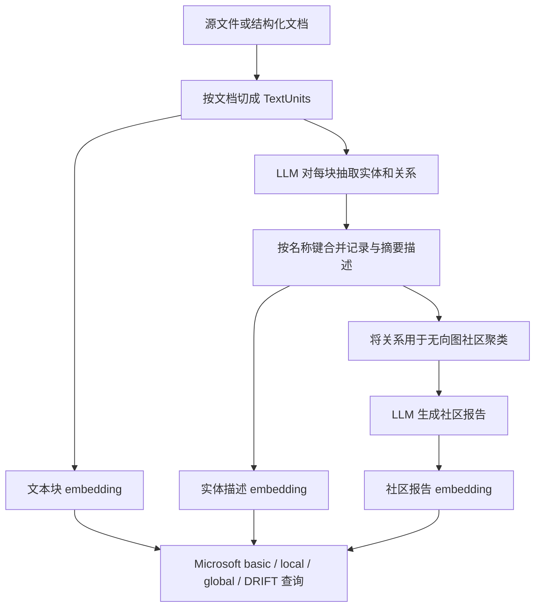

# Microsoft GraphRAG：代码索引能力与固定版本机制核查

本记录以 **v3.3.0 / `5faaaf4f5685fa2056fa8c3bf9342cb089f2942f`** 为准，研究截止日与访问日均为 **2026-10-12**。证据来自 Microsoft 官方发布记录、这个 commit 的源码/文档，以及原始论文。所有行为描述都受版本、配置、模型与输入约束；本文没有运行索引、查询、LLM 或 embedding，没有产生 Microsoft GraphRAG 的效果数据。

结论先行：Microsoft GraphRAG 把文本变成可用于问答的实体关系图与社区报告。它能把代码**作为文本**读入，但默认流程不会运行 Python 解析器、解析 import 的绑定关系，或验证运行时调用目标。LLM 写出的“调用”“依赖”描述不是经过程序分析验证的边。FastGraphRAG 的边则是名词短语在文本块中共现，也不是调用边。[S02] [S07] [S08] [S09] [S21]

本文用三类标签区分证据：**源码事实**可以在固定行号核查；**工程推断**是由事实推导的适用边界；**待验证假设**需要真正运行模型并评估，不能当成实验结果。教学示意同样不是官方输出。

当前评估精确定位、调用追踪、修改影响和 feature 上下文。§1–5 保留必要机制背景，§9–12 集中给出代码索引所需的身份、来源、检索和新鲜度证据；社区导读不是这四项任务的效果替代指标。

## 1. 版本与项目定位

GitHub 官方 `releases/latest` 返回 `tag_name=v3.3.0`、`published_at=2026-10-08T18:28:43Z`、`draft=false`、`prerelease=false`；该发布时间早于研究截止日。官方 tag API 显示 tag 直接指向 commit `5faaaf4f5685fa2056fa8c3bf9342cb089f2942f`。源码 `packages/graphrag/pyproject.toml` 同时声明 `version = "3.3.0"`、Python `>=3.11,<3.14`。因此本次采用的是截至访问时可核实的最新 GitHub 稳定发布，不把 `main` 当成固定版本，也不将发布记录等同于已验证的运行环境。[S01] [S03] [S04]

原始论文的核心研究问题是大型文本语料的全局概括，评估语料包含播客转录和新闻；不能将其结果外推成“已经证明适合这个代码仓库”。论文 §3.1.3–3.1.6 描述抽取、社区与摘要查询机制，§4.1.1 描述评估语料。[P01]

同一固定版本的 README 已将项目定位为主要处于维护状态的研究项目：不再接受新 PR 或实现新功能，仍按需修复缺陷和更新依赖，尤其处理 CVE；它也说明所提供的代码是方法示范，并非获得 Microsoft 官方支持的产品。团队试点需要自行承担集成、质量验证和维护工作；这不能扩写为“代码不能用”或“官方宣布弃用”。[S02]

下载仅用于静态阅读，存放在本仓库已忽略的 `.cache/ms-graphrag/`。未执行下载源码或安装脚本，未读取凭据；公开交付只保留本记录、版本元数据、链接和哈希，不复制第三方整仓。归档 SHA-256 与所引用文件的 SHA-256 见 [microsoft-version.json](microsoft-version.json)。

## 2. 从什么输入开始

**源码事实。** v3.3.0 内置 reader 类型包括 `text`、`csv`、`json`、`jsonl`、`parquet`、`markitdown`。统一的文档对象包含 `id`、`text`、`title`、`creation_date`，结构化输入还保留 `raw_data`。不是“只接受 TXT/CSV”，也不是“内置支持代码仓库语义解析”。[S05] [S06]

`text` reader 默认匹配 `.*\.txt$`，读出整个文件文本，使用文本内容的 SHA-512 派生文档 ID，并把 `Path(path).name` 用作 title。仅把 `.py` 放入默认 input 目录，通常不会被默认文件模式选中；即使选中，也只得到文本内容，title 只有 basename，不含目录。reader 源码中的注释说“每行一个文档”，但实际函数只构造一个 `TextDocument` 并返回 `[document]`，这里以实现为准。[S06]

**可配置的读入方法，未执行：** 把准备好的、明确允许使用的 `.py` 文件放进独立输入目录，修改以下配置片段；这是文本 reader 的文件模式配置，不是 Python 插件。

```yaml
input:
  type: text
  file_pattern: '.*\.py$'
  encoding: utf-8
input_storage:
  type: file
  base_dir: input
chunking:
  type: tokens
  size: 1200
  overlap: 100
  prepend_metadata: [title]
```

`prepend_metadata: [title]` 能让每块看到文件 basename，但不能解决不同目录中同名文件的问题。对代码教学/评估，更可控的方案是**输入适配**：每个源文件对应一条 JSONL/CSV 记录，显式提供相对路径 title、稳定 ID、原文 text 与路径/语言/原始 commit 等 metadata。配置 `id_column`、`title_column`、`text_column`，再用 `chunking.prepend_metadata` 复制需要的字段。它仍然是 Microsoft 文本索引，不能据此宣称存在符号解析。结构化 reader 的实际实现只有在 `id_column` 明确设置时才取该列，否则按文本哈希；不要仅依据文档某段“自动找 id 列”的说法。[S10] [S11]

例如以下是**建议的数据契约，不是实验输出**：

```json
{"id":"demo@fixed-commit:src/orders.py","title":"src/orders.py","text":"<原样的 Python 文件文本>","source_path":"src/orders.py","source_commit":"<被研究代码的固定 commit>"}
```

```yaml
input:
  type: jsonl
  id_column: id
  title_column: title
  text_column: text
chunking:
  prepend_metadata: [title, source_path, source_commit]
```

**工程推断。** metadata 给模型提供出处，不等于让模型精确理解每个名字的命名空间。文件/块的内容哈希也不是符号 ID；两个文件内容相同或两个块文本相同会得到相同的相应内容哈希，是否产生后续记录覆盖还取决于存储实现，本文没有运行验证，不做进一步断言。[S06] [S10] [S11]

## 3. 标准索引逐步发生什么

下面是根据源码绘制的机制示意，**不是本次运行所得图**。



### 3.1 切分不是函数切分

**源码事实。** 默认 `chunking.type=tokens`、`size=1200`、`overlap=100`、`encoding_model=o200k_base`。工作流逐个 document 调用 chunker；token chunker 将文本编码后按固定 token 窗口取片，步长为 `size-overlap`，再解码。默认路径没有按 `def`、class、AST 或函数体边界切分的分支。选用其他/自定义 chunker 属于配置或扩展，应记录为变体。[S07] [S11] [S12]

metadata 在切片之后附加，最终 `n_tokens` 再对完整文本计数。因此配置的 1200 是切片大小，不是加上路径元数据之后的严格总量，也不是最终 LLM 请求总 token 上限。抽取提示词、实体类型、历史消息与 gleaning 输出都还要占上下文。[S11] [S12] [S08]

**工程推断。** 一个函数可能被切开，调用点和 import 可能不在同一块；100-token overlap 只能缓解边界附近的信息断开，不能保证所有相关代码同时可见。缩小块会增加块数/调用次数，扩大块也不保证提升抽取质量。这些影响在该代码库/模型上的幅度属于待验证假设。

### 3.2 默认提示词真正要求抽取什么

**源码事实。** 默认类型是 `organization, person, geo, event`，不是 function、class、module。提示词要求从输入文本识别指定类型的实体，给出名字、类型、描述；随后列出被认为明确相关的实体对、自然语言关系解释及一个关系强度数值。默认要求英文输出。关系记录没有由程序验证的 `CALLS`、`IMPORTS` 等枚举类型。[S07] [S09]

标准 extractor 对每个 TextUnit 发出模型请求，把当前块作为 `input_text`。默认 `max_gleanings=1` 时，在初次响应之后还有一次“继续补充遗漏实体/关系”的请求；不是只有每块一次调用。输出是特定分隔符格式，再由代码解析成 DataFrame；模型生成数字无法解析时，关系权重回退到 `1.0`。[S08]

**工程推断。** 默认通用提示词与代码符号的目标不一致。可以试验代码实体类型与领域提示词，但“把类型改成函数/类”并不会自动引入 AST、作用域绑定或执行证据。若要分析真实调用/依赖，需要额外程序分析来源并把边的生成方式单独标注；这属于另一种输入/抽取方案，不能冒充默认 Microsoft 抽取成功。

### 3.3 合并是具体键规则，不是可靠消歧

**源码事实。** 解析模型返回记录时，实体名、实体类型、关系 source/target 都先 `upper()`，再做去首尾空白、HTML unescape 和控制字符清理。合并实体使用 `groupby(["title", "type"])`，收集描述列表、来源 text-unit IDs 与频次；合并关系使用 `groupby(["source", "target"])`，描述/来源收集为列表、权重相加。这个阶段 `(A,B)` 与 `(B,A)` 仍是不同分组。[S08] [S13] [S14]

合并后会去掉 source 或 target 不在实体 title 集合中的关系。这是在移除悬空引用，不能验证两个实体之间的语义关系是否真实。描述摘要先将完全相同的描述去重；只有一个不同描述时直接返回，多个描述时才调用 LLM 合成摘要。[S13] [S15] [S16] [S46]

还有一个容易遗漏的实现边界：初次合并虽使用 `(title,type)`，摘要结果只有 title，随后实体表按 title merge；默认 `finalize_entities` 更明确地仅按 title 去重、跳过后续同名行，并重新分配 UUID。社区建立时也用 `title -> entity_id` 字典。因此不能声称“不同 type 的同名实体在后续全链路完全隔离”，这些 ID 也不是稳定的源码符号身份。详见第 9 节；这里仍是静态核查，不是运行复现。[S17] [S18] [S59] [S80]

**工程推断。**

- 两个文件中的 `confirm_order` 若被模型输出为同一个 title/type，会在初次合并时被放到一起；没有自动加入相对路径的命名空间规则。
- 同一个符号若被输出为 `ORDERS.CONFIRM_ORDER` 与 `CONFIRM_ORDER`，精确键规则本身不会识别二者等价。LLM 可能自行统一表述，但不是可证明的链接过程。
- Python 大小写敏感；`Foo` 与 `foo` 经上大写处理后不能靠该名字键保留区别。即使提示词要求保留大小写，这一步源码仍执行 `upper()`。
- 跨文件知识可以通过共享名称实体合并后在图中相连，但这是文本证据与模型命名形成的连接，不是逐文件解析 import 后完成的符号解析。

### 3.4 图、层级社区与默认覆盖范围

**源码事实。** 聚类输入是关系表。代码将 source/target 规范为无向对，去掉反向重复对（保留最后一条），默认先取最大连通分量，然后调用 `graspologic_native.hierarchical_leiden`。默认 `max_cluster_size=10`、`use_lcc=true`、固定 seed `0xDEADBEEF`。社区表记录 level、parent、children、entity IDs、内部关系 IDs 和 text-unit IDs。[S07] [S18] [S19] [S20]

层级社区是根据所抽取图的连接结构形成的分组，不是程序包目录、架构层、强连通调用环或经过验证的业务子系统；给定图的聚类可重复性也不能消除上游 LLM 抽取变化。默认仅最大连通分量参与社区分析，所以不能保证社区报告覆盖所有已读文件、孤立实体或较小的分离子图；该设置不等于把那些原始文档从所有输出表删除。[S19] [S20]

### 3.5 社区报告的内容，以及固定版本的重要差异

**源码事实。** 标准报告上下文由实体描述、关系描述及可选 claims 组织而来。LLM 返回含 title、summary、rating、rating_explanation、findings 的结构化响应；默认 prompt 的 rating 是社区影响程度，不是答案正确率、代码质量分数或调用关系置信度。代码传入 `CommunityReportResponse` 作为 JSON schema 响应类型。[S22] [S23] [S24]

**设计与实现需分开。** 原始论文与官方流程文档描述层级社区及摘要，用于把大语料压缩成全局问答的上下文。固定版本也保留一个 `build_level_context` 分支：已有子社区报告时，可以用它替换过大的局部上下文。但 **v3.3.0 的 `summarize_communities` 标准调用路径先遍历所有层建立 `level_contexts`，之后才执行生成报告并追加到 `reports`**；建立各层上下文时传入的 `reports` 因而仍为空。超限时，graph context builder 的空-report 分支对局部上下文排序并裁剪。不能把该版本直接写成“已实测逐层生成报告，再以子报告生成父报告”。这是静态控制流观察，未运行复现或量化其影响。[P01] [S25] [S26]

描述摘要默认 `max_input_tokens=4000`、`max_length=500`；社区报告默认 `max_input_length=8000`、`max_length=2000`。这里 `max_length` 会被插入提示词，不能当作服务端严格截断参数或真实输出 token 实测。描述过长时会多轮压缩并把先前摘要带入下一轮；不能承诺保留每个条件分支、参数名、异常或精确常量。[S07] [S16] [S23]

**工程推断。** 原文仍在 text_units/documents 中，不等于每次回答都能看到全部原文。关系漏抽、名称误合并、图分量筛选、报告上下文裁剪、摘要压缩、检索和最终上下文预算都会影响可见证据。全局报告尤其不应被当作精确代码事实的最终裁决。

## 4. Standard 与 Fast：索引方法的差别

| 环节 | Standard（默认） | FastGraphRAG |
| --- | --- | --- |
| 实体来源 | LLM 按提示词抽取并描述 | NLP 名词短语 |
| 边来源 | LLM 对实体对的相关性解释 | 同一 TextUnit 中共现的名词短语对 |
| 初始边权 | 模型输出的强度，合并时求和 | 共现次数，可按 PMI 归一化 |
| 实体/关系描述摘要 | 多个不同描述时调用 LLM | 无对应描述摘要步骤 |
| claims | 可选，默认关闭 | 流程不使用 |
| 社区 | 图聚类 | 图聚类，之前还有 prune_graph |
| 社区报告输入 | 实体/关系描述、可选 claims | 相关原始文本块 |
| 社区报告与 embeddings | 仍调用模型 | 同样仍调用模型 |

上述是源码工作流与官方方法文档的差异，不是本仓库对速度、价格或质量的测量。Fast 默认 NLP 为偏英文的 `regex_english`；官方文档建议 Fast 常采用 50–100-token 的更小块，但不能写成“选择 fast 会自动把 size 从 1200 改成 50/100”：固定工作流选择本身没有这样的覆盖。默认 `normalize_edge_weights=true`，pruning 还会改变节点/边覆盖。[S07] [S21] [S27] [S28]

**工程推断。** Fast 减少的是抽图阶段的 LLM 使用，不是整个系统不需要 LLM/API。它的共现边不能拿来证明调用或依赖。官方文档中对成本占比的估计也不能用作这个代码语料、模型、提示词与硬件的预算保证。

## 5. Basic、Local、Global 与 DRIFT：查询方法的差别

索引方法与查询方法是两条不同轴：`standard/fast` 决定怎样建索引；`basic/local/global/drift` 决定怎样利用可用索引构造回答上下文。不是四种抽图算法。[S27] [S29]

| 查询 | 实际主要步骤 | 对代码问题的合理用途与边界 |
| --- | --- | --- |
| Basic | query embedding 搜索 text-unit embeddings；将选中的块装入 token 预算，再让 LLM 回答 | 给出文档/源码文本线索的向量 RAG 基线；不是关键词精确搜索或符号搜索 |
| Local | query embedding 映射到实体描述；围绕实体组装实体、关系、可选 claims、社区报告与原文块 | 适合围绕某概念/实体探索；实体匹配、邻接和上下文选择不保证程序路径正确 |
| Global | 选定社区层级（或可选动态社区选择）；把社区报告分批 map 得到要点/分数；过滤、按分数排序并在预算内 reduce | 适合“主要模块职责/主题是什么”一类概览假设；不是逐行穷举整个仓库 |
| DRIFT | 生成假设性回答并 embedding；挑相关报告做 primer，生成初步答案与追问；递归 local search，再合成回答 | 适合广泛起点到具体细节的探索；追问树不是经过验证的程序执行图 |

Basic 默认 `k=10`、上下文预算 12000。固定实现通过相似度结果拿到 ID 集合，再按 `self.text_units` 的原有遍历顺序装载块并遵守预算，所以不能未经检查就说最终上下文严格按相似度降序排列。其生成器是 Microsoft 自带 BasicSearch；自制 TF-IDF、BM25 或自写检索只能另列为独立基线。[S07] [S30] [S31]

Local 默认配置给原文块 0.5 的上下文比例、社区报告 0.15，其余用于实体/关系等。上下文构造器会先做 query-to-entity embedding 匹配，再装配多个表。它不是“找到一个节点后把整条可达调用链全放进去”。不要混淆构造器函数的备用默认参数与正常工厂传入的配置默认值。[S07] [S32] [S33]

Global 正常工厂使用报告 `full_content`（`use_community_summary=false`），不是必然只读报告的短 `summary` 字段；它还启用报告打乱/分批。map 输出要点和重要性分数，reduce 丢弃零分项、按分数排序，并受 `max_data_tokens` 限制。动态社区选择是可选能力，正常工厂参数默认关闭；不要把它当成所有 Global 查询都做的步骤。[S34] [S35] [S36]

DRIFT 固定实现会随机选一个已有报告作格式模板，请模型生成 query 的假设性回答，再对其 embedding 与报告向量比较；其后 primer 与 local follow-ups 会继续使用模型。默认配置 `n_depth=3`、`drift_k_followups=20`、`primer_folds=5`，这些是配置默认值，不是对每个问题固定发生多少请求的实测。在成本与复现中应记录真实追问次数、模型响应、失败/重试和所用报告。[S07] [S37] [S38] [S39]

## 6. 同一个小店回执例子怎样贯穿教学

沿用本仓库 [小店教学示例](../docs/examples/shop/README.md)：`checkout.place_order → orders.confirm_order → mailer.make_receipt`，另有谈到订单、却不在这条调用链中的 `analytics.order_count`。这些是**人工编写的教学代码，不是 GraphRAG 的输出**。下面省略 docstring，仅展示直接调用与返回值；完整文件以链接中的代码为准。

```python
# checkout.py
from orders import confirm_order

def place_order(order):
    return confirm_order(order)

# orders.py
from mailer import make_receipt

def confirm_order(order):
    return make_receipt(order)

# mailer.py
def make_receipt(order):
    return {"to": order["email"], "subject": "订单回执"}

# analytics.py
def order_count(orders):
    return len(orders)
```

示例只返回字典，不发送邮件，不支付，不操作库存或持久化。不能因为文件叫 `mailer.py`，就在讲解或生成答案中补成“系统已发信”。

可以用同一例子依次问：输入怎样保留 `orders.py` 路径？1200-token 切分是否可能切断更长文件的 import 与函数？默认实体类型是否抽出这些函数？模型返回 `CONFIRM_ORDER` 还是 `ORDERS.CONFIRM_ORDER`？另一个文件也定义 `confirm_order` 时是否合并？`order_count` 与下单链虽共用“订单”词汇，是否被模型错误写成调用关系？Basic/Local/Global/DRIFT 最终各自拿到什么上下文？

示意回答必须用条件语气：**如果**两个块都抽出同一个 `CONFIRM_ORDER` 节点且关系端点相符，它们可能通过该键接起来；**如果**类型/命名不匹配，连接可能不存在；默认通用 prompt 也可能根本没有抽出期望的代码符号。不能在没有真实模型产物时画一张完美 `PLACE_ORDER → CONFIRM_ORDER → MAKE_RECEIPT` 图，然后标成 Microsoft GraphRAG 实验结果。

程序分析对照可以人工检查上述明确的 import/直接调用，作为独立标注的参照；换成 `handlers[name](order)`、`getattr(client, operation)(order)`、插件注册或 monkey patch 后，必须说明静态分析/运行证据的覆盖范围。LLM 可以依据文本推测目标，但推测不构成运行时目标验证。

当前教学问题分组：

1. **精确定位**：“哪个具体函数返回默认回执主题？”核对定义、文件、范围、版本，不能只返回一个相似名字。
2. **调用追踪**：“place_order 经哪些调用得到回执？”核对 import 与调用方向，关联图不能充当证明。
3. **修改影响**：“改变回执接口，哪些上游和测试需要检查？”检查遗漏，同时避免把 order_count 列为必改项。
4. **feature 上下文**：“让入口支持自定义回执主题，应读取什么？”现有两个教学测试及 CONVENTIONS.md 也必须在取证范围；之后的编辑与验收是下游阶段。

这套讲解可以先理解机制，再决定哪些问题值得做真实模型实验；它不代替实验。

## 7. 真实 Microsoft 实验还缺哪些能力

**已确认的配置能力。** v3.3.0 初始化默认 completion 模型为 `gpt-4.1`，embedding 模型为 `text-embedding-3-large`，provider 为 `openai`；CLI 可覆盖这两个模型选择。3.x 的配置入口是 `completion_models` 和 `embedding_models`。[S47] 这些名称是版本默认值，不是本研究已配置、已付费或已运行的服务。[S07] [S40] [S41]

模型配置具备 `model_provider`、`model`、`api_base`、`api_key` 和 `call_args`；completion 与 embedding 的 LiteLLM 适配器都把 `api_base` 传给下层调用。因而可以配置指向本地 OpenAI 兼容服务的基地址。API-key 模式有非空校验；对于明确不校验 key 的本地服务，可以显式填非秘密的虚拟值。仅凭这些字段不能保证任意本地服务、模型或 Mac mini 内存容量都满足要求；官方也提示代理方案需要可靠遵循响应格式。[S42] [S43] [S44] [S48]

一次真实试验至少需要确认：

- **Completion 接口和模型**：能遵循实体抽取的分隔符格式，处理多轮 gleaning；报告生成能返回符合 JSON schema 的结构；所选查询路径支持需要的 JSON/流式响应。只有返回普通聊天字符串的 `/chat/completions` 兼容性不充分。[S08] [S23] [S35] [S43]
- **Embedding 接口和模型**：能为文本块、实体描述、社区报告及查询生成一致的向量；使用同一模型/维度和正确的向量索引。DRIFT 显式检查 query/report embedding 的类型和长度。默认三种 embedding 名称是 `entity_description`、`community_full_content`、`text_unit_text`。[S38] [S44] [S45]
- **上下文与运行参数**：块文本、metadata、提示词、响应历史需要一起容纳；确定真实 token 上限、并发、失败重试与缓存策略。不能把 `max_length` 提示词值当成整个 API 调用预算。[S08] [S16] [S23] [S42]
- **独立的完整实验记录**：固定微软 commit、被研究代码 commit、输入 manifest、提示词哈希、配置、模型标识/版本、endpoint 类型、实际 token/请求数、耗时、输出表、查询上下文、回答和人工评分依据。索引完成不等于四种查询都有效，更不等于优于基线。

**准确的代价边界。** 本研究没有发模型请求，API 费用为未发生，而非测得“GraphRAG 免费”。Standard 会用 completion 做抽取/补抽、必要的描述摘要、报告生成；Fast 免去部分图抽取 LLM 步骤，但保留报告和 embedding。Basic/Local 查询通常还需要 query embedding 与回答生成；Global 用报告做多批 map 与 reduce；DRIFT 会生成假设回答、做向量匹配并多次追问。真实金额取决于模型定价、token、失败重试、缓存命中与语料，不能由文件数给出可靠总价。[S08] [S16] [S21] [S23] [S30] [S35] [S37] [S39]

本地推理可以不使用按 token 计费的外部 API，但仍消耗模型下载空间、内存、CPU/GPU、时间和电力；还需验证格式能力及结果质量。这是可行方向的条件说明，不是本机已完成安装或跑通的声明。当前无付费、无模型调用约束下，**版本/源码核查是已完成成果，实际 Microsoft 运行与效果比较仍未执行**。

## 8. 结论的证据等级

| 表述 | 等级 | 可以如何写 |
| --- | --- | --- |
| v3.3.0、固定 commit、默认实体类型/合并键/切分参数 | 官方元数据与源码事实 | 明确断言，并引用固定行号 |
| `.py` 能通过 text reader 的 file_pattern 进入文本流程 | 源码支持的配置能力 | 标明未执行；不要写已成功索引 |
| 名称大写、同名键、跨块上下文会造成代码适配风险 | 事实加工程推断 | 给机制与条件，不捏造错误率 |
| 该版本报告上下文先于报告生成统一构建 | 静态控制流观察 | 说明未运行；与原论文机制分开 |
| 调整 prompt/path metadata 可能改善代码实体一致性 | 待验证假设 | 需要真实模型产物与对照 |
| GraphRAG 在这个仓库优于 Basic，或某方案快若干倍 | 当前无证据 | 不得下结论 |
| 原自制结构图检索效果代表 Microsoft GraphRAG | 归属错误 | 必须移除或明确另列为独立方法 |

## 9. 面向代码检索：符号与来源具体保存到哪一层

这里评估的是“精确找函数、追调用、判断修改影响、为 feature 提供上下文”需要的证据契约，不是已经跑出的效果。应把三个层次分开：**默认文本流程**实际做什么；**提示词/输入适配**可能改善什么；**外接程序图**需要集成者另行保证什么。

### 9.1 文档、块、符号与引用不是同一种 ID

**源码事实。** 默认最终表的核心字段如下；这是固定 schema 与输出代码，不是对所有自定义扩展的限制。[S49] [S54] [S55]

| 层次 | 默认保存的关键字段 | 不能仅凭它断言的代码属性 |
| --- | --- | --- |
| Documents | id、human_readable_id、title、text、text_unit_ids、creation_date、raw_data | title 不必是仓库相对路径；creation_date 不是源码 commit；raw_data 需要输入方自己提供版本/路径 |
| TextUnits | id、human_readable_id、text、n_tokens、document_id、entity_ids、relationship_ids、covariate_ids | 没有默认必填的文件路径、起止行、字符区间、源码版本列 |
| Entities | id、human_readable_id、title、type、description、text_unit_ids、frequency、degree | title/type 不等于限定符号名、签名、作用域、重载身份或语言服务 symbol ID |
| Relationships | id、human_readable_id、source、target、description、weight、combined_degree、text_unit_ids | source/target 是实体名称；没有默认必填的 CALLS/IMPORTS 枚举、调用点范围或验证方式 |

内部 `TextChunk` 对象确实定义了 `start_char`、`end_char`、`index` 等字段，因此不能说“项目任何地方都没有 offset”。但默认 `create_base_text_units` 在收集分块结果时只取 `chunk.text`，最终 TextUnits schema 也没有这些区间字段。这条默认路径没有把内部 offset 建成可供查询直接使用的源码定位契约。[S53] [S11] [S54]

通用 `Entity`、`Relationship`、`TextUnit` 数据模型允许 `attributes`；`read_text_units` 也允许传入 `attributes_cols`。这说明可以扩展来源或语义信息。但是默认 `read_indexer_text_units` 没有传这个参数，不能假设在 parquet 上加任意列后就会自动进到查询上下文。[S50] [S51] [S52] [S56] [S57]

**更具体的引用边界。** 默认 TextUnit loader 把重置前的 DataFrame index 转成 `short_id`，不是源码行号，也不是显式读取表里的 `human_readable_id`。Sources 构造器给模型的表默认只有 `id,text`，有 attributes 才附加相应列；虽然 TextUnit 对象加载了 `document_id`，默认 Sources 表不会自动显示它。因此回答中的 `[Sources (某编号)]` 首先是检索上下文中的块引用，不能直接宣称是“某 commit 的某文件第几行”。需要保留本次表索引与 TextUnit ID 的映射，再以 `document_id` 回查 Documents，并由输入适配层核验路径、版本和精确范围。[S56] [S57] [S58]

**工程推断。** 可以把 `repo-relative path + commit + language` 放入结构化原始记录，并将必要字段附到块文本供模型读取；这能改善可追溯性，但字段存在不代表坐标正确。要交付可点击的代码引用，还需独立保存/校验块与原文的映射、对齐原始字符/行范围、明确列的传播路径，不能从摘要或模型生成的行号反推事实。仅用正文哈希也不能区分“两个路径内容完全相同”的文件身份。[S06] [S10] [S11] [S49]

### 9.2 最终实体表的去重比初次 `(title,type)` 更强

**源码事实。** Standard/Fast 的默认工作流都经过 `finalize_graph`，它调用 `finalize_entities`。后者用 `seen_titles` **仅按 title 去重，跳过后续同名行，且为保留行分配新的 `uuid4()`**。`finalize_relationships` 按有序 `(source,target)` 去重，同样重新分配 UUID。因此初次按 `(title,type)` 分组不意味着最终表会保留所有跨类型同名实体；一次完整重建的实体 UUID 也不是按源码定义位置确定的稳定 symbol ID。[S27] [S80] [S59] [S60]

对同名函数、类方法、大小写不同的 Python 标识符、跨文件别名与重载，默认机制没有建立“限定名 + 签名 + 位置 + 版本”的身份规则。让提示词产出带路径的名称是一种可试验的适配，但仍受名称大写、模型一致性和最终去重键影响；添加 `function` 类型也不会消除这些规则。外接图若绕过抽取/finalize，可以提供自己的稳定实体 ID，但仍需确保端点名称唯一且下游读取按预期工作。[S08] [S49] [S51] [S52] [S59] [S79]

## 10. Local 能召回多少，为什么不能当调用闭包

**源码事实。** 正常工厂传入的默认上下文预算为 12000 token，其中原文块比例 0.5、社区报告 0.15，其余用于实体/关系/协变量。没有历史消息时，三部分预算约为 6000、1800、4200；有历史时先扣除历史占用，再分配剩余额度。这是数据上下文预算，不是包含所有提示词、问题与模型输出的请求总上限。[S07] [S32] [S34]

`top_k_entities=10` 不能简单写成“最终固定召回十个实体”：非空查询路径请求 `k × oversample_scaler` 个相似实体，Local 传 `oversample_scaler=2`；映射函数对找到的实体过滤后直接返回，没有再次截成 k。默认因此向向量库请求最多 20 个候选，实际结果还受索引内容和过滤影响。程序接口也能显式包含某个 title，但这仍是名称匹配，不是定义解析。[S32] [S33]

Local 的原文候选来自**已选实体的 `text_unit_ids`**，先按实体的选中次序、再按块中相关关系数排序，去重后装入 Sources 预算。若目标函数未被抽成实体或未匹配到，其对应原文没有在这条分支中自动通过独立的全库文本向量检索补回来。Basic 的直接文本向量检索是另一条查询路径；不能把两条路径的能力混写。[S30] [S32]

关系候选先取两个端点都在已选集合的边，再取只有一个端点在集合的边；后一类按共同邻接和 rank 排序。`top_k_relationships=10` 在该过滤函数中参与的预算是 `10 × 已选实体数`，主要裁剪集合外邻接边，不是全上下文严格十条边。之后表格构造仍受 token 限制；超限会停止或回退此前装入的上下文。[S61] [S62] [S32]

source/target 字段在关系表中仍有顺序，但 Local 的邻接选择会检查两端，不要求 `CALLS` 类型，也不执行“从 caller 沿真实调用方向穷举所有可达 callee”或其反向影响闭包。默认工厂还设置 `return_candidate_context=false`，通常返回实际装入的上下文；自定义调用可开启候选表和 `in_context` 标记，帮助分析漏在检索还是预算阶段。[S34] [S61] [S62] [S32]

**工程推断。** 对“找返回回执字典的函数”，应验证目标文件/函数是否进入最终 Sources，而非只看回答是否流畅。对“所有调用方”“改签名影响哪些调用点”，缺少一条边就会使穷举或影响分析失真；Local 的语义入口、邻接排序、预算裁剪均不提供完整性承诺。更大预算或更高 k 只能改变候选范围，不能把 LLM 边转成经过程序分析验证的调用边。

## 11. `update` 的新鲜度：默认路径是标题驱动的追加合并

本节来自固定版本的静态控制流，没有执行更新实验。范围是默认 `standard-update` / `fast-update` 工作流与输入 reader；自定义 pipeline 或直接传入 DataFrame 的 API 路径应另行检查，不能把本节写成所有扩展都不可能实现更新。

### 11.1 哪些文件会进入 delta

**源码事实。** `get_delta_docs` 比较旧 Documents 与新输入的 `title` 集合：未见过的 title 进入 `new_inputs`，消失的 title 进入 `deleted_inputs`。它没有在这里比较内容、文档 ID 或 commit。随后 `load_update_documents` **只返回 `new_inputs`**；没有新 title 时设置 `stop=True`，流水线停止。[S63] [S64] [S75]

由这一条件可直接推导默认路径的行为边界：

| 仓库变化 | 默认 title 差分判断 | 对新鲜度的含义 |
| --- | --- | --- |
| 新增从未出现过 title 的文件 | 作为新输入 | 可进入 delta 抽取/索引，但需真实运行验证后续完成 |
| 原文件内容改变、title 相同 | 不在 `new_inputs` | 该修改不会通过这个 loader 重建；清缓存不能改变这个筛选条件 |
| 删除旧 title | helper 能算出 `deleted_inputs`，loader 不使用 | 不能把算出了删除集合等同于已经删除旧索引事实 |
| 重命名导致 title 改变 | 新 title 当新增 | 后续追加合并不自动移除旧 title 的记录/事实 |
| 新目录下新增另一个同名文件，使用默认 text reader | basename title 可能与旧文档相同 | 可能被当成已有标题而跳过，即便相对路径和内容不同 |

上述是条件分析，不是本机复现结果。用相对路径替代 basename 可减少标题碰撞；把 commit 填进 title 会令每个版本更像新增数据，也不会自动删除旧版本，不能据此宣称解决仓库同步。[S06] [S63] [S64]

API 的 `input_documents` DataFrame 入口可移除 `load_update_documents` 并直接写 delta，说明标题筛选不是所有调用者无法绕过的限制。但绕过筛选后仍需自行定义替换、删除、去重和版本语义；默认合并步骤不会因此自动变成仓库同步器。[S75]

### 11.2 delta 和旧索引怎样合并

默认更新先对 delta 运行所选索引工作流，再执行 update 工作流。[S27]

- **Documents / TextUnits：** 前者由公共 helper 调整短 ID 后 `concat(old,delta)`；后者映射 delta 的实体 IDs、调整短 ID，再拼接旧/新块。所核查函数没有按删除集合移除旧文档/块，也没有在拼接处按内容 ID 做去重。[S63] [S65] [S66]
- **Entities：** 按 title 把 delta ID 映射到旧 ID，再按 title 聚合，保留首个 id/type，拼接描述与 text-unit IDs。`degree` 取首值，源码留有全图重算 TODO；frequency 取拼接后的来源列表长度。因此这里的频次不应未经去重检查就当成不同调用点数量。[S68]
- **Relationships：** 按有序 source/target 聚合，保留首个 ID，拼接描述/来源，weight 使用均值；它和初次抽取合并时的求和不是同一个规则。随后会对合并的实体/关系描述重新摘要，这仍是文本摘要，不能剔除已失效的程序事实。[S13] [S67] [S69]
- **Communities / reports：** 给 delta 社区 ID 和 parent 做偏移映射，再与旧社区/报告拼接。所核查默认更新步骤没有对合并后的整图重新聚类、重建所有旧报告；保留旧报告不等于报告已经代表最新仓库整体结构。[S70] [S71] [S72]
- **Embeddings：** 更新工作流从合并后的表调用 `generate_text_embeddings`；生成新向量或命中缓存都不能修复之前未纳入的同名修改，或已经保留在表里的旧事实。本节没有测试不同向量后端的删除/覆写行为。[S73] [S74]

### 11.3 缓存不是版本追踪

**源码事实。** 模型缓存以调用参数生成键，GraphRAG 再附缓存版本后缀；命中时返回已缓存响应，否则执行请求并写缓存。键生成明确排除 `api_key`、`api_base/base_url`、timeout 等参数。这是请求响应复用层，不是 Git diff、源码依赖失效传播或文档删除处理。[S76] [S77] [S78]

**工程推断。** 更改代码只有在输入被选入、相关模型请求实际变化并走到缓存层时，才谈得上缓存键变化。改变 endpoint 或清缓存不能替代版本管理。代码试点应把源码 commit、输入 manifest、配置/提示词/模型标识与输出目录一起固定；未实现并验证替换/删除策略前，以隔离的完整快照重建作为新鲜度对照。增量结果需要和同一目标 commit 的完整重建比较文档、块、实体/关系、报告与最终检索上下文，而不是只检查命令返回成功。

## 12. 官方 BYOG 可以接入程序图，但需要保留它的语义

**官方能力。** 固定版本的 Bring Your Own Graph 文档明确接受 `entities.parquet`、`relationships.parquet`，并按查询需要接受 `text_units.parquet`。可通过 `workflows` 只运行社区与报告步骤；Global 的最小示例是 `create_communities, create_community_reports`。Local/DRIFT/Basic 还需要相应原文块与 embeddings，Fast 报告变体要求有效的 text-unit 来源链接。这是官方扩展入口，不应写成“微软只能用 LLM 抽图，不能接程序图”。[S79]

**下游保留的限制。** BYOG 的最小关系字段仍是 source、target、description、weight、text-unit IDs。聚类使用的副本会把端点规范成无向对并按对去重，未保留 typed/directed 边语义作为聚类约束；这不等于原始 relationships 表的 source/target 列全被删除。Local 又会从任一端点收集邻接边。额外的 edge type、调用点、qualified symbol、版本属性能否进入模型、返回来源或参与过滤，需要逐层配置/改造，不能假设自定义 parquet 列自动贯穿整个系统。[S19] [S49] [S52] [S56] [S61] [S62] [S79]

**默认流程的审慎结论。** 所核对的 Standard 工作流由文本 reader、token chunker、LLM 实体关系抽取、finalize、社区与报告组成；Fast 用 NLP 名词共现代替 LLM 抽图。它们没有把 compiler/LSP/AST 的符号解析结果作为必需输入或校验条件。这个结论来自工作流与被调用实现，不是仅因搜索关键词未命中，也不否认可以注册自定义 workflow。[S06] [S11] [S12] [S08] [S21] [S27]

可行的集成分工是：外部语言工具/程序分析器提供有版本、限定身份、类型和来源范围的程序图；保留这份有向图用于查定义、查调用方与影响遍历；GraphRAG 的社区与文本问答帮助选取概念、解释职责和补充上下文。语言工具本身也有构建配置、静态可解析范围和动态调用覆盖限制，不能因使用 LSP 或 AST 就声称所有运行目标已证明正确。这里是工程方案，不是已实现系统或效果结论。

对 feature 实现，最终应把检索出的线索回查到目标 commit 的实际代码，读取有关函数、调用点、测试和接口约束，再通过修改后的验证确认行为。GraphRAG 可作为待评估的上下文入口；默认流程的文本图、社区报告和回答不能独立承担精确符号索引、真实调用闭包或修改影响完整性保证。

## 固定来源索引

下列 `Sxx` 的源码链接均固定到同一完整 commit。引用行范围只用于定位实际实现；最新网站上的说明若与该 release 不一致，以本文明确标出的固定实现为准。文件哈希及下载地址见 `microsoft-version.json`。`P01` 为原始论文，描述研究动机与方法，不能替代 v3.3.0 行为或代码仓库效果验证。

- [S01] 官方稳定发布页；结构化字段同时由 GitHub releases/latest API 核查。
- [S04] 官方 tag → commit 元数据。
- [P01] 原始论文 v2，2025-02-19 修订。
- [S02] `README.md`；[L3–L4](https://github.com/microsoft/graphrag/blob/5faaaf4f5685fa2056fa8c3bf9342cb089f2942f/README.md#L3-L4), [L35–L39](https://github.com/microsoft/graphrag/blob/5faaaf4f5685fa2056fa8c3bf9342cb089f2942f/README.md#L35-L39)。
- [S03] `packages/graphrag/pyproject.toml`；[L1–L26](https://github.com/microsoft/graphrag/blob/5faaaf4f5685fa2056fa8c3bf9342cb089f2942f/packages/graphrag/pyproject.toml#L1-L26)。
- [S05] `packages/graphrag-input/graphrag_input/input_type.py`；[L9–L23](https://github.com/microsoft/graphrag/blob/5faaaf4f5685fa2056fa8c3bf9342cb089f2942f/packages/graphrag-input/graphrag_input/input_type.py#L9-L23)。
- [S06] `packages/graphrag-input/graphrag_input/text.py`；[L16–L43](https://github.com/microsoft/graphrag/blob/5faaaf4f5685fa2056fa8c3bf9342cb089f2942f/packages/graphrag-input/graphrag_input/text.py#L16-L43)。
- [S07] `packages/graphrag/graphrag/config/defaults.py`；[L27–L84](https://github.com/microsoft/graphrag/blob/5faaaf4f5685fa2056fa8c3bf9342cb089f2942f/packages/graphrag/graphrag/config/defaults.py#L27-L84), [L89–L152](https://github.com/microsoft/graphrag/blob/5faaaf4f5685fa2056fa8c3bf9342cb089f2942f/packages/graphrag/graphrag/config/defaults.py#L89-L152), [L155–L209](https://github.com/microsoft/graphrag/blob/5faaaf4f5685fa2056fa8c3bf9342cb089f2942f/packages/graphrag/graphrag/config/defaults.py#L155-L209), [L261–L272](https://github.com/microsoft/graphrag/blob/5faaaf4f5685fa2056fa8c3bf9342cb089f2942f/packages/graphrag/graphrag/config/defaults.py#L261-L272), [L283–L292](https://github.com/microsoft/graphrag/blob/5faaaf4f5685fa2056fa8c3bf9342cb089f2942f/packages/graphrag/graphrag/config/defaults.py#L283-L292), [L315–L323](https://github.com/microsoft/graphrag/blob/5faaaf4f5685fa2056fa8c3bf9342cb089f2942f/packages/graphrag/graphrag/config/defaults.py#L315-L323)。
- [S08] `packages/graphrag/graphrag/index/operations/extract_graph/graph_extractor.py`；[L59–L178](https://github.com/microsoft/graphrag/blob/5faaaf4f5685fa2056fa8c3bf9342cb089f2942f/packages/graphrag/graphrag/index/operations/extract_graph/graph_extractor.py#L59-L178)。
- [S09] `packages/graphrag/graphrag/prompts/index/extract_graph.py`；[L6–L27](https://github.com/microsoft/graphrag/blob/5faaaf4f5685fa2056fa8c3bf9342cb089f2942f/packages/graphrag/graphrag/prompts/index/extract_graph.py#L6-L27)。
- [S10] `packages/graphrag-input/graphrag_input/structured_file_reader.py`；[L20–L65](https://github.com/microsoft/graphrag/blob/5faaaf4f5685fa2056fa8c3bf9342cb089f2942f/packages/graphrag-input/graphrag_input/structured_file_reader.py#L20-L65)。
- [S11] `packages/graphrag/graphrag/index/workflows/create_base_text_units.py`；[L27–L50](https://github.com/microsoft/graphrag/blob/5faaaf4f5685fa2056fa8c3bf9342cb089f2942f/packages/graphrag/graphrag/index/workflows/create_base_text_units.py#L27-L50), [L99–L111](https://github.com/microsoft/graphrag/blob/5faaaf4f5685fa2056fa8c3bf9342cb089f2942f/packages/graphrag/graphrag/index/workflows/create_base_text_units.py#L99-L111), [L127–L160](https://github.com/microsoft/graphrag/blob/5faaaf4f5685fa2056fa8c3bf9342cb089f2942f/packages/graphrag/graphrag/index/workflows/create_base_text_units.py#L127-L160)。
- [S12] `packages/graphrag-chunking/graphrag_chunking/token_chunker.py`；[L31–L69](https://github.com/microsoft/graphrag/blob/5faaaf4f5685fa2056fa8c3bf9342cb089f2942f/packages/graphrag-chunking/graphrag_chunking/token_chunker.py#L31-L69)。
- [S13] `packages/graphrag/graphrag/index/operations/extract_graph/extract_graph.py`；[L38–L73](https://github.com/microsoft/graphrag/blob/5faaaf4f5685fa2056fa8c3bf9342cb089f2942f/packages/graphrag/graphrag/index/operations/extract_graph/extract_graph.py#L38-L73), [L104–L129](https://github.com/microsoft/graphrag/blob/5faaaf4f5685fa2056fa8c3bf9342cb089f2942f/packages/graphrag/graphrag/index/operations/extract_graph/extract_graph.py#L104-L129)。
- [S14] `packages/graphrag/graphrag/index/utils/string.py`；[L11–L19](https://github.com/microsoft/graphrag/blob/5faaaf4f5685fa2056fa8c3bf9342cb089f2942f/packages/graphrag/graphrag/index/utils/string.py#L11-L19)。
- [S15] `packages/graphrag/graphrag/index/operations/extract_graph/utils.py`；[L13–L53](https://github.com/microsoft/graphrag/blob/5faaaf4f5685fa2056fa8c3bf9342cb089f2942f/packages/graphrag/graphrag/index/operations/extract_graph/utils.py#L13-L53)。
- [S16] `packages/graphrag/graphrag/index/operations/summarize_descriptions/description_summary_extractor.py`；[L56–L134](https://github.com/microsoft/graphrag/blob/5faaaf4f5685fa2056fa8c3bf9342cb089f2942f/packages/graphrag/graphrag/index/operations/summarize_descriptions/description_summary_extractor.py#L56-L134)。
- [S17] `packages/graphrag/graphrag/index/workflows/extract_graph.py`；[L97–L185](https://github.com/microsoft/graphrag/blob/5faaaf4f5685fa2056fa8c3bf9342cb089f2942f/packages/graphrag/graphrag/index/workflows/extract_graph.py#L97-L185)。
- [S18] `packages/graphrag/graphrag/index/workflows/create_communities.py`；[L86–L182](https://github.com/microsoft/graphrag/blob/5faaaf4f5685fa2056fa8c3bf9342cb089f2942f/packages/graphrag/graphrag/index/workflows/create_communities.py#L86-L182)。
- [S19] `packages/graphrag/graphrag/index/operations/cluster_graph.py`；[L50–L99](https://github.com/microsoft/graphrag/blob/5faaaf4f5685fa2056fa8c3bf9342cb089f2942f/packages/graphrag/graphrag/index/operations/cluster_graph.py#L50-L99)。
- [S20] `packages/graphrag/graphrag/graphs/hierarchical_leiden.py`；[L11–L26](https://github.com/microsoft/graphrag/blob/5faaaf4f5685fa2056fa8c3bf9342cb089f2942f/packages/graphrag/graphrag/graphs/hierarchical_leiden.py#L11-L26)。
- [S21] `packages/graphrag/graphrag/index/operations/build_noun_graph/build_noun_graph.py`；[L23–L53](https://github.com/microsoft/graphrag/blob/5faaaf4f5685fa2056fa8c3bf9342cb089f2942f/packages/graphrag/graphrag/index/operations/build_noun_graph/build_noun_graph.py#L23-L53), [L74–L86](https://github.com/microsoft/graphrag/blob/5faaaf4f5685fa2056fa8c3bf9342cb089f2942f/packages/graphrag/graphrag/index/operations/build_noun_graph/build_noun_graph.py#L74-L86), [L99–L143](https://github.com/microsoft/graphrag/blob/5faaaf4f5685fa2056fa8c3bf9342cb089f2942f/packages/graphrag/graphrag/index/operations/build_noun_graph/build_noun_graph.py#L99-L143)。
- [S22] `packages/graphrag/graphrag/index/workflows/create_community_reports.py`；[L40–L86](https://github.com/microsoft/graphrag/blob/5faaaf4f5685fa2056fa8c3bf9342cb089f2942f/packages/graphrag/graphrag/index/workflows/create_community_reports.py#L40-L86), [L97–L138](https://github.com/microsoft/graphrag/blob/5faaaf4f5685fa2056fa8c3bf9342cb089f2942f/packages/graphrag/graphrag/index/workflows/create_community_reports.py#L97-L138)。
- [S23] `packages/graphrag/graphrag/index/operations/summarize_communities/community_reports_extractor.py`；[L25–L41](https://github.com/microsoft/graphrag/blob/5faaaf4f5685fa2056fa8c3bf9342cb089f2942f/packages/graphrag/graphrag/index/operations/summarize_communities/community_reports_extractor.py#L25-L41), [L74–L102](https://github.com/microsoft/graphrag/blob/5faaaf4f5685fa2056fa8c3bf9342cb089f2942f/packages/graphrag/graphrag/index/operations/summarize_communities/community_reports_extractor.py#L74-L102)。
- [S24] `packages/graphrag/graphrag/prompts/index/community_report.py`；[L5–L48](https://github.com/microsoft/graphrag/blob/5faaaf4f5685fa2056fa8c3bf9342cb089f2942f/packages/graphrag/graphrag/prompts/index/community_report.py#L5-L48)。
- [S25] `packages/graphrag/graphrag/index/operations/summarize_communities/summarize_communities.py`；[L37–L100](https://github.com/microsoft/graphrag/blob/5faaaf4f5685fa2056fa8c3bf9342cb089f2942f/packages/graphrag/graphrag/index/operations/summarize_communities/summarize_communities.py#L37-L100)。
- [S26] `packages/graphrag/graphrag/index/operations/summarize_communities/graph_context/context_builder.py`；[L38–L60](https://github.com/microsoft/graphrag/blob/5faaaf4f5685fa2056fa8c3bf9342cb089f2942f/packages/graphrag/graphrag/index/operations/summarize_communities/graph_context/context_builder.py#L38-L60), [L196–L266](https://github.com/microsoft/graphrag/blob/5faaaf4f5685fa2056fa8c3bf9342cb089f2942f/packages/graphrag/graphrag/index/operations/summarize_communities/graph_context/context_builder.py#L196-L266)。
- [S27] `packages/graphrag/graphrag/index/workflows/factory.py`；[L40–L97](https://github.com/microsoft/graphrag/blob/5faaaf4f5685fa2056fa8c3bf9342cb089f2942f/packages/graphrag/graphrag/index/workflows/factory.py#L40-L97)。
- [S28] `docs/index/methods.md`；[L5–L44](https://github.com/microsoft/graphrag/blob/5faaaf4f5685fa2056fa8c3bf9342cb089f2942f/docs/index/methods.md#L5-L44)。
- [S29] `docs/query/overview.md`；[L1–L38](https://github.com/microsoft/graphrag/blob/5faaaf4f5685fa2056fa8c3bf9342cb089f2942f/docs/query/overview.md#L1-L38)。
- [S30] `packages/graphrag/graphrag/query/structured_search/basic_search/basic_context.py`；[L44–L109](https://github.com/microsoft/graphrag/blob/5faaaf4f5685fa2056fa8c3bf9342cb089f2942f/packages/graphrag/graphrag/query/structured_search/basic_search/basic_context.py#L44-L109)。
- [S31] `packages/graphrag/graphrag/query/structured_search/basic_search/search.py`；[L59–L118](https://github.com/microsoft/graphrag/blob/5faaaf4f5685fa2056fa8c3bf9342cb089f2942f/packages/graphrag/graphrag/query/structured_search/basic_search/search.py#L59-L118)。
- [S32] `packages/graphrag/graphrag/query/structured_search/local_search/mixed_context.py`；[L91–L222](https://github.com/microsoft/graphrag/blob/5faaaf4f5685fa2056fa8c3bf9342cb089f2942f/packages/graphrag/graphrag/query/structured_search/local_search/mixed_context.py#L91-L222), [L306–L375](https://github.com/microsoft/graphrag/blob/5faaaf4f5685fa2056fa8c3bf9342cb089f2942f/packages/graphrag/graphrag/query/structured_search/local_search/mixed_context.py#L306-L375), [L377–L493](https://github.com/microsoft/graphrag/blob/5faaaf4f5685fa2056fa8c3bf9342cb089f2942f/packages/graphrag/graphrag/query/structured_search/local_search/mixed_context.py#L377-L493)。
- [S33] `packages/graphrag/graphrag/query/context_builder/entity_extraction.py`；[L41–L96](https://github.com/microsoft/graphrag/blob/5faaaf4f5685fa2056fa8c3bf9342cb089f2942f/packages/graphrag/graphrag/query/context_builder/entity_extraction.py#L41-L96)。
- [S34] `packages/graphrag/graphrag/query/factory.py`；[L37–L100](https://github.com/microsoft/graphrag/blob/5faaaf4f5685fa2056fa8c3bf9342cb089f2942f/packages/graphrag/graphrag/query/factory.py#L37-L100), [L103–L179](https://github.com/microsoft/graphrag/blob/5faaaf4f5685fa2056fa8c3bf9342cb089f2942f/packages/graphrag/graphrag/query/factory.py#L103-L179)。
- [S35] `packages/graphrag/graphrag/query/structured_search/global_search/search.py`；[L142–L214](https://github.com/microsoft/graphrag/blob/5faaaf4f5685fa2056fa8c3bf9342cb089f2942f/packages/graphrag/graphrag/query/structured_search/global_search/search.py#L142-L214), [L216–L304](https://github.com/microsoft/graphrag/blob/5faaaf4f5685fa2056fa8c3bf9342cb089f2942f/packages/graphrag/graphrag/query/structured_search/global_search/search.py#L216-L304), [L306–L380](https://github.com/microsoft/graphrag/blob/5faaaf4f5685fa2056fa8c3bf9342cb089f2942f/packages/graphrag/graphrag/query/structured_search/global_search/search.py#L306-L380)。
- [S36] `packages/graphrag/graphrag/api/query.py`；[L64–L90](https://github.com/microsoft/graphrag/blob/5faaaf4f5685fa2056fa8c3bf9342cb089f2942f/packages/graphrag/graphrag/api/query.py#L64-L90), [L158–L183](https://github.com/microsoft/graphrag/blob/5faaaf4f5685fa2056fa8c3bf9342cb089f2942f/packages/graphrag/graphrag/api/query.py#L158-L183)。
- [S37] `packages/graphrag/graphrag/query/structured_search/drift_search/primer.py`；[L47–L129](https://github.com/microsoft/graphrag/blob/5faaaf4f5685fa2056fa8c3bf9342cb089f2942f/packages/graphrag/graphrag/query/structured_search/drift_search/primer.py#L47-L129)。
- [S38] `packages/graphrag/graphrag/query/structured_search/drift_search/drift_context.py`；[L168–L229](https://github.com/microsoft/graphrag/blob/5faaaf4f5685fa2056fa8c3bf9342cb089f2942f/packages/graphrag/graphrag/query/structured_search/drift_search/drift_context.py#L168-L229)。
- [S39] `packages/graphrag/graphrag/query/structured_search/drift_search/search.py`；[L192–L310](https://github.com/microsoft/graphrag/blob/5faaaf4f5685fa2056fa8c3bf9342cb089f2942f/packages/graphrag/graphrag/query/structured_search/drift_search/search.py#L192-L310)。
- [S40] `packages/graphrag/graphrag/cli/main.py`；[L98–L135](https://github.com/microsoft/graphrag/blob/5faaaf4f5685fa2056fa8c3bf9342cb089f2942f/packages/graphrag/graphrag/cli/main.py#L98-L135)。
- [S41] `packages/graphrag/graphrag/cli/initialize.py`；[L38–L101](https://github.com/microsoft/graphrag/blob/5faaaf4f5685fa2056fa8c3bf9342cb089f2942f/packages/graphrag/graphrag/cli/initialize.py#L38-L101)。
- [S42] `packages/graphrag-llm/graphrag_llm/config/model_config.py`；[L19–L111](https://github.com/microsoft/graphrag/blob/5faaaf4f5685fa2056fa8c3bf9342cb089f2942f/packages/graphrag-llm/graphrag_llm/config/model_config.py#L19-L111)。
- [S43] `packages/graphrag-llm/graphrag_llm/completion/lite_llm_completion.py`；[L171–L208](https://github.com/microsoft/graphrag/blob/5faaaf4f5685fa2056fa8c3bf9342cb089f2942f/packages/graphrag-llm/graphrag_llm/completion/lite_llm_completion.py#L171-L208), [L221–L303](https://github.com/microsoft/graphrag/blob/5faaaf4f5685fa2056fa8c3bf9342cb089f2942f/packages/graphrag-llm/graphrag_llm/completion/lite_llm_completion.py#L221-L303)。
- [S44] `packages/graphrag-llm/graphrag_llm/embedding/lite_llm_embedding.py`；[L160–L198](https://github.com/microsoft/graphrag/blob/5faaaf4f5685fa2056fa8c3bf9342cb089f2942f/packages/graphrag-llm/graphrag_llm/embedding/lite_llm_embedding.py#L160-L198)。
- [S45] `packages/graphrag/graphrag/config/embeddings.py`；[L6–L19](https://github.com/microsoft/graphrag/blob/5faaaf4f5685fa2056fa8c3bf9342cb089f2942f/packages/graphrag/graphrag/config/embeddings.py#L6-L19)。
- [S46] `packages/graphrag/graphrag/index/operations/summarize_descriptions/summarize_descriptions.py`；[L50–L93](https://github.com/microsoft/graphrag/blob/5faaaf4f5685fa2056fa8c3bf9342cb089f2942f/packages/graphrag/graphrag/index/operations/summarize_descriptions/summarize_descriptions.py#L50-L93)。
- [S47] `packages/graphrag/graphrag/config/init_content.py`；[L19–L46](https://github.com/microsoft/graphrag/blob/5faaaf4f5685fa2056fa8c3bf9342cb089f2942f/packages/graphrag/graphrag/config/init_content.py#L19-L46), [L77–L94](https://github.com/microsoft/graphrag/blob/5faaaf4f5685fa2056fa8c3bf9342cb089f2942f/packages/graphrag/graphrag/config/init_content.py#L77-L94)。
- [S48] `docs/config/models.md`；[L5–L9](https://github.com/microsoft/graphrag/blob/5faaaf4f5685fa2056fa8c3bf9342cb089f2942f/docs/config/models.md#L5-L9), [L72–L85](https://github.com/microsoft/graphrag/blob/5faaaf4f5685fa2056fa8c3bf9342cb089f2942f/docs/config/models.md#L72-L85)。

- [S49] `packages/graphrag/graphrag/data_model/schemas.py`；[L70–L90](https://github.com/microsoft/graphrag/blob/5faaaf4f5685fa2056fa8c3bf9342cb089f2942f/packages/graphrag/graphrag/data_model/schemas.py#L70-L90), [L140–L159](https://github.com/microsoft/graphrag/blob/5faaaf4f5685fa2056fa8c3bf9342cb089f2942f/packages/graphrag/graphrag/data_model/schemas.py#L140-L159)。
- [S50] `packages/graphrag/graphrag/data_model/text_unit.py`；[L12–L62](https://github.com/microsoft/graphrag/blob/5faaaf4f5685fa2056fa8c3bf9342cb089f2942f/packages/graphrag/graphrag/data_model/text_unit.py#L12-L62)。
- [S51] `packages/graphrag/graphrag/data_model/entity.py`；[L12–L38](https://github.com/microsoft/graphrag/blob/5faaaf4f5685fa2056fa8c3bf9342cb089f2942f/packages/graphrag/graphrag/data_model/entity.py#L12-L38)。
- [S52] `packages/graphrag/graphrag/data_model/relationship.py`；[L12–L38](https://github.com/microsoft/graphrag/blob/5faaaf4f5685fa2056fa8c3bf9342cb089f2942f/packages/graphrag/graphrag/data_model/relationship.py#L12-L38)。
- [S53] `packages/graphrag-chunking/graphrag_chunking/text_chunk.py`；[L9–L29](https://github.com/microsoft/graphrag/blob/5faaaf4f5685fa2056fa8c3bf9342cb089f2942f/packages/graphrag-chunking/graphrag_chunking/text_chunk.py#L9-L29)。
- [S54] `packages/graphrag/graphrag/index/workflows/create_final_text_units.py`；[L95–L112](https://github.com/microsoft/graphrag/blob/5faaaf4f5685fa2056fa8c3bf9342cb089f2942f/packages/graphrag/graphrag/index/workflows/create_final_text_units.py#L95-L112)。
- [S55] `packages/graphrag/graphrag/index/workflows/create_final_documents.py`；[L51–L73](https://github.com/microsoft/graphrag/blob/5faaaf4f5685fa2056fa8c3bf9342cb089f2942f/packages/graphrag/graphrag/index/workflows/create_final_documents.py#L51-L73)。
- [S56] `packages/graphrag/graphrag/query/indexer_adapters.py`；[L36–L42](https://github.com/microsoft/graphrag/blob/5faaaf4f5685fa2056fa8c3bf9342cb089f2942f/packages/graphrag/graphrag/query/indexer_adapters.py#L36-L42)。
- [S57] `packages/graphrag/graphrag/query/input/loaders/dfs.py`；[L25–L32](https://github.com/microsoft/graphrag/blob/5faaaf4f5685fa2056fa8c3bf9342cb089f2942f/packages/graphrag/graphrag/query/input/loaders/dfs.py#L25-L32), [L225–L257](https://github.com/microsoft/graphrag/blob/5faaaf4f5685fa2056fa8c3bf9342cb089f2942f/packages/graphrag/graphrag/query/input/loaders/dfs.py#L225-L257)。
- [S58] `packages/graphrag/graphrag/query/context_builder/source_context.py`；[L21–L79](https://github.com/microsoft/graphrag/blob/5faaaf4f5685fa2056fa8c3bf9342cb089f2942f/packages/graphrag/graphrag/query/context_builder/source_context.py#L21-L79)。
- [S59] `packages/graphrag/graphrag/index/operations/finalize_entities.py`；[L38–L56](https://github.com/microsoft/graphrag/blob/5faaaf4f5685fa2056fa8c3bf9342cb089f2942f/packages/graphrag/graphrag/index/operations/finalize_entities.py#L38-L56)。
- [S60] `packages/graphrag/graphrag/index/operations/finalize_relationships.py`；[L37–L55](https://github.com/microsoft/graphrag/blob/5faaaf4f5685fa2056fa8c3bf9342cb089f2942f/packages/graphrag/graphrag/index/operations/finalize_relationships.py#L37-L55)。
- [S61] `packages/graphrag/graphrag/query/context_builder/local_context.py`；[L158–L229](https://github.com/microsoft/graphrag/blob/5faaaf4f5685fa2056fa8c3bf9342cb089f2942f/packages/graphrag/graphrag/query/context_builder/local_context.py#L158-L229), [L232–L317](https://github.com/microsoft/graphrag/blob/5faaaf4f5685fa2056fa8c3bf9342cb089f2942f/packages/graphrag/graphrag/query/context_builder/local_context.py#L232-L317)。
- [S62] `packages/graphrag/graphrag/query/input/retrieval/relationships.py`；[L14–L54](https://github.com/microsoft/graphrag/blob/5faaaf4f5685fa2056fa8c3bf9342cb089f2942f/packages/graphrag/graphrag/query/input/retrieval/relationships.py#L14-L54)。
- [S63] `packages/graphrag/graphrag/index/update/incremental_index.py`；[L29–L78](https://github.com/microsoft/graphrag/blob/5faaaf4f5685fa2056fa8c3bf9342cb089f2942f/packages/graphrag/graphrag/index/update/incremental_index.py#L29-L78)。
- [S64] `packages/graphrag/graphrag/index/workflows/load_update_documents.py`；[L22–L62](https://github.com/microsoft/graphrag/blob/5faaaf4f5685fa2056fa8c3bf9342cb089f2942f/packages/graphrag/graphrag/index/workflows/load_update_documents.py#L22-L62)。
- [S65] `packages/graphrag/graphrag/index/workflows/update_final_documents.py`；[L17–L37](https://github.com/microsoft/graphrag/blob/5faaaf4f5685fa2056fa8c3bf9342cb089f2942f/packages/graphrag/graphrag/index/workflows/update_final_documents.py#L17-L37)。
- [S66] `packages/graphrag/graphrag/index/workflows/update_text_units.py`；[L63–L95](https://github.com/microsoft/graphrag/blob/5faaaf4f5685fa2056fa8c3bf9342cb089f2942f/packages/graphrag/graphrag/index/workflows/update_text_units.py#L63-L95)。
- [S67] `packages/graphrag/graphrag/index/workflows/update_entities_relationships.py`；[L61–L119](https://github.com/microsoft/graphrag/blob/5faaaf4f5685fa2056fa8c3bf9342cb089f2942f/packages/graphrag/graphrag/index/workflows/update_entities_relationships.py#L61-L119)。
- [S68] `packages/graphrag/graphrag/index/update/entities.py`；[L33–L74](https://github.com/microsoft/graphrag/blob/5faaaf4f5685fa2056fa8c3bf9342cb089f2942f/packages/graphrag/graphrag/index/update/entities.py#L33-L74)。
- [S69] `packages/graphrag/graphrag/index/update/relationships.py`；[L31–L86](https://github.com/microsoft/graphrag/blob/5faaaf4f5685fa2056fa8c3bf9342cb089f2942f/packages/graphrag/graphrag/index/update/relationships.py#L31-L86)。
- [S70] `packages/graphrag/graphrag/index/update/communities.py`；[L44–L84](https://github.com/microsoft/graphrag/blob/5faaaf4f5685fa2056fa8c3bf9342cb089f2942f/packages/graphrag/graphrag/index/update/communities.py#L44-L84), [L120–L149](https://github.com/microsoft/graphrag/blob/5faaaf4f5685fa2056fa8c3bf9342cb089f2942f/packages/graphrag/graphrag/index/update/communities.py#L120-L149)。
- [S71] `packages/graphrag/graphrag/index/workflows/update_communities.py`；[L40–L54](https://github.com/microsoft/graphrag/blob/5faaaf4f5685fa2056fa8c3bf9342cb089f2942f/packages/graphrag/graphrag/index/workflows/update_communities.py#L40-L54)。
- [S72] `packages/graphrag/graphrag/index/workflows/update_community_reports.py`；[L48–L67](https://github.com/microsoft/graphrag/blob/5faaaf4f5685fa2056fa8c3bf9342cb089f2942f/packages/graphrag/graphrag/index/workflows/update_community_reports.py#L48-L67)。
- [S73] `packages/graphrag/graphrag/index/workflows/update_text_embeddings.py`；[L22–L52](https://github.com/microsoft/graphrag/blob/5faaaf4f5685fa2056fa8c3bf9342cb089f2942f/packages/graphrag/graphrag/index/workflows/update_text_embeddings.py#L22-L52)。
- [S74] `packages/graphrag/graphrag/index/workflows/generate_text_embeddings.py`；[L52–L69](https://github.com/microsoft/graphrag/blob/5faaaf4f5685fa2056fa8c3bf9342cb089f2942f/packages/graphrag/graphrag/index/workflows/generate_text_embeddings.py#L52-L69), [L101–L156](https://github.com/microsoft/graphrag/blob/5faaaf4f5685fa2056fa8c3bf9342cb089f2942f/packages/graphrag/graphrag/index/workflows/generate_text_embeddings.py#L101-L156)。
- [S75] `packages/graphrag/graphrag/index/run/run_pipeline.py`；[L54–L90](https://github.com/microsoft/graphrag/blob/5faaaf4f5685fa2056fa8c3bf9342cb089f2942f/packages/graphrag/graphrag/index/run/run_pipeline.py#L54-L90), [L131–L146](https://github.com/microsoft/graphrag/blob/5faaaf4f5685fa2056fa8c3bf9342cb089f2942f/packages/graphrag/graphrag/index/run/run_pipeline.py#L131-L146)。
- [S76] `packages/graphrag/graphrag/cache/cache_key_creator.py`；[L10–L44](https://github.com/microsoft/graphrag/blob/5faaaf4f5685fa2056fa8c3bf9342cb089f2942f/packages/graphrag/graphrag/cache/cache_key_creator.py#L10-L44)。
- [S77] `packages/graphrag-llm/graphrag_llm/cache/create_cache_key.py`；[L26–L71](https://github.com/microsoft/graphrag/blob/5faaaf4f5685fa2056fa8c3bf9342cb089f2942f/packages/graphrag-llm/graphrag_llm/cache/create_cache_key.py#L26-L71)。
- [S78] `packages/graphrag-llm/graphrag_llm/middleware/with_cache.py`；[L56–L152](https://github.com/microsoft/graphrag/blob/5faaaf4f5685fa2056fa8c3bf9342cb089f2942f/packages/graphrag-llm/graphrag_llm/middleware/with_cache.py#L56-L152)。
- [S79] `docs/index/byog.md`；[L3–L33](https://github.com/microsoft/graphrag/blob/5faaaf4f5685fa2056fa8c3bf9342cb089f2942f/docs/index/byog.md#L3-L33), [L35–L68](https://github.com/microsoft/graphrag/blob/5faaaf4f5685fa2056fa8c3bf9342cb089f2942f/docs/index/byog.md#L35-L68)。
- [S80] `packages/graphrag/graphrag/index/workflows/finalize_graph.py`；[L28–L59](https://github.com/microsoft/graphrag/blob/5faaaf4f5685fa2056fa8c3bf9342cb089f2942f/packages/graphrag/graphrag/index/workflows/finalize_graph.py#L28-L59), [L62–L95](https://github.com/microsoft/graphrag/blob/5faaaf4f5685fa2056fa8c3bf9342cb089f2942f/packages/graphrag/graphrag/index/workflows/finalize_graph.py#L62-L95)。

[S01]: https://github.com/microsoft/graphrag/releases/tag/v3.3.0
[S04]: https://api.github.com/repos/microsoft/graphrag/git/ref/tags/v3.3.0
[P01]: https://arxiv.org/html/2404.16130v2#S3.SS1
[S02]: https://github.com/microsoft/graphrag/blob/5faaaf4f5685fa2056fa8c3bf9342cb089f2942f/README.md#L3-L4
[S03]: https://github.com/microsoft/graphrag/blob/5faaaf4f5685fa2056fa8c3bf9342cb089f2942f/packages/graphrag/pyproject.toml#L1-L26
[S05]: https://github.com/microsoft/graphrag/blob/5faaaf4f5685fa2056fa8c3bf9342cb089f2942f/packages/graphrag-input/graphrag_input/input_type.py#L9-L23
[S06]: https://github.com/microsoft/graphrag/blob/5faaaf4f5685fa2056fa8c3bf9342cb089f2942f/packages/graphrag-input/graphrag_input/text.py#L16-L43
[S07]: https://github.com/microsoft/graphrag/blob/5faaaf4f5685fa2056fa8c3bf9342cb089f2942f/packages/graphrag/graphrag/config/defaults.py#L27-L84
[S08]: https://github.com/microsoft/graphrag/blob/5faaaf4f5685fa2056fa8c3bf9342cb089f2942f/packages/graphrag/graphrag/index/operations/extract_graph/graph_extractor.py#L59-L178
[S09]: https://github.com/microsoft/graphrag/blob/5faaaf4f5685fa2056fa8c3bf9342cb089f2942f/packages/graphrag/graphrag/prompts/index/extract_graph.py#L6-L27
[S10]: https://github.com/microsoft/graphrag/blob/5faaaf4f5685fa2056fa8c3bf9342cb089f2942f/packages/graphrag-input/graphrag_input/structured_file_reader.py#L20-L65
[S11]: https://github.com/microsoft/graphrag/blob/5faaaf4f5685fa2056fa8c3bf9342cb089f2942f/packages/graphrag/graphrag/index/workflows/create_base_text_units.py#L27-L50
[S12]: https://github.com/microsoft/graphrag/blob/5faaaf4f5685fa2056fa8c3bf9342cb089f2942f/packages/graphrag-chunking/graphrag_chunking/token_chunker.py#L31-L69
[S13]: https://github.com/microsoft/graphrag/blob/5faaaf4f5685fa2056fa8c3bf9342cb089f2942f/packages/graphrag/graphrag/index/operations/extract_graph/extract_graph.py#L38-L73
[S14]: https://github.com/microsoft/graphrag/blob/5faaaf4f5685fa2056fa8c3bf9342cb089f2942f/packages/graphrag/graphrag/index/utils/string.py#L11-L19
[S15]: https://github.com/microsoft/graphrag/blob/5faaaf4f5685fa2056fa8c3bf9342cb089f2942f/packages/graphrag/graphrag/index/operations/extract_graph/utils.py#L13-L53
[S16]: https://github.com/microsoft/graphrag/blob/5faaaf4f5685fa2056fa8c3bf9342cb089f2942f/packages/graphrag/graphrag/index/operations/summarize_descriptions/description_summary_extractor.py#L56-L134
[S17]: https://github.com/microsoft/graphrag/blob/5faaaf4f5685fa2056fa8c3bf9342cb089f2942f/packages/graphrag/graphrag/index/workflows/extract_graph.py#L97-L185
[S18]: https://github.com/microsoft/graphrag/blob/5faaaf4f5685fa2056fa8c3bf9342cb089f2942f/packages/graphrag/graphrag/index/workflows/create_communities.py#L86-L182
[S19]: https://github.com/microsoft/graphrag/blob/5faaaf4f5685fa2056fa8c3bf9342cb089f2942f/packages/graphrag/graphrag/index/operations/cluster_graph.py#L50-L99
[S20]: https://github.com/microsoft/graphrag/blob/5faaaf4f5685fa2056fa8c3bf9342cb089f2942f/packages/graphrag/graphrag/graphs/hierarchical_leiden.py#L11-L26
[S21]: https://github.com/microsoft/graphrag/blob/5faaaf4f5685fa2056fa8c3bf9342cb089f2942f/packages/graphrag/graphrag/index/operations/build_noun_graph/build_noun_graph.py#L23-L53
[S22]: https://github.com/microsoft/graphrag/blob/5faaaf4f5685fa2056fa8c3bf9342cb089f2942f/packages/graphrag/graphrag/index/workflows/create_community_reports.py#L40-L86
[S23]: https://github.com/microsoft/graphrag/blob/5faaaf4f5685fa2056fa8c3bf9342cb089f2942f/packages/graphrag/graphrag/index/operations/summarize_communities/community_reports_extractor.py#L25-L41
[S24]: https://github.com/microsoft/graphrag/blob/5faaaf4f5685fa2056fa8c3bf9342cb089f2942f/packages/graphrag/graphrag/prompts/index/community_report.py#L5-L48
[S25]: https://github.com/microsoft/graphrag/blob/5faaaf4f5685fa2056fa8c3bf9342cb089f2942f/packages/graphrag/graphrag/index/operations/summarize_communities/summarize_communities.py#L37-L100
[S26]: https://github.com/microsoft/graphrag/blob/5faaaf4f5685fa2056fa8c3bf9342cb089f2942f/packages/graphrag/graphrag/index/operations/summarize_communities/graph_context/context_builder.py#L38-L60
[S27]: https://github.com/microsoft/graphrag/blob/5faaaf4f5685fa2056fa8c3bf9342cb089f2942f/packages/graphrag/graphrag/index/workflows/factory.py#L40-L97
[S28]: https://github.com/microsoft/graphrag/blob/5faaaf4f5685fa2056fa8c3bf9342cb089f2942f/docs/index/methods.md#L5-L44
[S29]: https://github.com/microsoft/graphrag/blob/5faaaf4f5685fa2056fa8c3bf9342cb089f2942f/docs/query/overview.md#L1-L38
[S30]: https://github.com/microsoft/graphrag/blob/5faaaf4f5685fa2056fa8c3bf9342cb089f2942f/packages/graphrag/graphrag/query/structured_search/basic_search/basic_context.py#L44-L109
[S31]: https://github.com/microsoft/graphrag/blob/5faaaf4f5685fa2056fa8c3bf9342cb089f2942f/packages/graphrag/graphrag/query/structured_search/basic_search/search.py#L59-L118
[S32]: https://github.com/microsoft/graphrag/blob/5faaaf4f5685fa2056fa8c3bf9342cb089f2942f/packages/graphrag/graphrag/query/structured_search/local_search/mixed_context.py#L91-L222
[S33]: https://github.com/microsoft/graphrag/blob/5faaaf4f5685fa2056fa8c3bf9342cb089f2942f/packages/graphrag/graphrag/query/context_builder/entity_extraction.py#L41-L96
[S34]: https://github.com/microsoft/graphrag/blob/5faaaf4f5685fa2056fa8c3bf9342cb089f2942f/packages/graphrag/graphrag/query/factory.py#L103-L179
[S35]: https://github.com/microsoft/graphrag/blob/5faaaf4f5685fa2056fa8c3bf9342cb089f2942f/packages/graphrag/graphrag/query/structured_search/global_search/search.py#L142-L214
[S36]: https://github.com/microsoft/graphrag/blob/5faaaf4f5685fa2056fa8c3bf9342cb089f2942f/packages/graphrag/graphrag/api/query.py#L64-L90
[S37]: https://github.com/microsoft/graphrag/blob/5faaaf4f5685fa2056fa8c3bf9342cb089f2942f/packages/graphrag/graphrag/query/structured_search/drift_search/primer.py#L47-L129
[S38]: https://github.com/microsoft/graphrag/blob/5faaaf4f5685fa2056fa8c3bf9342cb089f2942f/packages/graphrag/graphrag/query/structured_search/drift_search/drift_context.py#L168-L229
[S39]: https://github.com/microsoft/graphrag/blob/5faaaf4f5685fa2056fa8c3bf9342cb089f2942f/packages/graphrag/graphrag/query/structured_search/drift_search/search.py#L192-L310
[S40]: https://github.com/microsoft/graphrag/blob/5faaaf4f5685fa2056fa8c3bf9342cb089f2942f/packages/graphrag/graphrag/cli/main.py#L98-L135
[S41]: https://github.com/microsoft/graphrag/blob/5faaaf4f5685fa2056fa8c3bf9342cb089f2942f/packages/graphrag/graphrag/cli/initialize.py#L38-L101
[S42]: https://github.com/microsoft/graphrag/blob/5faaaf4f5685fa2056fa8c3bf9342cb089f2942f/packages/graphrag-llm/graphrag_llm/config/model_config.py#L19-L111
[S43]: https://github.com/microsoft/graphrag/blob/5faaaf4f5685fa2056fa8c3bf9342cb089f2942f/packages/graphrag-llm/graphrag_llm/completion/lite_llm_completion.py#L171-L208
[S44]: https://github.com/microsoft/graphrag/blob/5faaaf4f5685fa2056fa8c3bf9342cb089f2942f/packages/graphrag-llm/graphrag_llm/embedding/lite_llm_embedding.py#L160-L198
[S45]: https://github.com/microsoft/graphrag/blob/5faaaf4f5685fa2056fa8c3bf9342cb089f2942f/packages/graphrag/graphrag/config/embeddings.py#L6-L19
[S46]: https://github.com/microsoft/graphrag/blob/5faaaf4f5685fa2056fa8c3bf9342cb089f2942f/packages/graphrag/graphrag/index/operations/summarize_descriptions/summarize_descriptions.py#L50-L93
[S47]: https://github.com/microsoft/graphrag/blob/5faaaf4f5685fa2056fa8c3bf9342cb089f2942f/packages/graphrag/graphrag/config/init_content.py#L19-L46
[S48]: https://github.com/microsoft/graphrag/blob/5faaaf4f5685fa2056fa8c3bf9342cb089f2942f/docs/config/models.md#L5-L9
[S49]: https://github.com/microsoft/graphrag/blob/5faaaf4f5685fa2056fa8c3bf9342cb089f2942f/packages/graphrag/graphrag/data_model/schemas.py#L70-L90
[S50]: https://github.com/microsoft/graphrag/blob/5faaaf4f5685fa2056fa8c3bf9342cb089f2942f/packages/graphrag/graphrag/data_model/text_unit.py#L12-L62
[S51]: https://github.com/microsoft/graphrag/blob/5faaaf4f5685fa2056fa8c3bf9342cb089f2942f/packages/graphrag/graphrag/data_model/entity.py#L12-L38
[S52]: https://github.com/microsoft/graphrag/blob/5faaaf4f5685fa2056fa8c3bf9342cb089f2942f/packages/graphrag/graphrag/data_model/relationship.py#L12-L38
[S53]: https://github.com/microsoft/graphrag/blob/5faaaf4f5685fa2056fa8c3bf9342cb089f2942f/packages/graphrag-chunking/graphrag_chunking/text_chunk.py#L9-L29
[S54]: https://github.com/microsoft/graphrag/blob/5faaaf4f5685fa2056fa8c3bf9342cb089f2942f/packages/graphrag/graphrag/index/workflows/create_final_text_units.py#L95-L112
[S55]: https://github.com/microsoft/graphrag/blob/5faaaf4f5685fa2056fa8c3bf9342cb089f2942f/packages/graphrag/graphrag/index/workflows/create_final_documents.py#L51-L73
[S56]: https://github.com/microsoft/graphrag/blob/5faaaf4f5685fa2056fa8c3bf9342cb089f2942f/packages/graphrag/graphrag/query/indexer_adapters.py#L36-L42
[S57]: https://github.com/microsoft/graphrag/blob/5faaaf4f5685fa2056fa8c3bf9342cb089f2942f/packages/graphrag/graphrag/query/input/loaders/dfs.py#L25-L32
[S58]: https://github.com/microsoft/graphrag/blob/5faaaf4f5685fa2056fa8c3bf9342cb089f2942f/packages/graphrag/graphrag/query/context_builder/source_context.py#L21-L79
[S59]: https://github.com/microsoft/graphrag/blob/5faaaf4f5685fa2056fa8c3bf9342cb089f2942f/packages/graphrag/graphrag/index/operations/finalize_entities.py#L38-L56
[S60]: https://github.com/microsoft/graphrag/blob/5faaaf4f5685fa2056fa8c3bf9342cb089f2942f/packages/graphrag/graphrag/index/operations/finalize_relationships.py#L37-L55
[S61]: https://github.com/microsoft/graphrag/blob/5faaaf4f5685fa2056fa8c3bf9342cb089f2942f/packages/graphrag/graphrag/query/context_builder/local_context.py#L158-L229
[S62]: https://github.com/microsoft/graphrag/blob/5faaaf4f5685fa2056fa8c3bf9342cb089f2942f/packages/graphrag/graphrag/query/input/retrieval/relationships.py#L14-L54
[S63]: https://github.com/microsoft/graphrag/blob/5faaaf4f5685fa2056fa8c3bf9342cb089f2942f/packages/graphrag/graphrag/index/update/incremental_index.py#L29-L78
[S64]: https://github.com/microsoft/graphrag/blob/5faaaf4f5685fa2056fa8c3bf9342cb089f2942f/packages/graphrag/graphrag/index/workflows/load_update_documents.py#L22-L62
[S65]: https://github.com/microsoft/graphrag/blob/5faaaf4f5685fa2056fa8c3bf9342cb089f2942f/packages/graphrag/graphrag/index/workflows/update_final_documents.py#L17-L37
[S66]: https://github.com/microsoft/graphrag/blob/5faaaf4f5685fa2056fa8c3bf9342cb089f2942f/packages/graphrag/graphrag/index/workflows/update_text_units.py#L63-L95
[S67]: https://github.com/microsoft/graphrag/blob/5faaaf4f5685fa2056fa8c3bf9342cb089f2942f/packages/graphrag/graphrag/index/workflows/update_entities_relationships.py#L61-L119
[S68]: https://github.com/microsoft/graphrag/blob/5faaaf4f5685fa2056fa8c3bf9342cb089f2942f/packages/graphrag/graphrag/index/update/entities.py#L33-L74
[S69]: https://github.com/microsoft/graphrag/blob/5faaaf4f5685fa2056fa8c3bf9342cb089f2942f/packages/graphrag/graphrag/index/update/relationships.py#L31-L86
[S70]: https://github.com/microsoft/graphrag/blob/5faaaf4f5685fa2056fa8c3bf9342cb089f2942f/packages/graphrag/graphrag/index/update/communities.py#L44-L84
[S71]: https://github.com/microsoft/graphrag/blob/5faaaf4f5685fa2056fa8c3bf9342cb089f2942f/packages/graphrag/graphrag/index/workflows/update_communities.py#L40-L54
[S72]: https://github.com/microsoft/graphrag/blob/5faaaf4f5685fa2056fa8c3bf9342cb089f2942f/packages/graphrag/graphrag/index/workflows/update_community_reports.py#L48-L67
[S73]: https://github.com/microsoft/graphrag/blob/5faaaf4f5685fa2056fa8c3bf9342cb089f2942f/packages/graphrag/graphrag/index/workflows/update_text_embeddings.py#L22-L52
[S74]: https://github.com/microsoft/graphrag/blob/5faaaf4f5685fa2056fa8c3bf9342cb089f2942f/packages/graphrag/graphrag/index/workflows/generate_text_embeddings.py#L52-L69
[S75]: https://github.com/microsoft/graphrag/blob/5faaaf4f5685fa2056fa8c3bf9342cb089f2942f/packages/graphrag/graphrag/index/run/run_pipeline.py#L54-L90
[S76]: https://github.com/microsoft/graphrag/blob/5faaaf4f5685fa2056fa8c3bf9342cb089f2942f/packages/graphrag/graphrag/cache/cache_key_creator.py#L10-L44
[S77]: https://github.com/microsoft/graphrag/blob/5faaaf4f5685fa2056fa8c3bf9342cb089f2942f/packages/graphrag-llm/graphrag_llm/cache/create_cache_key.py#L26-L71
[S78]: https://github.com/microsoft/graphrag/blob/5faaaf4f5685fa2056fa8c3bf9342cb089f2942f/packages/graphrag-llm/graphrag_llm/middleware/with_cache.py#L56-L152
[S79]: https://github.com/microsoft/graphrag/blob/5faaaf4f5685fa2056fa8c3bf9342cb089f2942f/docs/index/byog.md#L3-L33
[S80]: https://github.com/microsoft/graphrag/blob/5faaaf4f5685fa2056fa8c3bf9342cb089f2942f/packages/graphrag/graphrag/index/workflows/finalize_graph.py#L28-L59
